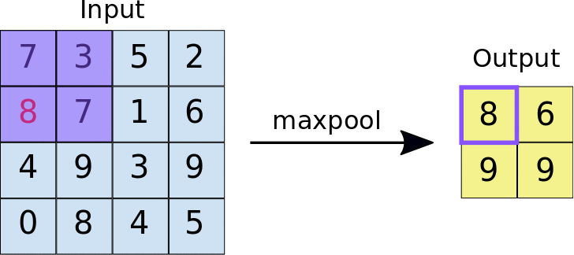
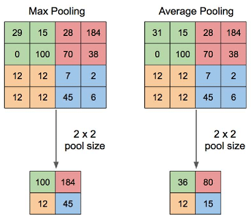
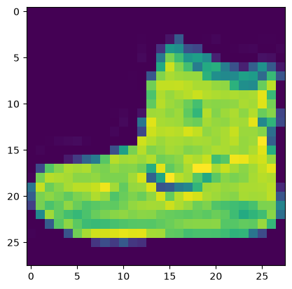
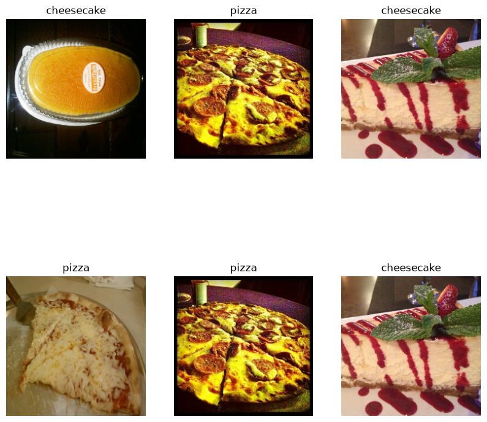
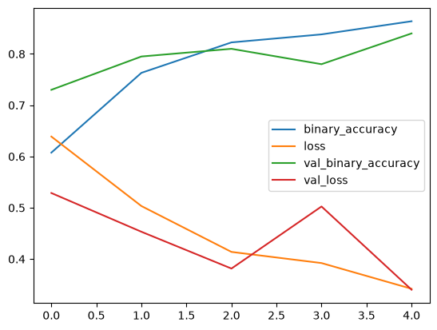
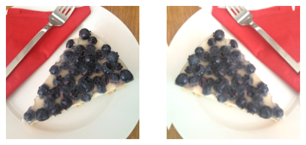
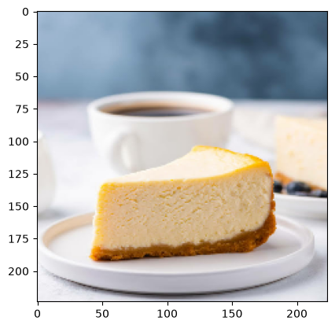

# Introduction to Computer Vision and Convolutional Neural Network

Ig you've been following this series than you already know about regression and classification using `TensorFlow`. In this article, we will learn about `Computer Vision` and `Convolutional Neural Network` (CNN).

**You can find me on**

- [LinkedIn](https://www.linkedin.com/in/pro-programmer/),
- [YouTube](http://www.youtube.com/@itvaya),
- [Gmail](talukderrishat2@gmail.com),
- [discord](https://discord.gg/ZB495XggcF),

**You can find all my articles and code on**

- [Deep Learning With Tensorflow](https://github.com/RishatTalukder/Deep_Learning_With_Tensorflow),

**If you are new to Machine learning, I also have a github for begennier machine learning.**

- [Machine Learning Zero to Hero](https://github.com/RishatTalukder/Machine-Learning-Zero-to-Hero)

**Pre-requisites**

- Python.
- Numpy.
- Pandas.
- Matplotlib/Seaborn.
- Basics of data analysis and preprocessing.
- Basics ML terminologies.
- Basics Tensorflow and keras terminologies.
- Basics of Neural Network.
- [Read the previous article on Multi Class Classification](https://github.com/RishatTalukder/Deep_Learning_With_Tensorflow/blob/main/pdfs/5_Multi_Class_Classification.pdf).

**Installations**

We need to install Tensorflow. To do so, we will use the following command:

```bash
    pip install tensorflow
```

or If you have conda installed,
    
```bash
    conda install tensorflow
```


# What is Computer Vision?

It's exactly as it sounds. We make computer see and recognise stuff.

We do that using the power of `Machine learning`.

We can use computer vision for many useful tasks like: Autonomous driving, face recognition, Healthcare, Manufacturing and many more.

But in machine learning lingo these task can be summarised as:

- Image Classification.
- Object detection.
- Segmentation.

And in the core of all of them, we use `Convolutional Neural Network` (CNN).

# Convolutional Neural Network

CNN is not like the typical layered perceptrons model or a normal feedforward network. It uses `convolution` to learn the pattern in the data. And it is a `deep learning model` which is trained using `backpropagation algorithm`.

So, we are changing the recipe.

Let's start with image classification.

## Image Classification

If you've read my previous articles, you already know that we can make a feedForward Neural Network to classify images by flattening the image and then passing it to the Neural Network. But there are some problems.

...But there are some problems.

### The Problem with Flattening

When we pass an image into a traditional feedforward network (or Multi-Layer Perceptron), we have to **flatten** the 2D or 3D grid of pixels into a single, long 1D vector. 

For example, a small color image of $64 \times 64$ pixels has $64 \times 64 \times 3 \text{ (RGB channels)} = 12,288$ individual values. If we flatten it, we run into two massive roadblocks:

1. **Loss of Spatial Relationships:** Images are defined by structure. A pixel's meaning relies entirely on its neighbors. A group of pixels together forms an edge, an edge forms a shape, and shapes form an object. When you flatten an image, you shatter those spatial relationships, forcing the network to look at pixels in isolation.

2. **The Parameter Explosion:** For small images like $16 \times 16$ it is farely okay but for our example of $64 \times 64$, If our first hidden layer has just 50 neurons, that single layer will require over **600 thousand weights** ($12,288 \times 50$). For modern, high-resolution images, the number of parameters quickly spirals out of control, leading to massive memory usage and severe overfitting.

This is why we change the recipe. Enter the **Convolutional Neural Network (CNN)**.


## How CNNs Fix This: The Core Ingredients

Instead of treating an image like a random list of numbers, a CNN treats an image like an actual map. It solves the problems above by using a sequence of specialized layers to automatically extract features without destroying the original shape of the data. 

Here is how a standard CNN architecture builds its "recipe" from start to finish:

```
[Input Image] ➔ [Convolution Layer + ReLU] ➔ [Pooling] ➔ [Flatten] ➔ [Fully Connected Layer] ➔ [Output]
```

### 1. The Convolution Layer (The Feature Finder)

The core building block of a CNN is the **Convolutional Layer**. Instead of connecting every pixel to every single neuron, it uses small matrices called **filters** or **kernels** (typically $3\times3$ or $5\times5$ grids). 

This filter slides (or *convolves*) across the image piece by piece. At each stop, it performs basic matrix multiplication to scan for specific patterns like vertical edges, horizontal lines, or curves. The output of this sliding process is a **Feature Map**, which highlights exactly where those patterns exist in the image.


#### The Learnable Parameters

It is crucial to understand that **the numbers inside these filters are the actual weights (parameters) of the network**. In traditional feedforward networks, weights are assigned to individual connections between neurons. Here, the weights live inside the filter matrix. Just like traditional weights, these filter values are initialized randomly and are **gradually optimized by the backpropagation algorithm** using gradient descent as the network learns from its mistakes.

#### How the Operation Works

This filter slides (or *convolves*) across the width and height of the input image piece by piece. At each stop, it performs an element-wise multiplication between the filter's weights and the current chunk of pixel values it is covering, summing up the results into a single value. 

The output of this entire sliding process is a new grid called a **Feature Map**, which highlights exactly where specific patterns exist in the image.

* **Automatic Feature Engineering:** In early computer vision, engineers manually hardcoded these filter values to detect specific things (like a Sobel filter for vertical edges). In a CNN, we don't hardcode anything. The backpropagation algorithm automatically discovers *what* features are important. Early layers might learn filters that detect basic edges, while deeper layers automatically learn filters that look for complex shapes like eyes or tires.

* **Parameter Sharing:** The magic here is that the exact same filter is used to scan the entire image. If a filter learns to detect a horizontal edge, it can find that edge whether it is at the top, bottom, or center of the image. This drastically cuts down the number of parameters the network needs to optimize.


### 2. The Activation Function (Adding Non-Linearity)

Real-world visual data is highly complex and non-linear. The convolution operation described above is entirely linear—it is just repeated multiplication and addition. If we stacked multiple convolutional layers without an activation function, the entire network would mathematically collapse into just one single, giant linear equation, making it incapable of learning intricate patterns.

To prevent this, right after the convolution operation, the network passes the feature maps through a non-linear activation function, most commonly **ReLU (Rectified Linear Unit)**. 

Mathematically, ReLU is incredibly simple: 

$$f(x) = \max(0, x)$$

It leaves any positive value completely unchanged but turns any negative value into a hard zero. 

By clamping negative activations to zero, ReLU introduces non-linearity into the network. This allows the CNN to learn complex, non-linear boundaries and ensures that neurons only fire when they detect a relevant feature, creating a sparse and computationally efficient representation of the image.
Use code with caution.


### 3. The Pooling Layer (The Downsampler)

Images contain a lot of redundant information. A **Pooling Layer** is introduced to reduce the spatial size (width and height) of the feature maps. 

The most common method is **Max Pooling**, where a small window (e.g., $2\times2$) slides across the feature map and keeps only the maximum value from that region. This does two crucial things:

* It shrinks the data size, keeping the network fast and efficient.
* It gives the network **translational invariance**, meaning it can recognize a cat whether it is sitting in the top-left corner or the bottom-right corner of the photo.



> I like `Average pooling`, the concept is almost exactly the same except instead of taking the maxing of a region it takes average.



### 4. Fully Connected Layer (The Classifier)

Then we will need a fully connected layer. 

By stacking multiple Convolution and Pooling layers together, the network learns a hierarchy of features: early layers detect simple edges, middle layers detect textures and shapes, and deep layers recognize whole objects (like eyes, noses, or wheels).

Finally, once the features are extracted, the final feature map is **flattened** into a vector. It is then passed to a traditional **Fully Connected (Dense) Layer**. This layer acts as the final judge, looking at all the gathered features to calculate the probability of what the image actually is (e.g., Cat: 92%, Dog: 5%, Car: 3%).

Alright! that covers the main theory behind Convolutional Neural Networks. Now let's get to the actual code.

Let's make a CNN model


# Getting the data

As we are testing out the theory I'll just use a very simple dataset.

you need to install the `tfds` library.

open terminal and type the following commands:
```bash
pip install tfds
```

after that follow the steps below.


```python
import tensorflow as tf;

print(tf.config.list_physical_devices('GPU'))
```

    2026-10-21 15:53:24.405409: I tensorflow/core/platform/cpu_feature_guard.cc:210] This TensorFlow binary is optimized to use available CPU instructions in performance-critical operations.
    To enable the following instructions: AVX2 FMA, in other operations, rebuild TensorFlow with the appropriate compiler flags.


    [PhysicalDevice(name='/physical_device:GPU:0', device_type='GPU')]


```python
from keras.datasets import fashion_mnist
```


```python
(x_train, y_train), (x_test, y_test) = fashion_mnist.load_data()
```


```python
from matplotlib import pyplot as plt

plt.imshow(x_train[0])
plt.show()
```


    

    


The above dataset is called the **Fashion MNIST** dataset. It is a alternative version of the classic MNIST dataset. It contains 10 different classes of clothing items.

Let's see what the classes are.


```python
import numpy as np

np.unique(y_train)
```


    array([0, 1, 2, 3, 4, 5, 6, 7, 8, 9], dtype=uint8)


So, the classes are already set as `0-9` numeric values but whats the fun in that?

You can find the labels here: https://github.com/zalandoresearch/fashion-mnist#labels


We can save these labels as an array or a dictionary. Either way is fine.


```python
labels = ['T-shirt', 'Trouser', 'Pullover', 'Dress', 'Coat', 'Sandal', 'Shirt', 'Sneaker', 'Bag', 'Ankle boot']
```

This will work because if we make a classification model in the output we will get a `probability array`  for each class `0-9` sequentially. So, each index of the probability array will represent the class and the original label also be in the same index.

# Creating the model using TensorFlow

Remember the architecture of a Convolutional Neural Network?

```
Input -> Convolution -> Pooling -> flatten -> Fully Connected -> Output
```

Now let's create the model using TensorFlow.


```python
from keras import layers, models
```


```python
model = models.Sequential([
    layers.Input((28,28, 1)),
    layers.Conv2D(5, (3,3), activation='relu'),
    layers.AveragePooling2D((2,2)),
    layers.Flatten(),
    layers.Dense(5, activation='relu'),
    layers.Dense(5, activation='relu'),
    layers.Dense(10, activation='softmax')
])

model.summary()
```

    WARNING: All log messages before absl::InitializeLog() is called are written to STDERR
    I0000 00:00:1792576406.791379  340505 gpu_device.cc:2020] Created device /job:localhost/replica:0/task:0/device:GPU:0 with 9582 MB memory:  -> device: 0, name: NVIDIA GeForce RTX 3060, pci bus id: 0000:05:00.0, compute capability: 8.6


<pre style="white-space:pre;overflow-x:auto;line-height:normal;font-family:Menlo,'DejaVu Sans Mono',consolas,'Courier New',monospace"><span style="font-weight: bold">Model: "sequential"</span>
</pre>


<pre style="white-space:pre;overflow-x:auto;line-height:normal;font-family:Menlo,'DejaVu Sans Mono',consolas,'Courier New',monospace">┏━━━━━━━━━━━━━━━━━━━━━━━━━━━━━━━━━┳━━━━━━━━━━━━━━━━━━━━━━━━┳━━━━━━━━━━━━━━━┓
┃<span style="font-weight: bold"> Layer (type)                    </span>┃<span style="font-weight: bold"> Output Shape           </span>┃<span style="font-weight: bold">       Param # </span>┃
┡━━━━━━━━━━━━━━━━━━━━━━━━━━━━━━━━━╇━━━━━━━━━━━━━━━━━━━━━━━━╇━━━━━━━━━━━━━━━┩
│ conv2d (<span style="color: #0087ff; text-decoration-color: #0087ff">Conv2D</span>)                 │ (<span style="color: #00d7ff; text-decoration-color: #00d7ff">None</span>, <span style="color: #00af00; text-decoration-color: #00af00">26</span>, <span style="color: #00af00; text-decoration-color: #00af00">26</span>, <span style="color: #00af00; text-decoration-color: #00af00">5</span>)      │            <span style="color: #00af00; text-decoration-color: #00af00">50</span> │
├─────────────────────────────────┼────────────────────────┼───────────────┤
│ average_pooling2d               │ (<span style="color: #00d7ff; text-decoration-color: #00d7ff">None</span>, <span style="color: #00af00; text-decoration-color: #00af00">13</span>, <span style="color: #00af00; text-decoration-color: #00af00">13</span>, <span style="color: #00af00; text-decoration-color: #00af00">5</span>)      │             <span style="color: #00af00; text-decoration-color: #00af00">0</span> │
│ (<span style="color: #0087ff; text-decoration-color: #0087ff">AveragePooling2D</span>)              │                        │               │
├─────────────────────────────────┼────────────────────────┼───────────────┤
│ flatten (<span style="color: #0087ff; text-decoration-color: #0087ff">Flatten</span>)               │ (<span style="color: #00d7ff; text-decoration-color: #00d7ff">None</span>, <span style="color: #00af00; text-decoration-color: #00af00">845</span>)            │             <span style="color: #00af00; text-decoration-color: #00af00">0</span> │
├─────────────────────────────────┼────────────────────────┼───────────────┤
│ dense (<span style="color: #0087ff; text-decoration-color: #0087ff">Dense</span>)                   │ (<span style="color: #00d7ff; text-decoration-color: #00d7ff">None</span>, <span style="color: #00af00; text-decoration-color: #00af00">5</span>)              │         <span style="color: #00af00; text-decoration-color: #00af00">4,230</span> │
├─────────────────────────────────┼────────────────────────┼───────────────┤
│ dense_1 (<span style="color: #0087ff; text-decoration-color: #0087ff">Dense</span>)                 │ (<span style="color: #00d7ff; text-decoration-color: #00d7ff">None</span>, <span style="color: #00af00; text-decoration-color: #00af00">5</span>)              │            <span style="color: #00af00; text-decoration-color: #00af00">30</span> │
├─────────────────────────────────┼────────────────────────┼───────────────┤
│ dense_2 (<span style="color: #0087ff; text-decoration-color: #0087ff">Dense</span>)                 │ (<span style="color: #00d7ff; text-decoration-color: #00d7ff">None</span>, <span style="color: #00af00; text-decoration-color: #00af00">10</span>)             │            <span style="color: #00af00; text-decoration-color: #00af00">60</span> │
└─────────────────────────────────┴────────────────────────┴───────────────┘
</pre>


<pre style="white-space:pre;overflow-x:auto;line-height:normal;font-family:Menlo,'DejaVu Sans Mono',consolas,'Courier New',monospace"><span style="font-weight: bold"> Total params: </span><span style="color: #00af00; text-decoration-color: #00af00">4,370</span> (17.07 KB)
</pre>


<pre style="white-space:pre;overflow-x:auto;line-height:normal;font-family:Menlo,'DejaVu Sans Mono',consolas,'Courier New',monospace"><span style="font-weight: bold"> Trainable params: </span><span style="color: #00af00; text-decoration-color: #00af00">4,370</span> (17.07 KB)
</pre>


<pre style="white-space:pre;overflow-x:auto;line-height:normal;font-family:Menlo,'DejaVu Sans Mono',consolas,'Courier New',monospace"><span style="font-weight: bold"> Non-trainable params: </span><span style="color: #00af00; text-decoration-color: #00af00">0</span> (0.00 B)
</pre>


> I used `AveragePooling2D` instead of `MaxPooling2D`, because I don't like when data is lost.

Now, we can compile and train the model.


```python
model.compile(optimizer='adam', loss='sparse_categorical_crossentropy', metrics=['accuracy'])
```

Before training we must normalize the data.


```python
x_train = x_train / 255
x_test = x_test / 255
```


```python
model.fit(x_train, y_train, epochs=5)
```

    Epoch 1/5


    2026-10-21 15:53:28.559609: I external/local_xla/xla/service/service.cc:163] XLA service 0x72f81400bf40 initialized for platform CUDA (this does not guarantee that XLA will be used). Devices:
    2026-10-21 15:53:28.559621: I external/local_xla/xla/service/service.cc:171]   StreamExecutor device (0): NVIDIA GeForce RTX 3060, Compute Capability 8.6
    2026-10-21 15:53:28.576608: I tensorflow/compiler/mlir/tensorflow/utils/dump_mlir_util.cc:269] disabling MLIR crash reproducer, set env var `MLIR_CRASH_REPRODUCER_DIRECTORY` to enable.
    2026-10-21 15:53:28.695346: I external/local_xla/xla/stream_executor/cuda/cuda_dnn.cc:473] Loaded cuDNN version 90300
    2026-10-21 15:53:29.445980: I external/local_xla/xla/stream_executor/cuda/subprocess_compilation.cc:346] ptxas warning : Registers are spilled to local memory in function 'gemm_fusion_dot_209', 140 bytes spill stores, 140 bytes spill loads
    
    2026-10-21 15:53:29.491672: I external/local_xla/xla/stream_executor/cuda/subprocess_compilation.cc:346] ptxas warning : Registers are spilled to local memory in function 'gemm_fusion_dot_209', 140 bytes spill stores, 140 bytes spill loads
    


     107/1875 ━━━━━━━━━━━━━━━━━━━━ 2s 1ms/step - accuracy: 0.1384 - loss: 2.1941

    I0000 00:00:1792576410.644572  340565 device_compiler.h:196] Compiled cluster using XLA!  This line is logged at most once for the lifetime of the process.


    1875/1875 ━━━━━━━━━━━━━━━━━━━━ 4s 914us/step - accuracy: 0.6370 - loss: 1.0072
    Epoch 2/5
    1875/1875 ━━━━━━━━━━━━━━━━━━━━ 2s 853us/step - accuracy: 0.7661 - loss: 0.6432
    Epoch 3/5
    1875/1875 ━━━━━━━━━━━━━━━━━━━━ 2s 855us/step - accuracy: 0.7855 - loss: 0.5861
    Epoch 4/5
    1875/1875 ━━━━━━━━━━━━━━━━━━━━ 2s 874us/step - accuracy: 0.7981 - loss: 0.5621
    Epoch 5/5
    1875/1875 ━━━━━━━━━━━━━━━━━━━━ 2s 866us/step - accuracy: 0.8066 - loss: 0.5433


    <keras.src.callbacks.history.History at 0x72f9003a7cb0>


We have a fairly modest model. At least it's not less than 50%. 

Now let's break down the model we made.

## Putting It Into Code: A Real-World Example

Let's look at how we build this recipe in code using Keras/TensorFlow. Here is a sequential CNN model designed to take in grayscale images (like the famous MNIST handwritten digit dataset) and classify them into 10 distinct categories:

```python
model = models.Sequential([
    layers.Input((28, 28, 1)),
    layers.Conv2D(5, (3, 3), activation='relu'),
    layers.AveragePooling2D((2, 2)),
    layers.Flatten(),
    layers.Dense(5, activation='relu'),
    layers.Dense(5, activation='relu'),
    layers.Dense(10, activation='softmax')
])
```

Let's break this down line-by-line to see exactly what is happening to our data at every step:

### 1. `layers.Input((28, 28, 1))`

This defines the entry point for our data. The model expects an input image with a shape of **28 × 28 × 1**. 
* The `28, 28` represents the width and height of the image in pixels.
* The `1` represents the number of color channels. A `1` means it is a grayscale image (if it were a color RGB image, this number would be `3`).

### 2. `layers.Conv2D(5, (3, 3), activation='relu')`

This is where our feature extraction begins! We apply a **2D Convolutional Layer** with the following settings:
* **`5`**: This tells the network to create **5 different filters**. Each filter will learn to look for a unique feature (like horizontal lines, diagonals, or curves).
* **`(3, 3)`**: The spatial size of each filter matrix. It will scan the image in tiny 3 × 3 pixel patches.
* **`activation='relu'`**: As we discussed earlier, immediately after convolving, every negative value in our feature maps is turned to zero to introduce non-linearity.
* *Output shape after this layer:* Since a 3 × 3 filter cannot perfectly center on the very outer edges of a 28 × 28 image without padding, the output size shrinks slightly to **26 × 26 × 5** (5 feature maps, each 26 × 26 pixels).

### 3. `layers.AveragePooling2D((2, 2))`

Next, we downsample the data using an **Average Pooling Layer** instead of the traditional Max Pooling. 
* The **`(2, 2)`** grid slides across our 5 feature maps. Instead of picking only the single highest value, it calculates the **mathematical average** of all four pixel values within that 2 × 2 area.
* While Max Pooling focuses purely on the sharpest, most dominant features (like bright edges), Average Pooling smooths things out by retaining a blend of all the background and feature information in that region.
* This operation cuts the width and height of our feature maps exactly in half.
* *Output shape after this layer:* The dimensions drop from 26 × 26 × 5 down to **13 × 13 × 5**. We have successfully compressed the image data while preserving a smooth, summarized version of its features!

### 4. `layers.Flatten()`

Our spatial feature extraction is complete. Now it is time to pivot to the classification phase. The `Flatten()` layer takes our 3D tensor of feature maps (13 × 13 × 5) and unrolls it into a single, long **1D array**.
* *Math check:* 13 × 13 × 5 = 845. 
* *Output shape after this layer:* A single flat vector containing **845 individual values**, ready to be fed into a standard neural network.

### 5. `layers.Dense(5, activation='relu')`

This is our first **Fully Connected (Dense) Layer**. Every single one of the 845 flattened values is connected to the **5 neurons** in this layer. This layer begins the high-level reasoning, combining the extracted features to look for broader patterns. We use the `'relu'` activation function here again to keep the relationships non-linear.

### 6. `layers.Dense(5, activation='relu')`

Another **Dense Layer** with **5 neurons** and a `'relu'` activation. Stacking dense layers allows the network to learn deeper, more abstract combinations of features before making its final guess.

### 7. `layers.Dense(10, activation='softmax')`

This is the **Output Layer**. Because our goal is to classify the image into 1 of 10 possible classes, this layer has exactly **10 neurons**. 
* Instead of ReLU, we use the **`'softmax'`** activation function here. Softmax takes the raw outputs from the 10 neurons and squashes them into a **probability distribution** between 0 and 1, ensuring all 10 outputs add up to exactly 100%. 
* The neuron with the highest probability value is the model's final prediction (e.g., "There is a 94% chance this image is the number 7").

And now we have a model with fewer parameters but very powerful in pattern recognition.

Well, that's the image classification with `convolutional neural network` for you.

That was just to show you how a convolutional neural network works and how usefull it can be.

Now time to a proper example.

# Loading Real images

Luckily if you need huge ammount image data, there is a fully free image dataset called [Food-101](https://data.vision.ee.ethz.ch/cvl/datasets_extra/food-101/).

> The official [website](https://data.vision.ee.ethz.ch/cvl/datasets_extra/food-101/) contain the whole dataset but I'll not be using all of it. I'm going to modify and keep three food category and images.

I've taken two food classes from the whole dataset made a folder named `cheese_cake_pizza` you can download the dataset urself from my [here](https://github.com/RishatTalukder/Deep_Learning_With_Tensorflow/raw/refs/heads/main/4_Convolutional_Neural_network/resource/cheese_cake_pizza.zip).

**You can uncomment the following cell to download and extract the dataset.**


```python
# !wget "https://github.com/RishatTalukder/Deep_Learning_With_Tensorflow/raw/refs/heads/main/4_Convolutional_Neural_network/resource/cheese_cake_pizza.zip"

# import zipfile

# zip_ref = zipfile.ZipFile('cheese_cake_pizza.zip')
# zip_ref.extractall(path='resource')
# zip_ref.close()
```

After running the above code, you should have a folder named `cheese_cake_pizza` inside a folder named `resource` in your current directory and the zip file too.

Now let's take a look at the extracted folder.


```python
!ls resource/cheese_cake_pizza
```

    test  train  val


Hmmm, there's three folders. `test`, `train` and `val`. Let's take a look at the `train` folder.


```python
!ls resource/cheese_cake_pizza/train
```

    cheesecake  pizza


Two folders: cheese_cake and pizza

What about the other two folders?


```python
!ls resource/cheese_cake_pizza/test
```

    cheesecake  pizza


```python
!ls resource/cheese_cake_pizza/val
```

    cheesecake  pizza


So, inside each of these folders there are two folders. `cheese_cake` and `pizza`. Whats inside the `cheese_cake` folder?


```python
!ls resource/cheese_cake_pizza/train/cheesecake
```

    1001446.jpg  1690850.jpg  2240092.jpg  2788779.jpg  3369593.jpg  3920168.jpg
    1004515.jpg  1692172.jpg  2240302.jpg  2788868.jpg  3377918.jpg  3923783.jpg
    1004807.jpg  1693775.jpg  2241264.jpg  2794584.jpg  3388138.jpg  399407.jpg
    1021942.jpg  1694199.jpg  2243942.jpg  280106.jpg   3399394.jpg  402953.jpg
    1023543.jpg  1703386.jpg  2245899.jpg  2801570.jpg  3405731.jpg  403610.jpg
    1034351.jpg  1707618.jpg  2249472.jpg  2803707.jpg  3406925.jpg  405679.jpg
    1035453.jpg  1710624.jpg  2260095.jpg  2805331.jpg  3409805.jpg  407073.jpg
    1037609.jpg  171494.jpg   2262460.jpg  280586.jpg   3410308.jpg  416008.jpg
    1047482.jpg  1725587.jpg  2262620.jpg  2811343.jpg  3416016.jpg  420521.jpg
    1057054.jpg  1725611.jpg  2292597.jpg  2817286.jpg  3432925.jpg  421920.jpg
    1061232.jpg  1725779.jpg  2294871.jpg  281928.jpg   3434716.jpg  42503.jpg
    1061989.jpg  1725960.jpg  229954.jpg   2828771.jpg  3435169.jpg  42504.jpg
    106769.jpg   172690.jpg   2307118.jpg  2829747.jpg  3435703.jpg  425913.jpg
    1073148.jpg  1728087.jpg  2310307.jpg  2837696.jpg  343611.jpg	 443543.jpg
    1077491.jpg  1730226.jpg  2313285.jpg  2844552.jpg  3438832.jpg  449664.jpg
    1083139.jpg  1732699.jpg  2321770.jpg  2850292.jpg  3439154.jpg  455155.jpg
    1085860.jpg  174793.jpg   2322601.jpg  2851722.jpg  3440780.jpg  461582.jpg
    1086179.jpg  1748224.jpg  2329297.jpg  2856239.jpg  3441357.jpg  461587.jpg
    1092082.jpg  1750456.jpg  2332717.jpg  2856960.jpg  344202.jpg	 462400.jpg
    1093939.jpg  1751518.jpg  2334103.jpg  2864249.jpg  3442365.jpg  468747.jpg
    1096018.jpg  1752259.jpg  2336166.jpg  2869177.jpg  3447412.jpg  469639.jpg
    1096029.jpg  1752942.jpg  2346728.jpg  2870482.jpg  3450123.jpg  471776.jpg
    1102384.jpg  1756729.jpg  2349745.jpg  2875112.jpg  3462499.jpg  476570.jpg
    1122445.jpg  1757216.jpg  2360737.jpg  2882357.jpg  3464214.jpg  478180.jpg
    1123723.jpg  1762561.jpg  2360832.jpg  2901903.jpg  3466705.jpg  483821.jpg
    1132368.jpg  176394.jpg   2361866.jpg  2912548.jpg  3468925.jpg  485150.jpg
    1142319.jpg  1765499.jpg  2363100.jpg  2920089.jpg  3471329.jpg  495805.jpg
    1142851.jpg  1767182.jpg  2365154.jpg  2928889.jpg  3476761.jpg  496038.jpg
    1153138.jpg  1767916.jpg  2369103.jpg  2934323.jpg  3477669.jpg  497262.jpg
    1159749.jpg  1770145.jpg  2371857.jpg  2936529.jpg  3483737.jpg  509947.jpg
    1159762.jpg  177866.jpg   2373914.jpg  293760.jpg   3490045.jpg  510488.jpg
    1167173.jpg  1790527.jpg  2375291.jpg  2939070.jpg  34970.jpg	 510747.jpg
    1170998.jpg  1798573.jpg  2387046.jpg  2940339.jpg  3504776.jpg  511136.jpg
    1179302.jpg  1800646.jpg  2390259.jpg  2950824.jpg  3510776.jpg  511496.jpg
    1197481.jpg  1803975.jpg  2395246.jpg  2952289.jpg  3519289.jpg  519369.jpg
    1207977.jpg  1810204.jpg  2398894.jpg  2953772.jpg  3526203.jpg  522013.jpg
    1210888.jpg  1810767.jpg  2403575.jpg  295478.jpg   3526353.jpg  523424.jpg
    1211627.jpg  181617.jpg   2408238.jpg  2956877.jpg  35298.jpg	 524587.jpg
    1217686.jpg  181706.jpg   2408784.jpg  2961165.jpg  3530691.jpg  526834.jpg
    1221551.jpg  1818389.jpg  2409232.jpg  2966085.jpg  3538930.jpg  526987.jpg
    1241400.jpg  1835656.jpg  2412067.jpg  2969365.jpg  3541634.jpg  529616.jpg
    124545.jpg   1845902.jpg  2414754.jpg  2975385.jpg  3543679.jpg  539382.jpg
    124695.jpg   1847655.jpg  2421513.jpg  2981348.jpg  3545325.jpg  548667.jpg
    1247843.jpg  1853531.jpg  2423972.jpg  2984677.jpg  3546977.jpg  556192.jpg
    1248580.jpg  1855433.jpg  2439835.jpg  2986141.jpg  355367.jpg	 566008.jpg
    125965.jpg   1862554.jpg  2440929.jpg  2989533.jpg  3558839.jpg  568417.jpg
    1261049.jpg  186309.jpg   2443507.jpg  2997918.jpg  3562075.jpg  570321.jpg
    1271183.jpg  1867199.jpg  2454449.jpg  2999765.jpg  356459.jpg	 577533.jpg
    1278827.jpg  1871868.jpg  2454710.jpg  3001984.jpg  3572011.jpg  580844.jpg
    1280675.jpg  1873909.jpg  2457475.jpg  3014021.jpg  3573058.jpg  581896.jpg
    1281082.jpg  1877085.jpg  2464644.jpg  301407.jpg   3575533.jpg  584166.jpg
    1286644.jpg  1890669.jpg  2465886.jpg  3017111.jpg  3578375.jpg  591125.jpg
    1288072.jpg  1891137.jpg  2470410.jpg  3017989.jpg  357959.jpg	 593072.jpg
    1291538.jpg  189346.jpg   2477757.jpg  3020434.jpg  358018.jpg	 597218.jpg
    1293877.jpg  1900269.jpg  2481047.jpg  3030686.jpg  358636.jpg	 598947.jpg
    1303693.jpg  1902799.jpg  248448.jpg   3032158.jpg  3586863.jpg  611864.jpg
    1304340.jpg  1914184.jpg  248453.jpg   3032644.jpg  3587155.jpg  615088.jpg
    1306238.jpg  1914330.jpg  2499894.jpg  3033039.jpg  3590444.jpg  618989.jpg
    1308111.jpg  1918958.jpg  2500180.jpg  3033674.jpg  359723.jpg	 619535.jpg
    1319639.jpg  1919594.jpg  2504884.jpg  3033983.jpg  3604714.jpg  621396.jpg
    1319907.jpg  1920846.jpg  2505611.jpg  3040775.jpg  3610444.jpg  6219.jpg
    1325649.jpg  192339.jpg   2506092.jpg  3047613.jpg  3616238.jpg  629317.jpg
    1339876.jpg  1923778.jpg  2506844.jpg  3049427.jpg  361721.jpg	 638192.jpg
    1343157.jpg  1924989.jpg  250756.jpg   305424.jpg   3618461.jpg  638957.jpg
    1346462.jpg  1925975.jpg  2508595.jpg  3058925.jpg  362045.jpg	 640507.jpg
    1356247.jpg  1926737.jpg  2522718.jpg  305926.jpg   3633852.jpg  644230.jpg
    1359343.jpg  193920.jpg   2522807.jpg  3082642.jpg  3638819.jpg  647429.jpg
    1374014.jpg  1947723.jpg  2525701.jpg  3088201.jpg  3656529.jpg  648441.jpg
    1380626.jpg  1948475.jpg  2527038.jpg  3094146.jpg  3656689.jpg  649724.jpg
    138314.jpg   1949233.jpg  2527203.jpg  3096572.jpg  3660758.jpg  659460.jpg
    1383955.jpg  1950970.jpg  2527984.jpg  3096890.jpg  3671710.jpg  660008.jpg
    1387798.jpg  1954335.jpg  2530391.jpg  3096899.jpg  3676115.jpg  666489.jpg
    1389466.jpg  1955517.jpg  253112.jpg   3097796.jpg  3688698.jpg  670188.jpg
    1397231.jpg  1958627.jpg  2543320.jpg  309792.jpg   3692460.jpg  683356.jpg
    1401296.jpg  196058.jpg   2549078.jpg  3104089.jpg  369347.jpg	 684738.jpg
    1416009.jpg  1974808.jpg  2549099.jpg  3104876.jpg  3699772.jpg  690648.jpg
    1418849.jpg  197565.jpg   2554570.jpg  3107544.jpg  3716536.jpg  703316.jpg
    1422000.jpg  1975932.jpg  2555966.jpg  3111556.jpg  3722228.jpg  704155.jpg
    1424299.jpg  1979166.jpg  2559262.jpg  311588.jpg   3727553.jpg  708439.jpg
    1425342.jpg  1981338.jpg  2559918.jpg  3115914.jpg  3740520.jpg  708936.jpg
    1425392.jpg  1983826.jpg  2572821.jpg  3121053.jpg  374209.jpg	 72190.jpg
    1431315.jpg  1992434.jpg  257369.jpg   3121485.jpg  3746025.jpg  72295.jpg
    1435236.jpg  2009726.jpg  2574796.jpg  3130983.jpg  3749514.jpg  724035.jpg
    1435986.jpg  2013524.jpg  2575885.jpg  3131282.jpg  3751079.jpg  726395.jpg
    1448697.jpg  2023629.jpg  2575898.jpg  3136381.jpg  3752257.jpg  736395.jpg
    1451380.jpg  2026630.jpg  2590969.jpg  3136503.jpg  3752667.jpg  737999.jpg
    1462232.jpg  2029634.jpg  259259.jpg   3138592.jpg  375486.jpg	 745074.jpg
    146384.jpg   2032871.jpg  2593548.jpg  3155394.jpg  375889.jpg	 745664.jpg
    1469076.jpg  2033012.jpg  2598526.jpg  3156270.jpg  3759363.jpg  750008.jpg
    1472489.jpg  2040540.jpg  2606803.jpg  3175098.jpg  3763869.jpg  752480.jpg
    1477628.jpg  2047998.jpg  2607573.jpg  3175462.jpg  3772649.jpg  756599.jpg
    148078.jpg   2059712.jpg  2613188.jpg  3189126.jpg  3772715.jpg  768208.jpg
    1495272.jpg  206855.jpg   2617496.jpg  3189636.jpg  3775314.jpg  771569.jpg
    1498417.jpg  2071574.jpg  2617920.jpg  3195428.jpg  3778639.jpg  776803.jpg
    1503556.jpg  2071784.jpg  262403.jpg   319547.jpg   3780311.jpg  780915.jpg
    1509393.jpg  2079422.jpg  2624175.jpg  3199531.jpg  3782431.jpg  784709.jpg
    1513140.jpg  2080519.jpg  2627267.jpg  3207232.jpg  3794714.jpg  792249.jpg
    1518931.jpg  2092470.jpg  263202.jpg   3210837.jpg  3795552.jpg  793391.jpg
    1523865.jpg  2094088.jpg  2637470.jpg  3214388.jpg  3804023.jpg  795089.jpg
    1524312.jpg  2103069.jpg  2639998.jpg  3216111.jpg  3807015.jpg  811556.jpg
    1527708.jpg  2103793.jpg  264328.jpg   3220534.jpg  3809000.jpg  827465.jpg
    1535829.jpg  2106674.jpg  2648207.jpg  3222698.jpg  3812242.jpg  838793.jpg
    1539415.jpg  210991.jpg   2651136.jpg  3234179.jpg  3814233.jpg  840504.jpg
    1540965.jpg  2115170.jpg  2656821.jpg  3236265.jpg  3817343.jpg  84085.jpg
    1540971.jpg  212691.jpg   2656.jpg     3239362.jpg  3818163.jpg  845088.jpg
    1543328.jpg  2129889.jpg  2670777.jpg  3251816.jpg  3818887.jpg  857330.jpg
    1543937.jpg  2144621.jpg  2676176.jpg  3259857.jpg  3819353.jpg  857432.jpg
    1545061.jpg  2146427.jpg  267622.jpg   3261002.jpg  3823810.jpg  859143.jpg
    1552807.jpg  2148420.jpg  267965.jpg   3266787.jpg  3824062.jpg  869766.jpg
    1553908.jpg  2160930.jpg  2682488.jpg  3267121.jpg  382494.jpg	 870163.jpg
    1564349.jpg  2167083.jpg  2685394.jpg  3267352.jpg  3827866.jpg  879840.jpg
    1566435.jpg  2168296.jpg  2687451.jpg  3267422.jpg  3834149.jpg  882135.jpg
    1566743.jpg  2168343.jpg  2709436.jpg  3270288.jpg  3837391.jpg  882301.jpg
    1583520.jpg  2172535.jpg  2711334.jpg  3274778.jpg  3838028.jpg  899194.jpg
    1590158.jpg  2174447.jpg  2714153.jpg  3277562.jpg  3839556.jpg  90021.jpg
    1592451.jpg  2175873.jpg  2729880.jpg  3284492.jpg  3844925.jpg  901928.jpg
    1596930.jpg  2182847.jpg  2730999.jpg  3288238.jpg  3845030.jpg  912931.jpg
    1600182.jpg  2183245.jpg  2733725.jpg  3288583.jpg  3857640.jpg  916541.jpg
    1609234.jpg  2188333.jpg  2733864.jpg  3294104.jpg  3859519.jpg  918354.jpg
    1615141.jpg  2192651.jpg  2739485.jpg  3296063.jpg  38622.jpg	 919611.jpg
    1624837.jpg  2202394.jpg  2748186.jpg  3296235.jpg  3863806.jpg  928874.jpg
    1624884.jpg  2202886.jpg  2750278.jpg  3299474.jpg  3865312.jpg  935701.jpg
    1626857.jpg  2211800.jpg  2750303.jpg  3301137.jpg  3868436.jpg  936503.jpg
    1629614.jpg  2217634.jpg  2751098.jpg  3314498.jpg  3871141.jpg  946930.jpg
    1632762.jpg  2224103.jpg  2751537.jpg  3320655.jpg  3874192.jpg  958209.jpg
    1642197.jpg  2227205.jpg  2754377.jpg  3321179.jpg  3874713.jpg  971470.jpg
    1642445.jpg  2227368.jpg  2756768.jpg  3323032.jpg  3885296.jpg  983639.jpg
    1649147.jpg  2227892.jpg  2761370.jpg  3327507.jpg  3885479.jpg  99277.jpg
    1656986.jpg  2228742.jpg  2771236.jpg  3338267.jpg  3888273.jpg  996516.jpg
    165910.jpg   2229007.jpg  2773483.jpg  3344906.jpg  3900431.jpg  998656.jpg
    1667024.jpg  2230316.jpg  2780839.jpg  3345639.jpg  3904984.jpg
    1678182.jpg  2230878.jpg  2781710.jpg  3351068.jpg  3915954.jpg
    1679654.jpg  2233012.jpg  2785771.jpg  335935.jpg   391930.jpg
    1681931.jpg  2236408.jpg  2788336.jpg  3361907.jpg  3919885.jpg


Ow wow! a lot of images! It would be nice to see the folder structure with how many images are in each folder.


```python
import os

for dirpath, dirnames, filenames in os.walk('resource/cheese_cake_pizza'):
    print(f"There are {len(dirnames)} directories and {len(filenames)} images in '{dirpath}'.")
```

    There are 3 directories and 0 images in 'resource/cheese_cake_pizza'.
    There are 2 directories and 0 images in 'resource/cheese_cake_pizza/train'.
    There are 0 directories and 800 images in 'resource/cheese_cake_pizza/train/cheesecake'.
    There are 0 directories and 800 images in 'resource/cheese_cake_pizza/train/pizza'.
    There are 2 directories and 0 images in 'resource/cheese_cake_pizza/val'.
    There are 0 directories and 100 images in 'resource/cheese_cake_pizza/val/cheesecake'.
    There are 0 directories and 100 images in 'resource/cheese_cake_pizza/val/pizza'.
    There are 2 directories and 0 images in 'resource/cheese_cake_pizza/test'.
    There are 0 directories and 100 images in 'resource/cheese_cake_pizza/test/cheesecake'.
    There are 0 directories and 100 images in 'resource/cheese_cake_pizza/test/pizza'.


Well, from the above cell we can see that In the train directory there are 2 directories with 800 images each, a total of 1600 images.

Test directories have 100 images each, a total of 200 images.

For validation directory it's the same as test directory, a total of 200 images.

I organised these folders to represent the train, test and validation sets.

So, let's see how they look like.

## Loading the training set


```python
from keras.utils import image_dataset_from_directory

image_dataset = image_dataset_from_directory(
    'resource/cheese_cake_pizza/train',
    labels='inferred',
    image_size=(224,224),
    seed=1
)

image_dataset
```

    Found 1600 files belonging to 2 classes.


    <_PrefetchDataset element_spec=(TensorSpec(shape=(None, 224, 224, 3), dtype=tf.float32, name=None), TensorSpec(shape=(None,), dtype=tf.int32, name=None))>


`image_dataset_from_directory` returns a `tf.data.Dataset` object. This single function will do a lot of the heavy lifting for us. It will automatically can read the images from a directory, for my case `resource/cheese_cake_pizza/train` folder and will automatically label the images based on the folder names.

> One good thing is, it does not load the images into memory. It will read the images from the disk and process them on the fly and only load the images into memory when we need them.

There are a lot of arguments we can pass to the `image_dataset_from_directory` function.

By default you have to pass `directory` argument. It is the path to the directory that contains the images. 

I passed:

- `Directory`: `resource/cheese_cake_pizza/train`
- `Labels`: `'inferred'` meaning the dataset will automatically label the images based on the folder names.
- `Image Size`: `(224,224)` meaning the images will be resized to this size. We have to do this because the convolutional neural network is trained on images of a specific size.
- `seed`: `1` meaning the dataset will be shuffled randomly but in the same order every time we run the code. This just to insure reproducibility.

So, let's explore our dataset.

Are the class names correct?


```python
image_dataset.class_names
```


    ['cheesecake', 'pizza']


Looks like it.

Let's plot some images and see there labels.


```python
import tensorflow as tf

images, labels = image_dataset.as_numpy_iterator().next()

```

Let's break down the code above first.

As `image_dataset` is a `tf.data.Dataset` object, it lazy loads the images from the disk. So, to completely load the images into memory, we need to use the `as_numpy_iterator` method.

This will return an `iterator` object that will allow us to access the image `batches` one by one.

> NOTE: The images are loaded as batches of 32 images at a time. Because if you load all the images directly into memory, you'll can run out of ram and the whole thing will crash.

We can take out each batch with the `next()` method which will return a tuple of images and their corresponding labels.

Now, to see if everything is loaded properly, let's print the shape of the images variable.


```python
images.shape
```


    (32, 224, 224, 3)


As you can see the shape is `(32, 224, 224, 3)` which means there are 32 images with a shape of `(224, 224, 3)`.

We can count how many batches with a simple for loop.


```python
batch_count = 0

for images, labels in image_dataset.as_numpy_iterator():
    batch_count += 1
    print(f"Number of images in batch {batch_count}: {len(images)}")

print(f'Number of batches: {batch_count}') 
```

    Number of images in batch 1: 32
    Number of images in batch 2: 32
    Number of images in batch 3: 32
    Number of images in batch 4: 32
    Number of images in batch 5: 32
    Number of images in batch 6: 32
    Number of images in batch 7: 32
    Number of images in batch 8: 32
    Number of images in batch 9: 32
    Number of images in batch 10: 32
    Number of images in batch 11: 32
    Number of images in batch 12: 32
    Number of images in batch 13: 32
    Number of images in batch 14: 32
    Number of images in batch 15: 32
    Number of images in batch 16: 32
    Number of images in batch 17: 32
    Number of images in batch 18: 32
    Number of images in batch 19: 32
    Number of images in batch 20: 32
    Number of images in batch 21: 32
    Number of images in batch 22: 32
    Number of images in batch 23: 32
    Number of images in batch 24: 32
    Number of images in batch 25: 32
    Number of images in batch 26: 32
    Number of images in batch 27: 32
    Number of images in batch 28: 32
    Number of images in batch 29: 32
    Number of images in batch 30: 32
    Number of images in batch 31: 32
    Number of images in batch 32: 32
    Number of images in batch 33: 32
    Number of images in batch 34: 32
    Number of images in batch 35: 32
    Number of images in batch 36: 32
    Number of images in batch 37: 32
    Number of images in batch 38: 32
    Number of images in batch 39: 32
    Number of images in batch 40: 32
    Number of images in batch 41: 32
    Number of images in batch 42: 32
    Number of images in batch 43: 32
    Number of images in batch 44: 32
    Number of images in batch 45: 32
    Number of images in batch 46: 32
    Number of images in batch 47: 32
    Number of images in batch 48: 32
    Number of images in batch 49: 32
    Number of images in batch 50: 32
    Number of batches: 50


    2026-10-21 15:53:41.519638: I tensorflow/core/framework/local_rendezvous.cc:407] Local rendezvous is aborting with status: OUT_OF_RANGE: End of sequence


As you can see the whole dataset has 50 batches of 32 images each.

With some simple math we can calculate the total number of images in the dataset.


```python
50*32
```


    1600


Exactly 1600!

That right! 

Now, let's see the shape of the first image.


```python
images[0].shape
```


    (224, 224, 3)


The shape of the first image is `(224, 224, 3)` which means it is a 224x224 image with `3 color channels`.

Unlike the mnist dataset, the images are not one grayscale image but 3 color channels. This is the RGB values of each pixel and it is set as an array of 3 values for each pixel.

Let's see the range of the color values.


```python
np.max(images[0]), np.min(images[0])
```


    (np.float32(255.0), np.float32(0.0))


Minimum is `0.0` and maximum is `255.0`.

That's just like before right?

Yes, But there is an issue. Take a closer look at the data type of the color values and try figure out what is different from the mnist dataset images.

It's `float32`, in the mnist dataset it was `uint8` which is an unsigned integer with a range of 0 to 255.

We are going to plot the images with the `matplotlib` library. And in matplotlib `inshow` function accepts the color value to be floating point only if it is between `0.0` and `1.0`.

So, how do We make any value between `0.0` and `1.0`? We standardise the values by dividing them by `255` just like before.


```python
images = images/255
```


```python
np.max(images[0]), np.min(images[0])
```


    (np.float32(1.0), np.float32(0.0))


And now we can plot the images.

Before that one last thing. We should inspect the labels.


```python
labels
```


    array([0, 1, 0, 1, 0, 0, 1, 0, 0, 1, 0, 1, 1, 1, 1, 1, 0, 0, 1, 1, 1, 1,
           1, 0, 1, 0, 1, 0, 0, 0, 1, 0], dtype=int32)


As you can see all the labels are either 0 or 1. But which one is cheese cake and which one is pizza?

> Always remember the labels are the index of the classnames.

So, what are the class names?


```python
image_dataset.class_names
```


    ['cheesecake', 'pizza']


Index `0` is `cheesecake` and index `1` is `pizza`. 

So, 

Label `0` = `cheesecake`
Label `1` = `pizza`

Now let's visualize


```python
import random 

def plot_randon_images(images, labels):
    plt.figure(figsize=(10,10))

    for i in range(6):
        ax = plt.subplot(2,3,i+1)
        rand_index = random.choice(range(len(images)))
        plt.imshow(images[rand_index])
        label_ind = labels[rand_index]
        plt.title(image_dataset.class_names[label_ind])
        plt.axis('off')
        
    plt.show()
```


```python
plot_randon_images(images, labels)
```


    

    


Ow, look at that! 

Look really nice, right? Some the images are repeated because the batch only has 32 images.

So, the data is loading exactly how we want it to be and also we have to remember that we must standardise the images.

So, let's properly load all the datasets.


```python
training_dataset= image_dataset_from_directory(
    directory='resource/cheese_cake_pizza/train',
    image_size=(224,224),
)

testing_dataset = image_dataset_from_directory(
    directory='resource/cheese_cake_pizza/test',
    image_size=(224,224),
    shuffle=False
)

validation_dataset = image_dataset_from_directory(
    directory='resource/cheese_cake_pizza/val',
    image_size=(224,224),
    shuffle=False
)
```

    Found 1600 files belonging to 2 classes.
    Found 200 files belonging to 2 classes.
    Found 200 files belonging to 2 classes.


Well, with that the data is ready to go.

> Here, the validation set and the testing sets suffle argument is set to `False`. Just remember that, This has a reason and we will come back to it later.

We should make a model.

## Model

WE can use the precious model in this article but where's the fun in that. We have real images and each image will have complex patterns. So, we have to make a more complex model.

Also remember the is not leaded into memory yet, we have to scale the images to be between `0.0` and `1.0`.


```python
model = models.Sequential([
    layers.Input(shape=(224,224,3)),
    layers.Rescaling(1./255), # 0-255 to 0-1

    layers.Conv2D(10, (3,3), activation='relu'),
    layers.Conv2D(10, (3,3), activation='relu'),
    layers.AveragePooling2D((2,2)),
    
    layers.Conv2D(10, (3,3), activation='relu'),
    layers.Conv2D(10, (3,3), activation='relu'),
    layers.AveragePooling2D((4,4)),
    
    layers.Flatten(),
    layers.Dense(5, activation='relu'),
    layers.Dense(1, activation='sigmoid')
])

model.summary()
```


<pre style="white-space:pre;overflow-x:auto;line-height:normal;font-family:Menlo,'DejaVu Sans Mono',consolas,'Courier New',monospace"><span style="font-weight: bold">Model: "sequential_1"</span>
</pre>


<pre style="white-space:pre;overflow-x:auto;line-height:normal;font-family:Menlo,'DejaVu Sans Mono',consolas,'Courier New',monospace">┏━━━━━━━━━━━━━━━━━━━━━━━━━━━━━━━━━┳━━━━━━━━━━━━━━━━━━━━━━━━┳━━━━━━━━━━━━━━━┓
┃<span style="font-weight: bold"> Layer (type)                    </span>┃<span style="font-weight: bold"> Output Shape           </span>┃<span style="font-weight: bold">       Param # </span>┃
┡━━━━━━━━━━━━━━━━━━━━━━━━━━━━━━━━━╇━━━━━━━━━━━━━━━━━━━━━━━━╇━━━━━━━━━━━━━━━┩
│ rescaling (<span style="color: #0087ff; text-decoration-color: #0087ff">Rescaling</span>)           │ (<span style="color: #00d7ff; text-decoration-color: #00d7ff">None</span>, <span style="color: #00af00; text-decoration-color: #00af00">224</span>, <span style="color: #00af00; text-decoration-color: #00af00">224</span>, <span style="color: #00af00; text-decoration-color: #00af00">3</span>)    │             <span style="color: #00af00; text-decoration-color: #00af00">0</span> │
├─────────────────────────────────┼────────────────────────┼───────────────┤
│ conv2d_1 (<span style="color: #0087ff; text-decoration-color: #0087ff">Conv2D</span>)               │ (<span style="color: #00d7ff; text-decoration-color: #00d7ff">None</span>, <span style="color: #00af00; text-decoration-color: #00af00">222</span>, <span style="color: #00af00; text-decoration-color: #00af00">222</span>, <span style="color: #00af00; text-decoration-color: #00af00">10</span>)   │           <span style="color: #00af00; text-decoration-color: #00af00">280</span> │
├─────────────────────────────────┼────────────────────────┼───────────────┤
│ conv2d_2 (<span style="color: #0087ff; text-decoration-color: #0087ff">Conv2D</span>)               │ (<span style="color: #00d7ff; text-decoration-color: #00d7ff">None</span>, <span style="color: #00af00; text-decoration-color: #00af00">220</span>, <span style="color: #00af00; text-decoration-color: #00af00">220</span>, <span style="color: #00af00; text-decoration-color: #00af00">10</span>)   │           <span style="color: #00af00; text-decoration-color: #00af00">910</span> │
├─────────────────────────────────┼────────────────────────┼───────────────┤
│ average_pooling2d_1             │ (<span style="color: #00d7ff; text-decoration-color: #00d7ff">None</span>, <span style="color: #00af00; text-decoration-color: #00af00">110</span>, <span style="color: #00af00; text-decoration-color: #00af00">110</span>, <span style="color: #00af00; text-decoration-color: #00af00">10</span>)   │             <span style="color: #00af00; text-decoration-color: #00af00">0</span> │
│ (<span style="color: #0087ff; text-decoration-color: #0087ff">AveragePooling2D</span>)              │                        │               │
├─────────────────────────────────┼────────────────────────┼───────────────┤
│ conv2d_3 (<span style="color: #0087ff; text-decoration-color: #0087ff">Conv2D</span>)               │ (<span style="color: #00d7ff; text-decoration-color: #00d7ff">None</span>, <span style="color: #00af00; text-decoration-color: #00af00">108</span>, <span style="color: #00af00; text-decoration-color: #00af00">108</span>, <span style="color: #00af00; text-decoration-color: #00af00">10</span>)   │           <span style="color: #00af00; text-decoration-color: #00af00">910</span> │
├─────────────────────────────────┼────────────────────────┼───────────────┤
│ conv2d_4 (<span style="color: #0087ff; text-decoration-color: #0087ff">Conv2D</span>)               │ (<span style="color: #00d7ff; text-decoration-color: #00d7ff">None</span>, <span style="color: #00af00; text-decoration-color: #00af00">106</span>, <span style="color: #00af00; text-decoration-color: #00af00">106</span>, <span style="color: #00af00; text-decoration-color: #00af00">10</span>)   │           <span style="color: #00af00; text-decoration-color: #00af00">910</span> │
├─────────────────────────────────┼────────────────────────┼───────────────┤
│ average_pooling2d_2             │ (<span style="color: #00d7ff; text-decoration-color: #00d7ff">None</span>, <span style="color: #00af00; text-decoration-color: #00af00">26</span>, <span style="color: #00af00; text-decoration-color: #00af00">26</span>, <span style="color: #00af00; text-decoration-color: #00af00">10</span>)     │             <span style="color: #00af00; text-decoration-color: #00af00">0</span> │
│ (<span style="color: #0087ff; text-decoration-color: #0087ff">AveragePooling2D</span>)              │                        │               │
├─────────────────────────────────┼────────────────────────┼───────────────┤
│ flatten_1 (<span style="color: #0087ff; text-decoration-color: #0087ff">Flatten</span>)             │ (<span style="color: #00d7ff; text-decoration-color: #00d7ff">None</span>, <span style="color: #00af00; text-decoration-color: #00af00">6760</span>)           │             <span style="color: #00af00; text-decoration-color: #00af00">0</span> │
├─────────────────────────────────┼────────────────────────┼───────────────┤
│ dense_3 (<span style="color: #0087ff; text-decoration-color: #0087ff">Dense</span>)                 │ (<span style="color: #00d7ff; text-decoration-color: #00d7ff">None</span>, <span style="color: #00af00; text-decoration-color: #00af00">5</span>)              │        <span style="color: #00af00; text-decoration-color: #00af00">33,805</span> │
├─────────────────────────────────┼────────────────────────┼───────────────┤
│ dense_4 (<span style="color: #0087ff; text-decoration-color: #0087ff">Dense</span>)                 │ (<span style="color: #00d7ff; text-decoration-color: #00d7ff">None</span>, <span style="color: #00af00; text-decoration-color: #00af00">1</span>)              │             <span style="color: #00af00; text-decoration-color: #00af00">6</span> │
└─────────────────────────────────┴────────────────────────┴───────────────┘
</pre>


<pre style="white-space:pre;overflow-x:auto;line-height:normal;font-family:Menlo,'DejaVu Sans Mono',consolas,'Courier New',monospace"><span style="font-weight: bold"> Total params: </span><span style="color: #00af00; text-decoration-color: #00af00">36,821</span> (143.83 KB)
</pre>


<pre style="white-space:pre;overflow-x:auto;line-height:normal;font-family:Menlo,'DejaVu Sans Mono',consolas,'Courier New',monospace"><span style="font-weight: bold"> Trainable params: </span><span style="color: #00af00; text-decoration-color: #00af00">36,821</span> (143.83 KB)
</pre>


<pre style="white-space:pre;overflow-x:auto;line-height:normal;font-family:Menlo,'DejaVu Sans Mono',consolas,'Courier New',monospace"><span style="font-weight: bold"> Non-trainable params: </span><span style="color: #00af00; text-decoration-color: #00af00">0</span> (0.00 B)
</pre>


Let's break it down.


**1. Input Layer and Normalization**

```python
layers.Input(shape=(224, 224, 3)),
layers.Rescaling(1./255),
```

- Input layer: Each image has a height of 224 pixels, a width of 224 pixels, and 3 color channels (Red, Green, Blue).
- Rescaling layer: Divides every pixel value by 255, converting pixel intensities from the range $([0,255]$) to $([0,1]$).


**2. First Convolutional Block**

```python
layers.Conv2D(10, (3, 3), activation='relu'),
layers.Conv2D(10, (3, 3), activation='relu'),
layers.AveragePooling2D((2, 2)),
```

This block extracts low-level visual features from the input image.

- First convolution: Applies 10 learnable filters of size $(3 \times 3$) to detect patterns such as edges, corners, and simple textures.
- Second convolution: Applies another 10 filters to learn more complex combinations of the features detected by the first convolution.
- Average pooling: Uses a $(2 \times 2$) window to reduce the spatial dimensions by calculating the average of each local region.

Because no padding is specified, the convolutional layers use `padding='valid'` by default. This means the feature maps become smaller after each convolution.

| Stage               | Output shape                   |
| ------------------- | ------------------------------ |
| Input               | $(224 \times 224 \times 3$)  |
| Rescaling           | $(224 \times 224 \times 3$)  |
| Conv2D (10 filters) | $(222 \times 222 \times 10$) |
| Conv2D (10 filters) | $(220 \times 220 \times 10$) |
| AveragePooling2D    | $(110 \times 110 \times 10$) |

The ReLU activation function introduces non-linearity, allowing the network to learn more complex patterns.

$$ \operatorname{ReLU}(x)=\max(0,x) $$


Now you might ask why does the feature map after the first layer have dimensions $222 \times 222 \times 10$. 

### First, why is the output $222 \times 222$ instead of $224 \times 224$?

To understand this, we first need to understand **padding**.

Remember that our convolutional filter has a spatial size of $3 \times 3$. When we apply this filter to an image, it needs a complete $3 \times 3$ region to calculate each output value.

Now, here's a question: **Can we place a $3 \times 3$ filter at the very edge of an image and still keep the entire filter inside the image?**

Not always! If we place the filter at the top-left corner, for example, it fits perfectly. But as we move it toward the right and bottom edges, we eventually run out of pixels to fill the entire filter.

As a result, without padding, the output becomes smaller than the original image.

So, what can we do to prevent this?

We can add extra pixels around the borders of the image. This technique is called **padding**. Usually, these extra pixels are filled with zeros, which is why this approach is called zero padding.

If we use `padding='same'`, TensorFlow adds padding as needed to preserve the spatial dimensions when the stride is 1.

However, we haven't specified any padding in our model:

```python
layers.Conv2D(10, (3, 3), activation='relu')
```

By default, Keras uses `padding='valid'`, which means **no padding is added**.

For a convolution with stride 1 and a $3 \times 3$ filter, the output dimension is calculated as:

$$
\text{Output size}=\text{Input size}-\text{Filter size}+1
$$

Therefore, our output height and width become:

$$
224-3+1=222
$$

So, the output's spatial dimensions are $222 \times 222$.

### But wait, what about the three RGB channels?

You might now ask: **If our input image has three color channels, why doesn't the output become $222 \times 222 \times 30$, or something similar?**

That's a great question!

Remember, our input image has three channels: red, green, and blue. Each convolutional filter processes all three channels together.

In other words, a filter with a spatial size of $3 \times 3$ actually has a complete shape of:

$$
3 \times 3 \times 3
$$

The filter calculates a weighted sum across the red, green, and blue channels to produce **one single value at each spatial position**.

So, although the input has three channels, each filter produces only one two-dimensional feature map.

Now, how many filters do we have?

```python
layers.Conv2D(10, (3, 3), activation='relu')
```

We have 10 filters. Each filter produces one feature map, so we end up with 10 feature maps stacked together.

That's why the final output shape is:

$$
\boxed{222 \times 222 \times 10}
$$

The first two dimensions come from the spatial size of the feature maps, while the last dimension comes from the number of filters.

**Remember:** The number of input channels determines the depth of each filter, while the number of filters determines the depth of the output.


**3. Second Convolutional Block**

```python
layers.Conv2D(10, (3, 3), activation='relu'),
layers.Conv2D(10, (3, 3), activation='relu'),
layers.AveragePooling2D((4, 4)),
```

The second block continues extracting features from the representations produced by the first block.

- Third convolution: Learns additional patterns from the previously extracted features.
- Fourth convolution: Combines existing features into potentially more informative visual patterns.
- Average pooling: Reduces the spatial dimensions again, making the representation smaller and more manageable for the subsequent dense layers.

The output dimensions are:

| Stage               | Output shape                   |
| ------------------- | ------------------------------ |
| Input to block      | $(110 \times 110 \times 10$) |
| Conv2D (10 filters) | $(108 \times 108 \times 10$) |
| Conv2D (10 filters) | $(106 \times 106 \times 10$) |
| AveragePooling2D    | $(26 \times 26 \times 10$)   |

At this stage, the network has transformed the original image into a collection of 10 feature maps, each measuring $(26 \times 26$).

**4. Flatten Layer**

```
layers.Flatten(),
```

The convolutional blocks produce a three-dimensional feature representation. However, a standard `Dense` layer operates on a vector of features.

The `Flatten` layer converts the feature maps into a one-dimensional vector without learning any parameters.

The input to this layer has shape:

$ 26 \times 26 \times 10 $

Therefore, the flattened vector contains:

$ 26 \times 26 \times 10 = 6,760 $

features.

The resulting shape is `(6760,)` for each individual image.

### 5. Hidden Dense Layer

```
layers.Dense(5, activation='relu'),
```

This fully connected layer receives the 6760 features and transforms them into five learned feature combinations.

Every neuron is connected to every input feature. The layer learns weights and biases that help determine which combinations of extracted visual features are useful for classification.

ReLU is applied again to introduce non-linearity.

The layer contains:

$ (6760 \times 5)+5=33,805 $

trainable parameters, including its weights and biases.

### 6. Output Layer

```
layers.Dense(1, activation='sigmoid')
```

The final layer contains a single neuron because we only have two classes in the dataset. 

The sigmoid activation function converts the neuron's output into a value between 0 and 1:

$ \sigma(x)=\frac{1}{1+e^{-x}} $

This value can be interpreted as the predicted probability of the positive class, assuming the model is trained with an appropriate binary classification objective.

For example, if the model produces an output of `0.85`, it indicates an estimated probability of 85% for the positive class. A threshold such as `0.5` can be used to assign a class label, although the appropriate threshold may depend on the application.

## Complete Architecture at a Glance

| Layer            | Output shape     | Purpose                          |
| ---------------- | ---------------- | -------------------------------- |
| Input            | `224 × 224 × 3`  | Accept RGB images                |
| Rescaling        | `224 × 224 × 3`  | Normalize pixel values           |
| Conv2D           | `222 × 222 × 10` | Extract visual features          |
| Conv2D           | `220 × 220 × 10` | Learn richer features            |
| AveragePooling2D | `110 × 110 × 10` | Reduce spatial dimensions        |
| Conv2D           | `108 × 108 × 10` | Extract additional features      |
| Conv2D           | `106 × 106 × 10` | Learn more complex patterns      |
| AveragePooling2D | `26 × 26 × 10`   | Further reduce dimensions        |
| Flatten          | `6760`          | Convert feature maps to a vector |
| Dense            | `5`              | Combine learned features         |
| Dense            | `1`              | Predict binary class probability |


AND NOW WE CAN TRAIN THE MODEL.


```python
from keras import optimizers, losses, metrics

model.compile(
    optimizer=optimizers.Adam(),
    loss=losses.BinaryCrossentropy(),
    metrics=[metrics.BinaryAccuracy()]
)
```


```python
model.fit(
    training_dataset,
    validation_data=validation_dataset,
    epochs=5,
)
```

    Epoch 1/5


    /home/itvaya/miniforge3/envs/ml_env/lib/python3.12/site-packages/keras/src/trainers/epoch_iterator.py:74: UserWarning: `shuffle=True` was passed, but will be ignored since the data `x` was provided as a tf.data.Dataset. The Dataset is expected to already be shuffled (via `.shuffle(buffer_size)`).
      self.data_adapter = data_adapters.get_data_adapter(
    2026-10-21 15:53:43.581827: I external/local_xla/xla/stream_executor/cuda/subprocess_compilation.cc:346] ptxas warning : Registers are spilled to local memory in function 'gemm_fusion_dot_444', 44 bytes spill stores, 44 bytes spill loads
    
    2026-10-21 15:53:43.583160: I external/local_xla/xla/stream_executor/cuda/subprocess_compilation.cc:346] ptxas warning : Registers are spilled to local memory in function 'gemm_fusion_dot_444', 44 bytes spill stores, 44 bytes spill loads
    


    50/50 ━━━━━━━━━━━━━━━━━━━━ 9s 59ms/step - binary_accuracy: 0.6075 - loss: 0.6389 - val_binary_accuracy: 0.7300 - val_loss: 0.5288
    Epoch 2/5
    50/50 ━━━━━━━━━━━━━━━━━━━━ 1s 18ms/step - binary_accuracy: 0.7631 - loss: 0.5034 - val_binary_accuracy: 0.7950 - val_loss: 0.4532
    Epoch 3/5
    50/50 ━━━━━━━━━━━━━━━━━━━━ 1s 18ms/step - binary_accuracy: 0.8225 - loss: 0.4139 - val_binary_accuracy: 0.8100 - val_loss: 0.3814
    Epoch 4/5
    50/50 ━━━━━━━━━━━━━━━━━━━━ 1s 18ms/step - binary_accuracy: 0.8381 - loss: 0.3921 - val_binary_accuracy: 0.7800 - val_loss: 0.5025
    Epoch 5/5
    50/50 ━━━━━━━━━━━━━━━━━━━━ 1s 19ms/step - binary_accuracy: 0.8637 - loss: 0.3420 - val_binary_accuracy: 0.8400 - val_loss: 0.3401


    <keras.src.callbacks.history.History at 0x72f9859f60f0>


Noice!

In just 5 epochs the model is performing well on the training dataset. 

And if you;ve noticed on the code I've passed an extra arugument `validation_data` to the `fit` method. 

Up untill now you guys know that a dataset is split into two parts, the training dataset and the testing dataset.

There is a third part, the validation dataset.

The validation dataset is just like the testing dataset, in fact sometimes the validation dataset is the same as the testing dataset.

This dataset is used to monitor the model's performance on unseen data. And as the model is learning, we can see if the model is overfitting or underfitting.

Now take look at the `val_binary_accuracy` metric and tell me how is the model performing on unseen data.

For me, I think it's perfect. The accuracy is in both the training and validation dataset is close and the loss is also close.

Now, here is a nice resource you visualize how a convolutional network learns: [Visualizing the filters of a convolutional neural network](https://poloclub.github.io/cnn-explainer/)

Go to the website and play around a little and also read the whole thing. You'll get a lot of insights that I cannot explain without properly giving you a visual understanding.

And also here's a small task for you take the above model and instead of `average pooling` you can use `max pooling` by replacing `layers.AveragePooling2D((2, 2))` with `layers.MaxPooling2D((2, 2))` and see the difference in the model's performance.

Now our model evaluation is not completed yet. We should properly evaluate the model.


```python
model.evaluate(testing_dataset)
```

    7/7 ━━━━━━━━━━━━━━━━━━━━ 0s 7ms/step - binary_accuracy: 0.8350 - loss: 0.3854 


    [0.3854452967643738, 0.8349999785423279]


In the testing set the model is performing pretty too. Let's see the loss curve.


```python
import pandas as pd

pd.DataFrame(model.history.history).plot()
```


    <Axes: >


    

    


Awh! would you look at that! accuarcy for both the training and the validation dataset is going up and the loss is going down. That is a very good signal that the model is learning and is not overfitting. Also with more epochs the model should learn more.

Let's do a classification report now, because we should see if the model is predicting each class correctly.


```python
predictions = model.predict(testing_dataset)
predictions
```

    7/7 ━━━━━━━━━━━━━━━━━━━━ 1s 63ms/step


    array([[0.10191924],
           [0.07007429],
           [0.809599  ],
           [0.59127   ],
           [0.94595516],
           [0.48744705],
           [0.05065721],
           [0.4697652 ],
           [0.06786269],
           [0.49997252],
           [0.11810534],
           [0.20624354],
           [0.37769836],
           [0.37373102],
           [0.376558  ],
           [0.2757838 ],
           [0.08231606],
           [0.91260505],
           [0.20138867],
           [0.06923483],
           [0.0993439 ],
           [0.12031463],
           [0.03438659],
           [0.22948863],
           [0.1404821 ],
           [0.05725495],
           [0.00621706],
           [0.7784441 ],
           [0.22454189],
           [0.02492011],
           [0.10055989],
           [0.7623279 ],
           [0.30170015],
           [0.3364668 ],
           [0.73976004],
           [0.5609601 ],
           [0.02389068],
           [0.1812288 ],
           [0.3146037 ],
           [0.11236703],
           [0.7451568 ],
           [0.38271874],
           [0.09924224],
           [0.89270025],
           [0.04479956],
           [0.47358483],
           [0.40000802],
           [0.13031249],
           [0.44906098],
           [0.9208354 ],
           [0.16203289],
           [0.9299059 ],
           [0.32984486],
           [0.03683502],
           [0.2685553 ],
           [0.05278558],
           [0.05111936],
           [0.37188214],
           [0.5291343 ],
           [0.17393395],
           [0.79641175],
           [0.5760314 ],
           [0.5858447 ],
           [0.03959451],
           [0.01318518],
           [0.02677863],
           [0.16478427],
           [0.02540594],
           [0.5537338 ],
           [0.0509498 ],
           [0.46635827],
           [0.00659499],
           [0.254265  ],
           [0.08435362],
           [0.30191168],
           [0.25354487],
           [0.04249085],
           [0.34945434],
           [0.13739188],
           [0.06714189],
           [0.09886558],
           [0.72042507],
           [0.00242393],
           [0.08152189],
           [0.5887165 ],
           [0.35731727],
           [0.02764689],
           [0.07145257],
           [0.32035676],
           [0.84340024],
           [0.88347   ],
           [0.30114716],
           [0.04625436],
           [0.12730536],
           [0.270848  ],
           [0.06365131],
           [0.12237633],
           [0.31632814],
           [0.19164248],
           [0.02551158],
           [0.87243885],
           [0.86366194],
           [0.97688836],
           [0.94854504],
           [0.96833706],
           [0.2978444 ],
           [0.9199087 ],
           [0.9630799 ],
           [0.9669398 ],
           [0.44378826],
           [0.95196456],
           [0.9333148 ],
           [0.9653219 ],
           [0.9512781 ],
           [0.9572105 ],
           [0.9688196 ],
           [0.41339707],
           [0.7765254 ],
           [0.7642715 ],
           [0.86107624],
           [0.91532487],
           [0.9251251 ],
           [0.96678114],
           [0.20033199],
           [0.9332804 ],
           [0.9284435 ],
           [0.9233394 ],
           [0.92055124],
           [0.96296084],
           [0.91986966],
           [0.9607122 ],
           [0.81465566],
           [0.93476105],
           [0.38350424],
           [0.81967926],
           [0.92342085],
           [0.9505947 ],
           [0.85612476],
           [0.47137067],
           [0.89256454],
           [0.9853933 ],
           [0.9679303 ],
           [0.97529364],
           [0.9081164 ],
           [0.80065477],
           [0.95925665],
           [0.8055524 ],
           [0.09702655],
           [0.9684047 ],
           [0.31147543],
           [0.63903534],
           [0.9460361 ],
           [0.8448613 ],
           [0.80075365],
           [0.98288494],
           [0.8842713 ],
           [0.99153006],
           [0.92359215],
           [0.9665052 ],
           [0.58587277],
           [0.16150697],
           [0.84770966],
           [0.9295503 ],
           [0.9473709 ],
           [0.85180545],
           [0.90444094],
           [0.614692  ],
           [0.7151389 ],
           [0.9505085 ],
           [0.8076894 ],
           [0.85911864],
           [0.96283233],
           [0.91850746],
           [0.9492584 ],
           [0.10417343],
           [0.981232  ],
           [0.9432491 ],
           [0.9223577 ],
           [0.22633171],
           [0.9428944 ],
           [0.906792  ],
           [0.9653186 ],
           [0.5637097 ],
           [0.89752376],
           [0.91469926],
           [0.7237528 ],
           [0.33828172],
           [0.9572729 ],
           [0.94924444],
           [0.8579594 ],
           [0.87503916],
           [0.9154904 ],
           [0.9444949 ],
           [0.9108498 ],
           [0.5446524 ],
           [0.632195  ],
           [0.9790647 ],
           [0.9787854 ],
           [0.86135936],
           [0.9590761 ]], dtype=float32)


```python
predictions = (predictions > 0.5)*1
predictions
```


    array([[0],
           [0],
           [1],
           [1],
           [1],
           [0],
           [0],
           [0],
           [0],
           [0],
           [0],
           [0],
           [0],
           [0],
           [0],
           [0],
           [0],
           [1],
           [0],
           [0],
           [0],
           [0],
           [0],
           [0],
           [0],
           [0],
           [0],
           [1],
           [0],
           [0],
           [0],
           [1],
           [0],
           [0],
           [1],
           [1],
           [0],
           [0],
           [0],
           [0],
           [1],
           [0],
           [0],
           [1],
           [0],
           [0],
           [0],
           [0],
           [0],
           [1],
           [0],
           [1],
           [0],
           [0],
           [0],
           [0],
           [0],
           [0],
           [1],
           [0],
           [1],
           [1],
           [1],
           [0],
           [0],
           [0],
           [0],
           [0],
           [1],
           [0],
           [0],
           [0],
           [0],
           [0],
           [0],
           [0],
           [0],
           [0],
           [0],
           [0],
           [0],
           [1],
           [0],
           [0],
           [1],
           [0],
           [0],
           [0],
           [0],
           [1],
           [1],
           [0],
           [0],
           [0],
           [0],
           [0],
           [0],
           [0],
           [0],
           [0],
           [1],
           [1],
           [1],
           [1],
           [1],
           [0],
           [1],
           [1],
           [1],
           [0],
           [1],
           [1],
           [1],
           [1],
           [1],
           [1],
           [0],
           [1],
           [1],
           [1],
           [1],
           [1],
           [1],
           [0],
           [1],
           [1],
           [1],
           [1],
           [1],
           [1],
           [1],
           [1],
           [1],
           [0],
           [1],
           [1],
           [1],
           [1],
           [0],
           [1],
           [1],
           [1],
           [1],
           [1],
           [1],
           [1],
           [1],
           [0],
           [1],
           [0],
           [1],
           [1],
           [1],
           [1],
           [1],
           [1],
           [1],
           [1],
           [1],
           [1],
           [0],
           [1],
           [1],
           [1],
           [1],
           [1],
           [1],
           [1],
           [1],
           [1],
           [1],
           [1],
           [1],
           [1],
           [0],
           [1],
           [1],
           [1],
           [0],
           [1],
           [1],
           [1],
           [1],
           [1],
           [1],
           [1],
           [0],
           [1],
           [1],
           [1],
           [1],
           [1],
           [1],
           [1],
           [1],
           [1],
           [1],
           [1],
           [1],
           [1]])


We can use the numpy broadcasting to just check if a prediction is greater than 0.5 or not. If it is than it is 1 else it is 0.

Now we have to extract the actual labels from the testing dataset.


```python
y_actual = testing_dataset.map(lambda x, y: y)

list(y_actual.as_numpy_iterator())
```

    2026-10-21 15:53:55.234511: I tensorflow/core/framework/local_rendezvous.cc:407] Local rendezvous is aborting with status: OUT_OF_RANGE: End of sequence


    [array([0, 0, 0, 0, 0, 0, 0, 0, 0, 0, 0, 0, 0, 0, 0, 0, 0, 0, 0, 0, 0, 0,
            0, 0, 0, 0, 0, 0, 0, 0, 0, 0], dtype=int32),
     array([0, 0, 0, 0, 0, 0, 0, 0, 0, 0, 0, 0, 0, 0, 0, 0, 0, 0, 0, 0, 0, 0,
            0, 0, 0, 0, 0, 0, 0, 0, 0, 0], dtype=int32),
     array([0, 0, 0, 0, 0, 0, 0, 0, 0, 0, 0, 0, 0, 0, 0, 0, 0, 0, 0, 0, 0, 0,
            0, 0, 0, 0, 0, 0, 0, 0, 0, 0], dtype=int32),
     array([0, 0, 0, 0, 1, 1, 1, 1, 1, 1, 1, 1, 1, 1, 1, 1, 1, 1, 1, 1, 1, 1,
            1, 1, 1, 1, 1, 1, 1, 1, 1, 1], dtype=int32),
     array([1, 1, 1, 1, 1, 1, 1, 1, 1, 1, 1, 1, 1, 1, 1, 1, 1, 1, 1, 1, 1, 1,
            1, 1, 1, 1, 1, 1, 1, 1, 1, 1], dtype=int32),
     array([1, 1, 1, 1, 1, 1, 1, 1, 1, 1, 1, 1, 1, 1, 1, 1, 1, 1, 1, 1, 1, 1,
            1, 1, 1, 1, 1, 1, 1, 1, 1, 1], dtype=int32),
     array([1, 1, 1, 1, 1, 1, 1, 1], dtype=int32)]


The `map` mathod can be used to apply a function to all the elements in the dataset.

You have to pass a `map_func` argument which is a function that will be applied to all the elements in the dataset. In our datasets case to all the rows one by one, we will get a new tf.data.Dataset object with the values that we will get after applying the function.

So, that why we can use `as_numpy_iterator` to get the values as a numpy array. And if we convert all the values to a python list we get a list of numpy arrays.

Because of the image dataset being batched we get multiple numpy arrays in the list containing all the labels.

So, we have merge all of them togather to get the full list of labels.


```python
y_actual = np.concatenate(list(y_actual.as_numpy_iterator()))
y_actual
```


    array([0, 0, 0, 0, 0, 0, 0, 0, 0, 0, 0, 0, 0, 0, 0, 0, 0, 0, 0, 0, 0, 0,
           0, 0, 0, 0, 0, 0, 0, 0, 0, 0, 0, 0, 0, 0, 0, 0, 0, 0, 0, 0, 0, 0,
           0, 0, 0, 0, 0, 0, 0, 0, 0, 0, 0, 0, 0, 0, 0, 0, 0, 0, 0, 0, 0, 0,
           0, 0, 0, 0, 0, 0, 0, 0, 0, 0, 0, 0, 0, 0, 0, 0, 0, 0, 0, 0, 0, 0,
           0, 0, 0, 0, 0, 0, 0, 0, 0, 0, 0, 0, 1, 1, 1, 1, 1, 1, 1, 1, 1, 1,
           1, 1, 1, 1, 1, 1, 1, 1, 1, 1, 1, 1, 1, 1, 1, 1, 1, 1, 1, 1, 1, 1,
           1, 1, 1, 1, 1, 1, 1, 1, 1, 1, 1, 1, 1, 1, 1, 1, 1, 1, 1, 1, 1, 1,
           1, 1, 1, 1, 1, 1, 1, 1, 1, 1, 1, 1, 1, 1, 1, 1, 1, 1, 1, 1, 1, 1,
           1, 1, 1, 1, 1, 1, 1, 1, 1, 1, 1, 1, 1, 1, 1, 1, 1, 1, 1, 1, 1, 1,
           1, 1], dtype=int32)


And we have all the 

And now comes the part where I anwer why I kept the `validation_data` and `test_data` unshuffled.

So, the issue is not the model or the predictions. It is related to how the data is loaded using `tf.data.Dataset` object.

As I said earlier the `tf.data.Dataset` object is a lazy object. It will only load the data when it is needed.

So, everytime I use `testing_dataset` the data will load and be converted to a numpy array. But if that process the data will be shuffled everytime.

So, first I get the predictions, that's when the data is loaded and shuffled. Then when I get the `actual labels` that's when the data is loaded and shuffled again.

So, the prediction and the actual labels will get `out of sync`. So, there will be no way compare the prediction with the actual labels.

I hope you know for scikitleanrs classification report is just comparing the predicted labels with the actual labels by index.

So, that's why I kept the `validation_data` and `test_data` unshuffled.

> Rule of Thumb: When lazy loading a dataset, shuffle the training set but never shuffle the validation set or the test set because the data will go out of sync while evaluating the model. That'll be bad!!

So, the model is not overfitting and performing well after being trained for only 5 epochs.

Let's set a base line and see if we can improve the performce of the model even more in just 5 epochs.

# Improving The models performance

There are many ways we can try to improve a models performance. Some of them are:

1. Standardization/Normalization.
2. Train for more epochs.
3. More complex models. DUH?!!
4. Different activation functions.
5. Different optimizers.

And many more. But when you are trying to improve the performance of a convolutional neural network you can do another very special thing.

## Data Augmentation

`Data augmentation` is a technique used artificially explan a training set, increaing both the size and the diversity while preserving the original data distribution.

Data augmentation can be used to improve the `generalization` power of a model. 

It would be best if I show you what it is.


```python
rotation = layers.RandomRotation(0.2)
```

Data augmentation classes are found in the `layers` module. And in the above cell I made a `RandomRotation` object using the `layers.RandomRotation` class. Inside that class we can pass the angle of rotation. I passed .2 which means 20 degrees.

So, each image passed to the model will be rotated by a random angle between -20 and 20 degrees.

Let's see if it works!

> You can use the instance of the class like a function.


```python
images, labels = training_dataset.as_numpy_iterator().next()

ind = random.randint(0, len(images)-1)

plt.subplot(1,2,1)
plt.imshow(images[ind]/255)
plt.axis('off')
plt.subplot(1,2,2)
plt.imshow(rotation(images[ind])/255)
plt.axis('off')
plt.show()

```


    

    


As you can see the images are the same. But the second image is rotated by a random angle between -20 and 20 degrees.

There are other data augmentation classes in the `layers` module.

- `RandomFlip`: Flips the image horizontally or vertically.
- `RandomTranslation` : Translates the image.
- `RandomZoom` : Zooms the image.

You can explore all of this layers [here](https://www.tensorflow.org/tutorials/images/data_augmentation)

One cool thing I want to show you is, we can make a pipeline of data augmentation useing the `sequential` class.

And then see the final result.


```python
augmentation_pipeline = tf.keras.Sequential([
    layers.RandomFlip("horizontal"),
    layers.RandomRotation(factor=0.15, fill_mode="reflect"),
    layers.RandomZoom(height_factor=0.1, width_factor=0.1),
    layers.RandomBrightness(factor=0.2)
])
```


```python
images, labels = training_dataset.as_numpy_iterator().next()

ind = random.randint(0, len(images)-1)

plt.subplot(1,2,1)
plt.imshow(images[ind]/255)
plt.axis('off')
plt.subplot(1,2,2)
plt.imshow(augmentation_pipeline(images[ind])/255)
plt.axis('off')
plt.show()
```


    

    


Because the augmentation pipeline applies random transformations on-the-fly during each epoch, the probability of the model encountering the exact same image configuration twice is extremely low. Consequently, during every training iteration, the network is continuously exposed to unique variations and unique perspectives of the training data.

So, even though the model is trained on the same data, it learns to recognize the same things but in different ways.

But there is a problem with this approach.

The model will generalize well but the learning process will be very slow.

So, it's a `necessary-evil` trade-off.

So, let's make a model with data augmentation and see if we can improve the model's performance.


```python
model2 = models.Sequential([
    layers.Input((224,224,3)),

    # augmentation layers
    layers.RandomFlip("horizontal"),
    layers.RandomRotation(factor=0.15, fill_mode="reflect"),
    layers.RandomZoom(height_factor=0.1, width_factor=0.1),
    layers.RandomBrightness(factor=0.2),

    # convolutional layers
    layers.Rescaling(1./255),

    layers.Conv2D(10, (3,3), activation='relu'),
    layers.Conv2D(10, (3,3), activation='relu'),
    layers.AveragePooling2D((2,2)),
    
    layers.Conv2D(10, (3,3), activation='relu'),
    layers.Conv2D(10, (3,3), activation='relu'),
    layers.AveragePooling2D((4,4)),
    
    layers.Flatten(),
    layers.Dense(5, activation='relu'),
    layers.Dense(1, activation='sigmoid')
])

model.summary()
```


<pre style="white-space:pre;overflow-x:auto;line-height:normal;font-family:Menlo,'DejaVu Sans Mono',consolas,'Courier New',monospace"><span style="font-weight: bold">Model: "sequential_1"</span>
</pre>


<pre style="white-space:pre;overflow-x:auto;line-height:normal;font-family:Menlo,'DejaVu Sans Mono',consolas,'Courier New',monospace">┏━━━━━━━━━━━━━━━━━━━━━━━━━━━━━━━━━┳━━━━━━━━━━━━━━━━━━━━━━━━┳━━━━━━━━━━━━━━━┓
┃<span style="font-weight: bold"> Layer (type)                    </span>┃<span style="font-weight: bold"> Output Shape           </span>┃<span style="font-weight: bold">       Param # </span>┃
┡━━━━━━━━━━━━━━━━━━━━━━━━━━━━━━━━━╇━━━━━━━━━━━━━━━━━━━━━━━━╇━━━━━━━━━━━━━━━┩
│ rescaling (<span style="color: #0087ff; text-decoration-color: #0087ff">Rescaling</span>)           │ (<span style="color: #00d7ff; text-decoration-color: #00d7ff">None</span>, <span style="color: #00af00; text-decoration-color: #00af00">224</span>, <span style="color: #00af00; text-decoration-color: #00af00">224</span>, <span style="color: #00af00; text-decoration-color: #00af00">3</span>)    │             <span style="color: #00af00; text-decoration-color: #00af00">0</span> │
├─────────────────────────────────┼────────────────────────┼───────────────┤
│ conv2d_1 (<span style="color: #0087ff; text-decoration-color: #0087ff">Conv2D</span>)               │ (<span style="color: #00d7ff; text-decoration-color: #00d7ff">None</span>, <span style="color: #00af00; text-decoration-color: #00af00">222</span>, <span style="color: #00af00; text-decoration-color: #00af00">222</span>, <span style="color: #00af00; text-decoration-color: #00af00">10</span>)   │           <span style="color: #00af00; text-decoration-color: #00af00">280</span> │
├─────────────────────────────────┼────────────────────────┼───────────────┤
│ conv2d_2 (<span style="color: #0087ff; text-decoration-color: #0087ff">Conv2D</span>)               │ (<span style="color: #00d7ff; text-decoration-color: #00d7ff">None</span>, <span style="color: #00af00; text-decoration-color: #00af00">220</span>, <span style="color: #00af00; text-decoration-color: #00af00">220</span>, <span style="color: #00af00; text-decoration-color: #00af00">10</span>)   │           <span style="color: #00af00; text-decoration-color: #00af00">910</span> │
├─────────────────────────────────┼────────────────────────┼───────────────┤
│ average_pooling2d_1             │ (<span style="color: #00d7ff; text-decoration-color: #00d7ff">None</span>, <span style="color: #00af00; text-decoration-color: #00af00">110</span>, <span style="color: #00af00; text-decoration-color: #00af00">110</span>, <span style="color: #00af00; text-decoration-color: #00af00">10</span>)   │             <span style="color: #00af00; text-decoration-color: #00af00">0</span> │
│ (<span style="color: #0087ff; text-decoration-color: #0087ff">AveragePooling2D</span>)              │                        │               │
├─────────────────────────────────┼────────────────────────┼───────────────┤
│ conv2d_3 (<span style="color: #0087ff; text-decoration-color: #0087ff">Conv2D</span>)               │ (<span style="color: #00d7ff; text-decoration-color: #00d7ff">None</span>, <span style="color: #00af00; text-decoration-color: #00af00">108</span>, <span style="color: #00af00; text-decoration-color: #00af00">108</span>, <span style="color: #00af00; text-decoration-color: #00af00">10</span>)   │           <span style="color: #00af00; text-decoration-color: #00af00">910</span> │
├─────────────────────────────────┼────────────────────────┼───────────────┤
│ conv2d_4 (<span style="color: #0087ff; text-decoration-color: #0087ff">Conv2D</span>)               │ (<span style="color: #00d7ff; text-decoration-color: #00d7ff">None</span>, <span style="color: #00af00; text-decoration-color: #00af00">106</span>, <span style="color: #00af00; text-decoration-color: #00af00">106</span>, <span style="color: #00af00; text-decoration-color: #00af00">10</span>)   │           <span style="color: #00af00; text-decoration-color: #00af00">910</span> │
├─────────────────────────────────┼────────────────────────┼───────────────┤
│ average_pooling2d_2             │ (<span style="color: #00d7ff; text-decoration-color: #00d7ff">None</span>, <span style="color: #00af00; text-decoration-color: #00af00">26</span>, <span style="color: #00af00; text-decoration-color: #00af00">26</span>, <span style="color: #00af00; text-decoration-color: #00af00">10</span>)     │             <span style="color: #00af00; text-decoration-color: #00af00">0</span> │
│ (<span style="color: #0087ff; text-decoration-color: #0087ff">AveragePooling2D</span>)              │                        │               │
├─────────────────────────────────┼────────────────────────┼───────────────┤
│ flatten_1 (<span style="color: #0087ff; text-decoration-color: #0087ff">Flatten</span>)             │ (<span style="color: #00d7ff; text-decoration-color: #00d7ff">None</span>, <span style="color: #00af00; text-decoration-color: #00af00">6760</span>)           │             <span style="color: #00af00; text-decoration-color: #00af00">0</span> │
├─────────────────────────────────┼────────────────────────┼───────────────┤
│ dense_3 (<span style="color: #0087ff; text-decoration-color: #0087ff">Dense</span>)                 │ (<span style="color: #00d7ff; text-decoration-color: #00d7ff">None</span>, <span style="color: #00af00; text-decoration-color: #00af00">5</span>)              │        <span style="color: #00af00; text-decoration-color: #00af00">33,805</span> │
├─────────────────────────────────┼────────────────────────┼───────────────┤
│ dense_4 (<span style="color: #0087ff; text-decoration-color: #0087ff">Dense</span>)                 │ (<span style="color: #00d7ff; text-decoration-color: #00d7ff">None</span>, <span style="color: #00af00; text-decoration-color: #00af00">1</span>)              │             <span style="color: #00af00; text-decoration-color: #00af00">6</span> │
└─────────────────────────────────┴────────────────────────┴───────────────┘
</pre>


<pre style="white-space:pre;overflow-x:auto;line-height:normal;font-family:Menlo,'DejaVu Sans Mono',consolas,'Courier New',monospace"><span style="font-weight: bold"> Total params: </span><span style="color: #00af00; text-decoration-color: #00af00">110,465</span> (431.51 KB)
</pre>


<pre style="white-space:pre;overflow-x:auto;line-height:normal;font-family:Menlo,'DejaVu Sans Mono',consolas,'Courier New',monospace"><span style="font-weight: bold"> Trainable params: </span><span style="color: #00af00; text-decoration-color: #00af00">36,821</span> (143.83 KB)
</pre>


<pre style="white-space:pre;overflow-x:auto;line-height:normal;font-family:Menlo,'DejaVu Sans Mono',consolas,'Courier New',monospace"><span style="font-weight: bold"> Non-trainable params: </span><span style="color: #00af00; text-decoration-color: #00af00">0</span> (0.00 B)
</pre>


<pre style="white-space:pre;overflow-x:auto;line-height:normal;font-family:Menlo,'DejaVu Sans Mono',consolas,'Courier New',monospace"><span style="font-weight: bold"> Optimizer params: </span><span style="color: #00af00; text-decoration-color: #00af00">73,644</span> (287.68 KB)
</pre>


The above model is the same as the previous one but with data augmentation.

Another nice thing I want to show you before training the model again is. We can combine multiple `Sequential` models inside another `Sequential` model. Best practice is to separate the data augmentation and the convolutional layers.

We can do that like this:


```python
data_augmentation = tf.keras.Sequential([
    layers.RandomFlip("horizontal"),
    layers.RandomRotation(factor=0.15, fill_mode="reflect"),
    layers.RandomZoom(height_factor=0.1, width_factor=0.1),
    layers.RandomBrightness(factor=0.2)
])

model3 = models.Sequential([
    layers.Input((224,224,3)),

    data_augmentation,
    
    layers.Rescaling(1./255),
    layers.Conv2D(10, (3,3), activation='relu'),
    layers.Conv2D(10, (3,3), activation='relu'),
    layers.AveragePooling2D((2,2)),
    layers.Conv2D(10, (3,3), activation='relu'),
    layers.Conv2D(10, (3,3), activation='relu'),
    layers.AveragePooling2D((4,4)),
    layers.Flatten(),
    layers.Dense(5, activation='relu'),
    layers.Dense(1, activation='sigmoid')
])

model3.summary()
```


<pre style="white-space:pre;overflow-x:auto;line-height:normal;font-family:Menlo,'DejaVu Sans Mono',consolas,'Courier New',monospace"><span style="font-weight: bold">Model: "sequential_5"</span>
</pre>


<pre style="white-space:pre;overflow-x:auto;line-height:normal;font-family:Menlo,'DejaVu Sans Mono',consolas,'Courier New',monospace">┏━━━━━━━━━━━━━━━━━━━━━━━━━━━━━━━━━┳━━━━━━━━━━━━━━━━━━━━━━━━┳━━━━━━━━━━━━━━━┓
┃<span style="font-weight: bold"> Layer (type)                    </span>┃<span style="font-weight: bold"> Output Shape           </span>┃<span style="font-weight: bold">       Param # </span>┃
┡━━━━━━━━━━━━━━━━━━━━━━━━━━━━━━━━━╇━━━━━━━━━━━━━━━━━━━━━━━━╇━━━━━━━━━━━━━━━┩
│ sequential_4 (<span style="color: #0087ff; text-decoration-color: #0087ff">Sequential</span>)       │ (<span style="color: #00d7ff; text-decoration-color: #00d7ff">None</span>, <span style="color: #00af00; text-decoration-color: #00af00">224</span>, <span style="color: #00af00; text-decoration-color: #00af00">224</span>, <span style="color: #00af00; text-decoration-color: #00af00">3</span>)    │             <span style="color: #00af00; text-decoration-color: #00af00">0</span> │
├─────────────────────────────────┼────────────────────────┼───────────────┤
│ rescaling_2 (<span style="color: #0087ff; text-decoration-color: #0087ff">Rescaling</span>)         │ (<span style="color: #00d7ff; text-decoration-color: #00d7ff">None</span>, <span style="color: #00af00; text-decoration-color: #00af00">224</span>, <span style="color: #00af00; text-decoration-color: #00af00">224</span>, <span style="color: #00af00; text-decoration-color: #00af00">3</span>)    │             <span style="color: #00af00; text-decoration-color: #00af00">0</span> │
├─────────────────────────────────┼────────────────────────┼───────────────┤
│ conv2d_9 (<span style="color: #0087ff; text-decoration-color: #0087ff">Conv2D</span>)               │ (<span style="color: #00d7ff; text-decoration-color: #00d7ff">None</span>, <span style="color: #00af00; text-decoration-color: #00af00">222</span>, <span style="color: #00af00; text-decoration-color: #00af00">222</span>, <span style="color: #00af00; text-decoration-color: #00af00">10</span>)   │           <span style="color: #00af00; text-decoration-color: #00af00">280</span> │
├─────────────────────────────────┼────────────────────────┼───────────────┤
│ conv2d_10 (<span style="color: #0087ff; text-decoration-color: #0087ff">Conv2D</span>)              │ (<span style="color: #00d7ff; text-decoration-color: #00d7ff">None</span>, <span style="color: #00af00; text-decoration-color: #00af00">220</span>, <span style="color: #00af00; text-decoration-color: #00af00">220</span>, <span style="color: #00af00; text-decoration-color: #00af00">10</span>)   │           <span style="color: #00af00; text-decoration-color: #00af00">910</span> │
├─────────────────────────────────┼────────────────────────┼───────────────┤
│ average_pooling2d_5             │ (<span style="color: #00d7ff; text-decoration-color: #00d7ff">None</span>, <span style="color: #00af00; text-decoration-color: #00af00">110</span>, <span style="color: #00af00; text-decoration-color: #00af00">110</span>, <span style="color: #00af00; text-decoration-color: #00af00">10</span>)   │             <span style="color: #00af00; text-decoration-color: #00af00">0</span> │
│ (<span style="color: #0087ff; text-decoration-color: #0087ff">AveragePooling2D</span>)              │                        │               │
├─────────────────────────────────┼────────────────────────┼───────────────┤
│ conv2d_11 (<span style="color: #0087ff; text-decoration-color: #0087ff">Conv2D</span>)              │ (<span style="color: #00d7ff; text-decoration-color: #00d7ff">None</span>, <span style="color: #00af00; text-decoration-color: #00af00">108</span>, <span style="color: #00af00; text-decoration-color: #00af00">108</span>, <span style="color: #00af00; text-decoration-color: #00af00">10</span>)   │           <span style="color: #00af00; text-decoration-color: #00af00">910</span> │
├─────────────────────────────────┼────────────────────────┼───────────────┤
│ conv2d_12 (<span style="color: #0087ff; text-decoration-color: #0087ff">Conv2D</span>)              │ (<span style="color: #00d7ff; text-decoration-color: #00d7ff">None</span>, <span style="color: #00af00; text-decoration-color: #00af00">106</span>, <span style="color: #00af00; text-decoration-color: #00af00">106</span>, <span style="color: #00af00; text-decoration-color: #00af00">10</span>)   │           <span style="color: #00af00; text-decoration-color: #00af00">910</span> │
├─────────────────────────────────┼────────────────────────┼───────────────┤
│ average_pooling2d_6             │ (<span style="color: #00d7ff; text-decoration-color: #00d7ff">None</span>, <span style="color: #00af00; text-decoration-color: #00af00">26</span>, <span style="color: #00af00; text-decoration-color: #00af00">26</span>, <span style="color: #00af00; text-decoration-color: #00af00">10</span>)     │             <span style="color: #00af00; text-decoration-color: #00af00">0</span> │
│ (<span style="color: #0087ff; text-decoration-color: #0087ff">AveragePooling2D</span>)              │                        │               │
├─────────────────────────────────┼────────────────────────┼───────────────┤
│ flatten_3 (<span style="color: #0087ff; text-decoration-color: #0087ff">Flatten</span>)             │ (<span style="color: #00d7ff; text-decoration-color: #00d7ff">None</span>, <span style="color: #00af00; text-decoration-color: #00af00">6760</span>)           │             <span style="color: #00af00; text-decoration-color: #00af00">0</span> │
├─────────────────────────────────┼────────────────────────┼───────────────┤
│ dense_7 (<span style="color: #0087ff; text-decoration-color: #0087ff">Dense</span>)                 │ (<span style="color: #00d7ff; text-decoration-color: #00d7ff">None</span>, <span style="color: #00af00; text-decoration-color: #00af00">5</span>)              │        <span style="color: #00af00; text-decoration-color: #00af00">33,805</span> │
├─────────────────────────────────┼────────────────────────┼───────────────┤
│ dense_8 (<span style="color: #0087ff; text-decoration-color: #0087ff">Dense</span>)                 │ (<span style="color: #00d7ff; text-decoration-color: #00d7ff">None</span>, <span style="color: #00af00; text-decoration-color: #00af00">1</span>)              │             <span style="color: #00af00; text-decoration-color: #00af00">6</span> │
└─────────────────────────────────┴────────────────────────┴───────────────┘
</pre>


<pre style="white-space:pre;overflow-x:auto;line-height:normal;font-family:Menlo,'DejaVu Sans Mono',consolas,'Courier New',monospace"><span style="font-weight: bold"> Total params: </span><span style="color: #00af00; text-decoration-color: #00af00">36,821</span> (143.83 KB)
</pre>


<pre style="white-space:pre;overflow-x:auto;line-height:normal;font-family:Menlo,'DejaVu Sans Mono',consolas,'Courier New',monospace"><span style="font-weight: bold"> Trainable params: </span><span style="color: #00af00; text-decoration-color: #00af00">36,821</span> (143.83 KB)
</pre>


<pre style="white-space:pre;overflow-x:auto;line-height:normal;font-family:Menlo,'DejaVu Sans Mono',consolas,'Courier New',monospace"><span style="font-weight: bold"> Non-trainable params: </span><span style="color: #00af00; text-decoration-color: #00af00">0</span> (0.00 B)
</pre>


This way the model architecture stays clean and we can focus on the data augmentation and testing it as well.

So, let's train.


```python
model3.compile(
    optimizer=optimizers.Adam(),
    loss=losses.BinaryCrossentropy(),
    metrics=[metrics.BinaryAccuracy()]
)

model3.fit(
    training_dataset,
    validation_data=validation_dataset,
    epochs=10,
)
```

    Epoch 1/10


    /home/itvaya/miniforge3/envs/ml_env/lib/python3.12/site-packages/keras/src/trainers/epoch_iterator.py:74: UserWarning: `shuffle=True` was passed, but will be ignored since the data `x` was provided as a tf.data.Dataset. The Dataset is expected to already be shuffled (via `.shuffle(buffer_size)`).
      self.data_adapter = data_adapters.get_data_adapter(


    50/50 ━━━━━━━━━━━━━━━━━━━━ 4s 26ms/step - binary_accuracy: 0.6750 - loss: 0.6153 - val_binary_accuracy: 0.6650 - val_loss: 0.5873
    Epoch 2/10
    50/50 ━━━━━━━━━━━━━━━━━━━━ 1s 23ms/step - binary_accuracy: 0.7013 - loss: 0.5777 - val_binary_accuracy: 0.7450 - val_loss: 0.5501
    Epoch 3/10
    50/50 ━━━━━━━━━━━━━━━━━━━━ 1s 23ms/step - binary_accuracy: 0.7319 - loss: 0.5429 - val_binary_accuracy: 0.7800 - val_loss: 0.4610
    Epoch 4/10
    50/50 ━━━━━━━━━━━━━━━━━━━━ 1s 22ms/step - binary_accuracy: 0.7531 - loss: 0.5109 - val_binary_accuracy: 0.7900 - val_loss: 0.4288
    Epoch 5/10
    50/50 ━━━━━━━━━━━━━━━━━━━━ 1s 23ms/step - binary_accuracy: 0.7962 - loss: 0.4682 - val_binary_accuracy: 0.8600 - val_loss: 0.3542
    Epoch 6/10
    50/50 ━━━━━━━━━━━━━━━━━━━━ 1s 23ms/step - binary_accuracy: 0.8219 - loss: 0.4055 - val_binary_accuracy: 0.8950 - val_loss: 0.2857
    Epoch 7/10
    50/50 ━━━━━━━━━━━━━━━━━━━━ 1s 23ms/step - binary_accuracy: 0.8350 - loss: 0.3808 - val_binary_accuracy: 0.9000 - val_loss: 0.2757
    Epoch 8/10
    50/50 ━━━━━━━━━━━━━━━━━━━━ 1s 23ms/step - binary_accuracy: 0.8375 - loss: 0.3730 - val_binary_accuracy: 0.9250 - val_loss: 0.2561
    Epoch 9/10
    50/50 ━━━━━━━━━━━━━━━━━━━━ 1s 23ms/step - binary_accuracy: 0.8525 - loss: 0.3468 - val_binary_accuracy: 0.8750 - val_loss: 0.2972
    Epoch 10/10
    50/50 ━━━━━━━━━━━━━━━━━━━━ 1s 23ms/step - binary_accuracy: 0.8556 - loss: 0.3313 - val_binary_accuracy: 0.8200 - val_loss: 0.4170


    <keras.src.callbacks.history.History at 0x72f9855bb140>


Nice! The model is learning pretty well and in the validation set the accuracy is increasing as well. 

And I ran the model for 10 epochs because as I said earlier data augmentation is a `necessary-evil` trade-off. So, if I had ran it for 5 epochs the performace would've been good at all. You can clearly see that from the training epochs.

OKHAY!! THE MODEL IS TRAINED MAYBE NOT THAT GOOD BUT IT IS LEARNING.

So, let's do something different.

Let's try to predict a image that is not in any dataset.


I dowloaded the above image. I love cheese-cakes so let's see if the model can predict it correct.

But first we have to load the image.

We can do it in many ways.


```python
cheesecake = plt.imread('cheesecake.jpeg')
cheesecake
```


    array([[[166, 190, 218],
            [166, 190, 218],
            [166, 190, 218],
            ...,
            [ 70,  97, 124],
            [ 69,  96, 123],
            [ 69,  96, 123]],
    
           [[166, 190, 218],
            [166, 190, 218],
            [166, 190, 218],
            ...,
            [ 70,  97, 124],
            [ 69,  96, 123],
            [ 69,  96, 123]],
    
           [[166, 190, 218],
            [166, 190, 218],
            [166, 190, 218],
            ...,
            [ 70,  97, 124],
            [ 69,  96, 123],
            [ 69,  96, 123]],
    
           ...,
    
           [[239, 238, 244],
            [239, 238, 244],
            [239, 238, 244],
            ...,
            [225, 225, 233],
            [216, 212, 226],
            [193, 189, 203]],
    
           [[239, 238, 244],
            [239, 238, 244],
            [239, 238, 244],
            ...,
            [225, 225, 233],
            [212, 208, 222],
            [189, 185, 199]],
    
           [[239, 238, 244],
            [239, 238, 244],
            [239, 238, 244],
            ...,
            [225, 225, 233],
            [209, 205, 219],
            [186, 182, 196]]], dtype=uint8)


`plt.imread` is a function that reads an image from a file and returns it as a numpy array.

We should see the shape of image.


```python
cheesecake.shape
```


    (597, 514, 3)


OWH? that's a big image. But the model only accepts images with a shape of `(224, 224, 3)`.

So, have to resize the image and that will be a hastle to do with numpy. But lucky for us tensorflow has a built-in module built-in for image processing called `tf.image`.

It can do a lot of things. So, instead of loading the image as a numpy array we can load load it and resize it as a tensor.


```python
img_bytes = tf.io.read_file('cheesecake.jpeg')
img_bytes
```


    <tf.Tensor: shape=(), dtype=string, numpy=b'\xff\xd8\xff\xe0\x00\x10JFIF\x00\x01\x01\x00\x00\x01\x00\x01\x00\x00\xff\xdb\x00\x84\x00\t\x06\x07\x10\x10\x0f\x0f\x0f\x0f\x10\x0f\x0f\x0f\x0f\r\r\r\x0f\r\x0f\x0f\x0f\r\r\r\r\x15\x11\x16\x16\x15\x11\x15\x15\x18\x1d( \x18\x1a%\x1b\x15\x15!1!%)+...\x17\x1f383,7(-.+\x01\n\n\n\x0e\r\x0e\x17\x10\x10\x17-\x1d\x1d\x1d----+-----------+---------------------------------\xff\xc0\x00\x11\x08\x02U\x02\x02\x03\x01\x11\x00\x02\x11\x01\x03\x11\x01\xff\xc4\x00\x1c\x00\x00\x03\x01\x01\x01\x01\x01\x01\x00\x00\x00\x00\x00\x00\x00\x00\x01\x02\x03\x00\x04\x05\x06\x07\x08\xff\xc4\x00@\x10\x00\x02\x02\x01\x02\x04\x03\x06\x03\x06\x04\x05\x04\x03\x00\x00\x00\x01\x02\x11\x03\x04!\x121AQ\x05aq\x06\x13\x14"\x81\x912B\xa1\x15R\xb1\xc1\xd1\xf0Sr\xe1\xf1\x16b\x82\x92\xa2\x07#3C$c\x93\xff\xc4\x00\x1a\x01\x01\x01\x01\x01\x01\x01\x01\x00\x00\x00\x00\x00\x00\x00\x00\x00\x00\x01\x02\x03\x04\x05\x06\xff\xc4\x002\x11\x01\x01\x00\x02\x02\x02\x01\x03\x03\x03\x03\x03\x04\x03\x00\x00\x00\x01\x02\x11\x03!\x121A\x04\x13Q"aq\x05\x142\x81\xa1\xb1#B\x913R\xc1\xd1\x06\x15\xf0\xff\xda\x00\x0c\x03\x01\x00\x02\x11\x03\x11\x00?\x00\xfb6{\x9eB\xb0\x11\x81\x80\xc0\x10\x08\x19\x80\xac\x00\xc0V\x10\x8d\x80\xad\x94\x0b\x03Y\x06\xb2\x81a\x00\x0c\x02\xb0\x16@JEDd\xc0\x93\x000\'0\xa8d \xe5\xc8\x07<\xd8\x11\x9b\x02M\x90d\xc0\xa4YEP\x0e\x98\x0f\x16\x19?\x11@r(\x8c\xd9\x169\xb2\xb2+\x8f+%X\xe7\x99\x150\x1e P\x0c\xc0\x9b`n \xba<f\x11E2\xec\x1e1\xb4\xd0\xa9\x80\xf1\x98Ea2\x8a)\x00l\x05`,\x80\x00\x14\x01\x03\x00\x1b\x01$@\x80~\xa4\xd8h\x8d\x80\xb6\x01L\x02\x80d\x06\x03\x00\xac\x05a\n\xc0\x9c\x80VP\x020\x02\xc0\xd6\x06\x03\x00\x18\t&\x04dTJ@M\x80\xac\x05\x91(\xe7\xc8\x82\xb9r\x01\xcd0# $\xd1\x01\x8a\x02\xb1E\x14@\x1b\x03)\x00x\xca\x9a\x070i9\xc8\x8a\xe6\xc9 9r3+\x10\x93\nTCGE\x0e\x98\x01\x80\x8c,M\xb2\x02\xa4\x03\xa9\x04\xd1\x94\x8a\x0f\x10\x05L\n\xc2e\x88\xb4&TU0\x08\n\xc0\x00`\r\x81\x9b\x01l\x81[\x01@\xfdA\xb0\xd1\x1b\x08[\x00\xa0\x19\x050\x04\x00\xc0\x0c\x04a\n\xc0V\x8a\x16\x80\r\x00\x18B\xb00\x18\x0c\x02\xb6\x04\xe4\xca% \x89\xc8\t\xb0\x03 Y\x15P\xc8\x076DA\xcb\x91\x01\x19 \x16\x80h\xc4\n(\x81\x80YH\t9\x81\xbd\xe0\x03\x8c\x05\x94\xc0\xe7\xc9"\x08JDi\x192+ \x1e%C\xa0\x03\x01\x18!\x1a"\x85\x00@\xd6\x01\xb0\x19H\xa1\xe0\xc2-\x06T\xae\x882\xa2\x88\r@\x06\x80\x14\x00\x00\x10+`-\x81\x82\xbfN\x93\n\x93a\x02\xc0t\x03 \x1a\xc2\x8d\x80\x1b\x01[\x08V\xc0\x00`\x05\x00\x1a\x01\x19B0\x80\x80`\x03\x01$\x11)2\x89\xc8\t\xb0\x15\x90+\x01d\x15)\xa2\x8e|\x88\x83\x9ah\x08\xb8\x808@h\xc4\x07\xa0\'6\x042H\x0eyL\x81x\xc0\x1c`\x070\')\x11\xa4d\xc0FE\x14\x03 \x86L\xa3X\x1a\x80\x1c \x07\x12)\x18\x0b`k\n)\x84V,\x15h\x1a\x88\xe8\x83*+\x10\x86\x03\x00\x18\n\xc0\x9bd\n\xd8P\x03\x01\xfat\x82\xa6\xd0@\x01\x90\x0e\x806\x06\xb0\x15\x80\x1b\x00\x01\x804\x06\xa0\x04\x80\x9c\x91B0\x8d@\x1a\x000\' %"\xa2L\x05`#\x01X\n\xc8\xa9\xc8\x08d@sM\x01&\x80\xc9\x00\xc9\x01\x986\x8e@92\xb09\xe6\xcc\xaa|AF\xc23aI $\xc8\x14)\x90\x06\xc0\xd6Tn \x1d0\x18\x05`\x89H\x8a\x9baX\x07\x88E"\x05\xa0X\x8b\xc1\x95*\xb1eE\x10\x04\x05`# I\x016\xc3Aa(\x81\xfa\x83AJ\xd0\x02\x82\r\x00B\x80F\xb0\x05\x80\x00\x00\x10\n\x00\x80\xac\x05h\x05h\xa3P\x1a\x80V\x80\x9c\x82%4TI\x80\x8c\x04`#\nF\xc8\x12L\tL\x0ey\x816\x80\xc9\x00h\x01 9\xf2\xb08\xf2\xb2\x0eY\xb24K\x01\x93\x00\x80\x8c\t\xb2\x10\xa1Z\xc0\r\x808\x80\xdc@2\x904u2\x9ag"\t\xc9\x80\x84VE\x0f\x10\x8b@\x15h\xa2\xc4V(\xa8\xacB(\x8a\x18\x00\xd0\x08\xc8\' &\xc2\x95\x050e\xfa\x8b\r\x14\x0c\x06\x03\x04\x00\x03\x00\x00\x00 `\r\x81\x80\xc0\x06\x80\x14\x00\xa0\x03\x01YD\xa4\x11)\x04JE\x13`#`NL\x8a\x9b`$\x98\x13\x93\x022\x01\x00)\x00h\x04\x98\x1c\xd9P\x1c\x99\x11\x07,\xd1\x1a%\x00@\xc0,\x88&\xd8R6\x00l\x05l\x01`\x0b&\xc1L\xbb\x0c\xa4\x14x\x80\r\x91\x00\x02"\x9e%\x17\x81Y\xab\xc1\x16\x0bE\x04V(\xa8\xa2@7\x08\x19\xc4\t\xca JQ\x02rD\x0bA\xa6\x03\xf5\x16\x02\x84`\xac\x10\x00\xc0(\x18\x0c\x06\x03\x01\x80(\x02\x06\x03P\n\xc0V\x022\x89\xc8"S\x08\x84\xca%&\x04\xe4\xc2\xa7&A90\x11\xb0\x15\x816\x80Z\x00\xa0\x08\x0b$\x07>H\x81\xcb\x92\x00sN\x06t\xa9\xb8\x05+\x88\x02\x80Y\x10NH*m\x00(\x05h\x00\xd1\x02\xb2(\x00\xc9\x95\x0c\x8a\x1a\x80\x04V\x01\xe2T_\x19R\xbaq\x95\x17\x82\x08\xacQEb\x80t\x80\xdc +\x88\x12\x9c\x00\x8c\xe2A&\x82\xb5\x03o\xd3\x98R\x84`0\x18\x00\x00\x03\x01\x80\xc0`0\x05\x00\xc0`0\n\xc0V\x02H\xa2r\x08\x8c\xc2!2\x88I\x81)2*2\x90\t``5\x00\x8d\x00\xb4\x06\x01\xa8\x05h\tN Bp\x022\xc4\x04\xe5\x8c\x8a\x94\xa0\r\xa7(\x91R\x94@G\x12\x05q\x01xB\xec\x1c\x01\xb2\xb8\x00\x8e$\xd0^\x10\nAN\x91P\xc9\x01\x9a\x00Q\x03E\x14_\x19GD\n\xca\xf0*-\x10+\x10(\x80d\x80\xcd\x019D\tN\x00BP\x01xH?Hl(X\x1a\xc0\xd6\x06\x03\x00\x00\xc0\x0b\x03 \x08\x05\x00@ \x100\n\xc0V\x04\xe4\x04\xe4TFa\x10\x99G<\xc0\x84\xd8Td\xc8\x02`2@\x14\x80Y \x11\xa0\x05\x00P\x19\x80\xad\x00\x8e\x00$\xb1\x81)c\x022\xc6\x04\xa5\x8c\x82R\x80\xd2\xa7(\x11H\xe0\x00\xe0\x00\xfb\xb0\x15\xe3\x02R\x81\r\xa6\xe2\x14(\x06H\x06H\x03\xc2\x06Q\x01\x94A\xb3\xc5\x15\x16\x80\x82\xd0f\x99Z,\x0bD\n\xc4\x06@\x10\x03@#\x88\t,`\'\xbb\x03\xef,\x8a\xd6\x01\x03\x01\x80\xc0`\x03\x00\x01\x80`\x08\x04\x02\x01\x030\x03\x01$\x04\xe4Q9\x04Fa\x10\x99D&\x80\xe7\x99\x15\x19\x00\xa8\nE\x00\xf4\x00h\x05q\x01\x1c@V\x80\x00`\x05\x00h\x04\x94\x00\x8c\xe0\x04\xa5\x00%(\x01\x19@\x818F\x97b\xa0\x10x\x00\x0f\x18\x11\x9e2*R\x81\x15>\x10\xa2\xa2\x10\xea \x15\x02\x86\xe0\x00\xf0\x01\xb8@h\x81H\xb2\xa2\xf0eE\xe0\xc0\xaa\x00\xd8\x050\n\x01\x94@<\x00\x0fv\x07\xd7\xd9\x14@(\x02\x06\x03\x00\x18\x01\x80\x00(\x06@\x1b\x00\x81\x80 k\x006\x026\x04\xe4\xc0\x9c\x8a\x89H\xa8\x8c\xc0\x8c\xc0\xe7\x9a"\xa1$\x00H\nE\x00\xf4\x06\xa2\x00\xe2\x02\xb8\x80\x1c\n\x11\xc4\x05\xe1\x00\xa8\x80x@Y #4\x04\xe5\x10%8\x81)D\x82M\x00\xd1@2\x89Fq\x02S\x89\x04\'\x12*N!YD\x07H\x07Q*\x1b\x84#p\x80\xb2D\xaaP\x1a%\x16\xc6\x11\xd3\x02\x8a\xa0\x08\x18\x07\x88\x15\x88\x0e\x90\x06\x80\xfatE2\x00\xa0\x08\x18\x00\x00`\x00\x00\x04\x02\x98\x06\xc0 \x14\x01\x03X\x08\xd8\t&\x04\xdb*\x12L"r`JE\x11\x98\x10\x99\x15&\x00H\x07\x88\x0c\x01@\x1a\x00P\x1a\x80G\x10\x15\xc4\x01D\x1a\x80Y"\x89I\x01&\x80I #$\x04\xa5\x12\x0c\x90\x0c\x8a\x0b\x02rD\x11\x9a\x15Q\x92 \t\x054B(\x8a\x86\x03\x00\x92@-\x05\x14\x05q\x84t@\xa2\xb1\x01\xc04\x03\xc5\x01H\x80\xe9\x81\xac\x0f\xa6DS \x08\x04\x01`k\x01l\x01``\x08\x190\x08\x06\xc06\x01\xb0\x03`#`M\xb2\xa1\x1b\x01[\x08\x9c\x99D\xa4\xc0\x94\xd9\x04&\xc2\xa6\xc0\x08\x07@\x14\x03 \x08\x04\x0c\x00\xa0\xa5`# \x01\x0b"\x89\xc9\x01&\x80I\x01) &\xd0\x08\xc85\x81\xac\x00\xc0\x9c\x90\x11\x91\x14\x8c(\xa6\x10\xd6T5\x80l\x0c\x00\x03$\x05 \x05\xe2QH\xb0(\x98\x0c\x80t\x03\x00l\r`}B\nd\xc8\x08\x04\x00\xd8\n\xd9B\xd8\x1a\xc0\xd6\x10l(\xd9\x06\xb0\n`0\x1a\xc0\r\x8192\xa2ra\x08\xd8\n\xd8\t&\x04\xa4\xc0\x94\x80\x8c\x82\xa6\xc80\x050\na\x0e\x98Q@1Fl\x81$\xca&\xe4@\xbc@e 3e\x13\x90\x13`$\x80\x94\x80\x9b\x02l\x81\x1b\x00X\x050\x04\x80\x8c\xc8\xa9\xb0\xa1`k\x01\x93\x08d\xca\x86\x03\x00\xc8\x06@R,\xa2\xb1`U0\x1d\x00\xc9\x80l\r`\x0b\x03\xea\xd3\x00\xa6\x14\xc9\x90k\x006P\x8d\x80\xb6\x10l\x03`\x1b\x03\x00l\r`\x1b\x036E+eB6\x04\xdb\x08V\xc0V\xc0F\x04\xe4\x04\xa4\x04\xa4EM\x80\xb6PS )\x80\xf1(t\x14\xc1\n\xc0\x94\xe4A\x19H\xa2|`:\x90\r`\x06\xc0\x9b`NL\t\xc9\x81)\x016@\x8c\x00\x01@\t0%!U9\x11H\x06\xb0\r\x80S\x01\x93\x08d\xca\x87L\x06@<@\xb4J+\x10\x1d0\r\x80l\x00\xd8\t\xc4\x07\xd6\xd8\x050\x1905\x80\x1b\x01[\x01l\ra\x06\xc2\x8d\x80S\x00\xd8\x06\xc0\xd6\x00\xb0\x15\xb0\x84l\x04l\x04l\x05l\xa1[ I\x01)\x019\x10NAS\xb2\x8c\x99\x03&\x05"QD\x14\xc0,\x80\xe7\xc8\x11\xcd6\x04\xf8\x80\xa4d\x03\xa6\x06l\x04\x93\x02R`M\xb0\'&\x02\xb2\x04`\x06\x00\xb0\x03`NL\x95Sl)\x1b\x00X\x1a\xc0)\x80\xc9\x80\xe8!\xd1P\xe8\nD\n\xc0\xa2\xa8\x03`\x1b\x03X\x02R\x01,\x0f\xaeL\x02\x98\x0c\xa4\x06\xb0\x03`#`\x0b\x00\xd8A\xb05\x80S\x00\xd8\x06\xc2\xb5\x80\xad\x84+\x90\x08\xe4\x02\xb9\x14-\x80\xad\x80\xad\x90+\x02r\x02R"\xa7 %&\x00\xb0\x1a,\n\xc5\x94Q0\x1a\xc0\x12`s\xe4 \xe5\xc8Q0\x1e :`f\xc0I0%6\x04\xdb F\x06\x01X\n\xc0F\x157"\x04\x93\nF\xc0F\xc8\x00\x19\x14:@:\x01\x90E\x11P\xd1\x02\xb1\x02\xb1(\xa2\x00\xd8\x02\xc0\xd6\x02\xb9\x00\x96\x07\xd7)\x042`\x1b\x03XPl\x05\xb0\x8d`k\x00\xd8\x1a\xc0d\xc0)\x81\xac\x0c\xd8\n\xd8\t)\x00\x8e@#\x90\x02\xc0\x16\x00\xb0\x15\xb0\x11\x85ND\x13\x90\x12\x90\n\x01L\n\xc5\x81D\xca\x190\x04\x98\x11\xc8A\xcd2\x89\x80S\x01\xac\x00\xd8\x08\xd8\x12\x93\x02m\x90\x00\n\x034\x024\x04\xa4J\xa9H*m\x80\x8d\x90(\x05\x00\xf1\x89C\xa8\x80\xdc!\x05 \x1d\x15\x0c\x80\xa4X\x14\x8b(t\xc06\x06\xb0\x03`$\x98\t\xc4A\xf5\xc9\x9aC&@\xd6\x00\xb05\x80,\r`k\x03X\x06\xc0d\xc0 k\x006\x02\xb6\x02I\x81&\xc0W \xa1\xc4\x06\xb05\x84+`+"\x92L\tH\t2\x85\xb2\x02\x8a\x1e,\x81\xd4\x80t\xc0\xcd\x95S\x99\x11\t\xa0% \x16\xca\r\x80\x1b\x01[\x02R @5\x00\xc8\x02\xc0V\x80\x94\xa2\x15\x19\xc4\x8a\x8c\x91\x04\xd8\x01\x00\xf1\x88\x15\x8cJ,\xa24\x82\xe2]!Z"\x81P\xc8\x06L\x07L\n&Pl\r`+\x90\t)\x10O\x88\x0f\xb1L\xa8)\x94\x1b \xd6\x06\xb05\x81\xac\r`k\x00\xa6\x03 \r\x81\xac\x01`+`NL\tI\x80\x8d\x85\x0b\n(m\x0e\xa0\xdfG\xf6&\xcd\x19i\xa6\xff\x00+\'\x94_\x1ao\x81\xc8\xff\x00)<\xa2\xf8\xd1\xfd\x95\x95\xf4\x1eq|(\xfe\xc5\xca\xc9\xf7!\xe1[\xf6\x0eB}\xc5\xfbu\xbf\xe1\xfc\x83\xee\x1fn\x8a\xf6{\'q\xf7\x0f\xb7L\xbd\x9e\xc9\xdc}\xc3\xed\xd1\xfd\x81\x90}\xc8}\xba\xdf\xb0r\xff\x00h\xbfr\'\xdb\xa5~\t\x97\xb0\xfb\x90\xf0\xa9O\xc1\xf3v\x1eq<+\x9b\'\x85f_\x94\xbep\xf1\xaeL\x9a\x0c\xab\xf22\xf9D\xd5s\xcb\x04\xd78\xcb\xec7\r&\xedsO\xecT\x0e \x15\xb0\x15\x80\xac\x0c\x80 `\x08\x0b$\x04r!U\xcd4EFD\x01\x01h\x14Z!\x16EF`M\x80\xac\x95Z\xc6\xc1L\xa8t\xc0t\xc0)\x81\x9c\x80W &\xd8\x02\xc0\xfb\x14SCcf\x9a\xc1\xa6\xb05\x85k\t\xa6\xb05\x81\x81\xa3&\x03\xa05\x81\xac\x01`+\x081\xc19rL\x9b\x8b%[\x1f\x85d\x97\x91\x9b\x9cja]X\xbc\x05\xf5l\xcf\xdcnq\xba\xf1x\x0cW4g\xce\xb5\xf6\xdd\x98\xfc\x1e\x0b\xa23\xe4\xd7\x84tC\xc3b\xba\x13\xc9\xaf\x08\xb4t1\xecO%\xf1Qi\x17bl\xd1\x96\x95v\x1b]\x1di\x97bl\xd0\xad2\x1b4?\x0c\x86\xcd\x1b\xe1\x90\xda\xe8V\x99\x042\xd3.\xc3f\x87\xe1\x97a\xb3C\xf0\xab\xb0\xd8\x1f\x06\xbb\r\xa6\x8a\xf4\x11\xec6i9x\\_E\xf6.\xcd!?\x05\x83\xfc\xab\xec7S\xc693{;\x8d\xfeT_*\x9e\x11\xc1\xa8\xf6K\x1b\xfc\xa6\xbc\xeb7\x8e<\xbdO\xb1\xab\xf2\xb6\x8dNFo\x13\xc9\xd5{-\x96<\xb759#\x17\x0b\x1eV\xa3\xc32\xc3\x9c\x1f\xd0\xdc\xca3\xaa\xe5qk\x9a\xa2\xa1@\xc02\x030!\x90UsL\x8a\x8c\x88\x15\x01H\xb2\x8bBA\x15L\xa8-\x80\x92aKd\x02\xc0\xc9\x80\xc9\x95\x0e\x98\x07\x88\x00\xe4\x02\xb6\x02\xb6M\xa9l\x0f\xb7\xe13\xb7_\x10\xa1\xb3\xc48Yvx\x85\x13g\x88\xa46x\x99D\xbbO\x13\xa8\x8d\x9e-\xc06x\x8a\x80\xdax\x99c\x1b<N\xb1\x8d\x9e-\xee\x86\xcf\x11X\x1b\xe4\x86\xd3\xc5\xd7\xa7\xf0\x99K\x9e\xc4\xb9\xac\xc1\xe9\xe9\xfc\x1e+\xa1\xce\xe6\xe98\xdd\xd8\xf4q]\x0c\xf971Z8R3\xb6\xb4e\x1466\xc4Q\xe3@o{\x12\x00\xf5(l/\xc5\xa1\xb3U\xbe-\x13f\xa8\xfcX\xda\xea\x99j\x87\x91\xaae\xa9\x1eF\xa9\x96\xa0y\x1a\xa7Y\xc7\x91\xa3\xac\xc3\xc8\xd1\xd6Q\xb4\xd1\xd6Q\xb3GS\x1b\x0e\xa46\x86\xb4]\x83Hln\x146\x03\xc6\x86\xc2\xcbN\x86\xc4rh\x93\xe8]\x8e\x1dG\x84\xc6]\x11|\x92\xc8\xf0\xbcG\xd9\x8cr\xbf\x94\xd4\xcd\xce\xf1\xc7\xca\xf8\x87\xb32\x83|7GY\x9b\x95\xc3O1\xf8c7\xb4\xd3~\xceci\xe2\xdf\xb3X\xda\xe99\xf8[&\xcd9\xf2xL\x86\xcd!/\t\x97\x996h\xaf\xc2e\xe66\xbae\xe1S.\xd3JG\xc2\xe66h\xff\x00\xb3\xa66h?g\xccm4\x0f\xc3\xa66\xba+\xf0\xe9\x84\xd1\x1e\x82cj\x1f\x0307\xc1L \xfc$\xfb\x14o\x85\x98\x01\xe9\xa7\xd8\x00\xf4\xd3\xec\x02\xbd4\xbb\x00>\x1e]\x80\xfb\xf7\x80\xe3\xb7\xb7\xc4=\xc0\xdax\x87\xb8\x1b<[\xe1\xc6\xcf\x16\xf7\x03i\xe2>\xe0\xbb<N\xb0\r\xa7\x89\x96\x11\xb4\xd1\xd6\x01\xb3G\x8e\x9cm4\xa2\xd3\x97f\x95\xc1\xa2rd\xb4\xd3\xd7\xd3xr\x8fC\x17&\xa6.\xc5\x89#;]\x16sH\x9bW6MlQ6\xae\\\x9e#\xd8\x96\xae\xab\x9e~ \xfb\x92\xe4\xbe\x05Z\xc7\xdc\xcf\x9a\xf8\x1dj<\xc7\x9a\xf83\xd4y\x92\xe6\xbe)\xcbS\xe6b\xf250\'\xc4\xf9\x99\xfb\x8d\xfd\xb1Z\xa5\xdc\x9fp\xfbgZ\xa4O\xb8\xbe\x06Z\xb4>\xe1\xe0x\xea\xd7q\xf7\x0f\x05c\xabC\xee\x1e\n\xc3T\x8b\xe6\x9e\x0bCP\x8b\xe6\x9e\x0bG1|\xd3\xc1H\xe65\xe4\xcf\x8a\xb1\xca_$\xf1V9My\'\x8a\x91\xc8]\xb3\xe2u2\xed4u!\xb3FR*h\xc9\x84\x103@Nx\x93.\xc7\x9d\xac\xd1&\x9e\xc5\x95,|\xd6\xbf\xc3\x12v\x91\xd3\x1c\x9c\xee.E\xa0\xf27\xb4\xd1\x96\x83\xc8l\xd0\xfe\xcf\xf2\x1b]\x15\xf8r\xec6h\xaf\xc3\x17bl\xd1\x7ff.\xc0\xd3~\xcc]\x8b\xb3C\xfb5v\x1b4\x1f\xb3Wa\xb4\xd3~\xcd]\x86\xcf\x10~\x1a\xbb\r\x9a+\xf0\xd5\xd8l\xd1\x1f\x86.\xc3g\x89_\x86.\xc3f\x83\xf6Z\xec6h\xaf\xc3\x17a\xb3\xc4\xaf\xc3Wa\xb3E~\x1a\xbb\x17f\x8a\xfc7\xc8l\xd1_\x86.\xc3i\xa2\xfe\xcc]\x86\xcd>\x8b\xdc\x1c^\xb6\xf7\x05@\xf7\x00\x1fp\x00zp\x8d\xf0\xe1\x0f\x1d8E\x16\x9c\xa1\xe3\xa7\x08u\x80\xa0\xac#c\xd4\xd1i\x92F-#\xb6p\xa4e^F\xbbY\xc2M\x8f\x1f>\xb5\xbe\xa6.M\xcc\\y5\x07;\x9b\xac\xc1\x19j\x0ew\x91\xb9\x82oRb\xe6\xdc\xc4\xbf\x1c\x91<\xd7\xc4\x92\xf1D\xba\x8f:\x9e)K\xc5\xbc\xc9\xba\xba\x88\xcb\xc5\x97rv\xbd$\xfc]w\x1a7\t\xfbew\x1e4\xd8\xfe\xda]\xc7\x89\xb1^6\xbb\x8f\x1ay\x19x\xdf\x98\xf1<\x94\x87\x8d\xf9\x97\xc56\xe8\xc7\xe3^e\xf16\xeb\xc5\xe3>f\xb4\x96\xba\xf1\xf8\xc2,\x88\xe9\xc7\xe2\xc8\xac\xbaq\xf8\x9a4:a\xe2(&\x9d\x10\xd7\xae\xe5\xdaixk\x17q\xb4\xf1^\x1a\x95\xdc\xbeI\xe2\xb43\x9a\xdaih\xe4.\xd9\xf1QL\xd6\xd9\xd1\x93\t\xa1*9\xf3\xb5E\x83\xc8\xd4A3R\xa6\x92Zb\xec\xd0\xfc8\xf24?\x0e]\x9a\x0f\x87\x1b4\x1f\x0e6\x9a\x0f\x87\x1b4\xdf\x0f\xe46i\xbe\x1f\xc8l\xd3|9vi\xbd\xc2\x1b4W\xa7Cf\x83\xe1\xd0\xd9\xa2\xbd2\x1bM7\xc3\r\xae\x83\xe1\x86\xcd\x15\xe9K\xb3A\xf0\x84\xd9\xa0\xf8D6h\xb2\xd2\x8d\xae\x92\x96\x98m4O\x87.\xd3N\xdfte\xd3c\xee\x81\xb6\xf7@ot\r\x99a\x08>\xe4\x06X\x80e\x8c\x06\xf7`\x07\x00\x8c\xa0\x07\xad\xa4[#\x15]\x19\xb1\xda \xf9\xef\x15\xd0I\xdbFrk\x17\xccj\xe18sO\xd4\xf2\xe5\x95zq\x91\xe7\xe5\xd4Q\x8e\xebn<\xba\xe4\xba\x8f\n\xbeN\x0c\xfe\'\xe6_\x04\xf2pe\xf1W\xdc\xbe\t\xe4\xe5\x9f\x88\xc9\x97\xc5<\x93\xf8\xb9\xbe\xe5\xf1M\xb7\xbc\x9b\xee_\x13b\xa17\xd4\xbe)\xe4\xa4p>\xe5\xf0<\x95\x8e\x9f\xccx\x1eJ\xc7N\x8b\xe0\x9ej\xc7\x02\x1fl\xf3Z\x18Q~\xd9\xe6\xbc \x87\xdb<\x9d\x18\xe2\x87\xdb<\xddx\xd2/\xdbO7V$\x8b\xe0\x9eN\xaciw\x1e\x07\x92\xf0^c\xc1|\x96\x8d\xf7\'\x89\xe4\xacg"x\xaf\x92\xb0\xd4I\x13\xc5v\xea\xc5\xacd\xd1\xd3\xb3\x0e\xb1\xb1\xda];\xb1f\xb3Q\x8a\xe9\x8eSq\x9a\xd3\xce\x8a\xce\x9c:\x9dM\x97i\xa4\xb1+\x1b]:}\xd8\xd8\x0e\x03cp\x17f\x83\x80m4\x1c\x05\xd8\xcb\x18\xdah\xde\xecl\xd1\\\x06\xc2\xb8\x97f\x8a\xd0\xd8\r\x17h\x14\x00\xa1\xb1\xa8(Q\x06\xe1\x1b\x07\x84mt\r\x13f\x93\x90\xda\xe9\xcf\x91\xa2\xed4\x97\x125\xb4u\xd0\x06\x80\xd4\x01Q\x01\x94@n\x10\x0f\x08\x06\x80\xd4\x00\xa0\x03A\x1d\xfa)lf\x91\xdeaI<I\x81\xc3\xa8\xf0\xe8K\x9aFn2\xb52\xb1\xe2k\xfd\x98\xc7;\xda\xbd\x0c^(\xe99+\xe6\xfcC\xd8y;\xe0\x9bD\xf0\xb1|\xe3\xc1\xd5{\x0f\xa9\\\x9a\x915\x7f\x0b\xb8\xf3\xe7\xec\x8e\xa6<\xe1~\x8c\xa6\xd0\x97\x81f\x8f<R\xfbYzKJ\xf4\x19\x17<r\xff\x00\xb5\x9b\x92&\xe9^\x16\xbf,\xbe\xcc\xd6\xa3;o\xa7\xe8]D\xdb{\xc2\xe9<\x9b\xdf\xa2\xf8\xa7\x93|J.\x8f&\xf8\xb44y\n\xd6\x8d\x1eG\x8e\xb8h\xf2R\x1a\xe7\xe7\xf6c\xa3\xc9\xd3\x8b[/\xdd\x97\xd9\x8e\x8d\xbb1jr>P\x97\xd9\x8d\xc3n\xec\x12\xca\xff\x00$\x89\xb8n\xbd\x0c\x183?\xcbCqw^\x86\r\x16G\xcc\x86\xdd\xb8\xbc=\xf5d_\'\\4\x08\xce\x8d\xab\x1d\x1a]\x06\x97jG\x15\x04\xda\x89\xd1\x02\xcb8Tg\x99\xb2\x1a%X\x1d\xbah\x9a\x88\xeb\xa0\x80\xe2\x02\xd0V\xa02@2\x88Fq)\xa4\xe4\x86\xcd&\xd0\xd9\xa1x\xc9\xe4i7\x02\xf9CDq/\x92h\xad\x17f\x80lbmLM\x8c\x14\x92d\xd8\x86Y\x13k#\x8b.B\xecC\xde\x17h\xf6\xb8N\xac\r\x01\xa8\x02\x90\x0c\x90\x04\x0c\x06\x03\x01\xa8\x00\xd0J\xeb\xd1\xb34\x8fB&\x15\xac\r`+\xa0\x12P@NX\x10]\xa5-${\x03iKA\x1e\xc8\x9a]\xa1?\x0b\x83\xfc\xab\xec5\r\xa1?\x06\xc6\xff\x00"\xfb\x0f\x18\xbbF~\x01\x89\xfeH\xfd\x87\x8c6\x8c\xbd\x9b\xc2\xff\x00$~\xc3F\xd2\x97\xb2\xf8?\xc3\x8f\xd8x\x85~\xca`\xff\x00\r}\x86\x82\xff\x00\xc2\x98?\xc3\x8f\xd8h\x15\xec\xae\x0f\xf0\xe3\xf6\x1a\x0f\x1ff\xb0\xaf\xc9\x1f\xb0\xd46\xa4}\x9f\xc4\xbf"\xfb\rAX\xf8.5\xf9W\xd8hV>\x17\x05\xd1\x15\x15\x8e\x86+\xa2\x01\xd6\x9e+\xb0\x0c\xa1\x146\x19M\x13c{\xd4M\xae\x8a\xf2\x93k\xa29\xb2l\xd1\x1b\nV\x00(h\x95\x1d\xfatTu\x04\x06\x80\r\x00\xb4\x01H\x07\xa0\x12@FAM\x89\x12\xab\xa1@\xe7T\x92\xc4cj\x94\xb1\x0f:\xba+\xc2jf\x9e%xG\x99\xe2_r<\xcf\x10x\xcdy\xa7\x89xK\xe4h\xaf\x18\xf2M\',\x166\xbas\xcfJ6\x9aO\xe0\xfc\x8b\xb3N\xea=\x0el\x06\x03\x01\xac\r`k\x03\x00P\x04\x00\xc0\xe9\xd235#\xd1\x87#5E\x90+\x01X\x00\x00\x00l\x04l)%6\x02<\xac\x05y\x89\xb0\xbe\xf8\xbb4\xde\xf8l\xd1^`h\x1erl\xd0<\xe3k\xa2\xbc\xecl\xd0<\xecl\xd1^f6h=\xeb&\xcd\x07\x1b\x0b\xa2\xb90\xba\x0b%\x06\xcc\xa8\xd8\x1a\xc2\xb5\x84\x06h\x00\x00\x0f\x02\xa3\xbf\x01Q\xd2\x82\x08\n\xc0Z\x01\xa2\x80 NaR`W\x123Us\x95h,\x8a\x14gJ\xdc&\xbcSeq3b\xec\x94E\x07\x12\x80\xa0T\x1e\x12\xed\x1b\x81\x17ae\x89\x19\xda\x97\xdc\xa2\x88Q\xeey\x8a\xd0\x01\xa0\xa1@j\x00P\x1a\x80 \x100\x01\x81}+\xdc\x95\x1e\x9e>F\x14\xc4\x01\x80\xa0\x06\x80\x14\x06\xe1\nID\x08\xcd\x01)\x11H\xc2\x15\x80\xac)X\x00\x00\xc8\xa5`\x00\x00\x18\x02\x00aB\xc8\xa2\x8c\x82\x15\x80\xc1\x18\xd0\x0c\x80"\xc0\xf0*;\xb0\xc8\xa8\xe9\x8b\x08 f\x00\x00\xa0\x03\x02s\nJ\x02\x903V*q\xad\xb1\x06\x01\x91\xa83EB\xb8\x99\xb1v\x1c\x04\xf1]\x95\xc4\x86\xc0\x9bV(\xc0`%\x93N\xd1\xee\x95\xe6E\xc4\xd2\x17\x84\r\xc2\x06\xe0\n\xdc\x00n\x00\x07\x00\x07\x84\x05\xa0\x15\x84\xda\x9aw\xb9(\xf5q3\nv@\x18\x01\x80\x12\x00\xd0\x01\xb0\'9\x01\xcf\x92AP\x94\x88\xa5\xb0i\x82\x03\x04#\n\x00\x06\x02\x91@\x00\x06\x03\x00\x19\x02\xd8hS2\x18\x0c\x14B1\xa0\xac\x94dX)\x02\xa3\xa7\x1b4\xcb\xa7\x1b \xaa`\x100\x00\x00\xc0V\x80\x14\x03E\x19\xab\x0cr\xae\x8241A\x00q\x18\xf2]\tv\x82\x99v\x80\xc5\n\xd1\x9d.\xca\xe2e\xad\xb5\x00\x08\xae\xc9\xc6\xcfk\xca\xf3\xb3*f\xe5B\xa4i[\x84 \xf0\x93j\xdc#h\x1c!A\xc4\xa1Z\x01\x1a\t\xb24\x11\xb1\xf3\x04z\xd8\x1e\xc6+K\x19\n\x06H\x06\xa0\x16l\x0eL\xb9@\xe7\x96`\xa9\xcb!6\xa8\xcadSFECX\x19\x80\xac\x00\x00`+ P\xac\x06\x03\x00\x19\x14\xac+"PS"\x89\x01EA.\xc2I\x90d\xcb\x05\xb1#Q\x9a\xea\xc7\x03l\xad\x14AT\xc2\x8ad\x04\x0c\x00\x00P\x1a\x80\xc8\xc6U\xa8\'6\xc4\x04r1r\xd3R\x1a\xcdo\xa4\x04b)\x8e\x95\x92\xd9\xcfmh\xc8\xd4\x88\xcd\x8d\x9a\x04\xc9(\xc5\xe8j&\x8d\xad\x972H\xf5\xbc\xef>{\xbb.\xc3E\x1b\xda\x19D\x80\xd0P\xa0\x80P(\xa0P\x01\xc4!\\\x00^\x00;\xf0r1Zt\x19\x00\x06H\x0c\xd8\x1c\xd9\xf2\x01\xe7f\xc8\x15\x14\xec\xcbGH\t\xe4@$$Ad\xcd \x80\x18\x00\x05`\x06\x02\x91X\x02\x00\x000\x03"\x94\x95E2(\xd9()\x94\xada\t&\x02\xc5\x94wi\x91\xb8\xc5wB&\xd9\x16\x80\r\x93J\nfT\xca@5\x80@ \x06\x00\xb3\x9eMF\xb3\x96\xdd\x1a\xcb\xb1\x19\xf3<\xf9on\x91\\h\xed\x87\xa621\xa9\x10Y\xa4*F5\xda\x99\xb3V\xe9!l\xc3L@\x00\xd6gf\x9c\xb3\x93g\xb3n\x1aW\x1f"\xc42F\xe2\x1a\x8a5\x00( P\x1b\x84\x03\xc2\x06\xe0\x1b4\xdc\x03f\x8a\xe06ilD\xaa\xe8FA@\x10\'\x92@y\xfa\x8c\x81\\\x92\xdc\x8ax@\x8af\x11,\x88*\x08\x82\xb1e\x0e\x8a\x8c\x00`+\x00\x00(\rD\x18+\x00\x18\n\xc8\xb0\xa4\xaa\xc4V\xb2\x02\x99J\xcd\x84\x06]\x01\x18\x956\xf44\xb17#\x15\xdd\x13H\xcd\x019 &\xcc\xab)\x05<fAH\xb0\x1a\xc06\x023\x195\np\xf9u1B\xb4f\xc0\xf15\x12\xb3cc\x15\x19\x08\xa5\xc8\xcey\xb5\x8bD\xb8\xc2\x98\xd6\x91\x86\x90\xb4gJ\xe6=N*@\xb1)\xe2j2\xa2(4\x00\xa05\x00h\r@j\x00P\x1a\x80h\x01h\xb2\x06D\x01\xb09\xb3\xcc+\xce\xcd",\x84\xc7\xbb"\xba\x94\x02\' %4\x15\x1a\x01\xe2\x03\x15\x18\x0c\x00\x000\x00\x18\x00A\x82\x80\x060o\x91\x9c\xb2\x98\xcd\xd5\x92\xd3K\x05\x1e\x0eO\xaf\xc3\x1fSn\xf8\xf0\xef\xddM\xc7\xd4\xe1\x8f\xf5L-\xd5\x95\xd3\xfbo\xdc\x8e\'_\xff\x00c\xc3\xbdT\xfe\xdf/\xcb\x1d\xf0\xfa\xbe,\xbdd\xc6\\9\xcf\x80;\xceL/\xaa\xe7p\xca|\x19\x1d#\nb\x8e\xe6\xa35\xe8\xe0\x89\xb6W\n\xd6\x10\x1a\x01%\x10&\xe2Ej"\x992\x07S\x03q\x01\xac\xc6MF\xb3\x85\xf6\xeb\x04\x02\x8b\xa45\x17@1\xa1\x8a\x8c\x14\xad\x19\xb3k\xb1E\x88%@\xb3;]5\x8d\xab\x9a\x8fC\x89\xa2\xc4C\xa3Q*\xd14\x82\x06\x03\x00\x00\xc0`0\x00\x02\x80\xac\x19\x03\x90$\xd8\x1cy\xe4\x15\xc3\x90\xcbF\xd3\xad\xc0\xf48v\x08\xe5\xc8\x80\x8c\xc0\x8b\nt\x01*0\x00\x0c\x06`(\x18\x00A\x82\x83\x03\xb7\x1a\xe1\x82\xdbw\xcc\xf9?]\xcd\x94\xeb\x1e\xde\x8e<F\n\xcf\x1f\x16;\xf6\xebY%\xd8\xeb\x8c\x97\xbd\x1b\xa1-=\xefTc/\xa4\xf3\xefZY\xc9\xa3|*:\xff\x00i\x8c\x9d\xb3\xf7k\x92z$\xe5{\xaa\xec|\xfc\xfe\x83|\xb3)l\x91\xdesj\x13&\x9a\\_+\xdb\xb3\xdc\xebo\xd5\xf1\xf2\x7f\xd3\xcf\xf4\xfe/i\xbc2\x9f\xaa3n\x0fug\xa7/\xea\xbc\xbc7Y\xe1\xbf\xe1\xcf\xfbn<\xfd]:\xf4\xfa\xecok\xa7\xd9\xec{\xbe\x9b\xfa\xbf\xd3s_\x1f-_\xc5\xe9\xc3?\xa4\xe4\xc7\xb97\x1d\x89\x9fM\xe6`\x08\x18\x88\r\x14\x0e\x00\x15\xc4\x8aF\x88l\x8d\x91v1\x91\x9c\x9a\x8a\xa3\xcf]!\x91C"\xfaF\xe2\'\x92\xe9\x8d# 0\x18\xa3\x10\x06J\xb1\x92\x12\x03E\xd0\xe6;8\x95\xb0\xa7\x8c\x8b\x19\xae\x8cl\xda\x1c\x0c\x00\x03\x00\x00\xc0j\x03P\x06\x80x\x8a\x1c\x82Y\x19\x07\x1ef\x15\xc9#-+\xa6\xe6\x12\xbd\x04\xb6*9s"+\x9eAQ`2\x08%\x18\x00\x06`\x00\x00\x18\x00A\x82\xbbt\xda>R\x97\xd8\xe5\x9e_\x86\xa4v8&y\xaf\x1c\xc9\xbd\xe9\xa3\x8dr7\x87\x1c\x93E\xca\x8f\n\\\x8b\xe1\x8e=Cv\x8d\x1a\xd2l\xb2Fr\xc7k*Y\x15Q\xe7\xe4\x97\x1dV\xf1\xbb;\x8a\xe6u\xb8\xcdm\x9d\xa3\x93\x02\x973\xcd\xc9\xf4\xf8r\xfbt\x99\xdcR\xcb\xa0\x8b\\\xb7<\xfc\xdf\xd3\xb8\xf3\xc7Z\xed\xbcy\xf2\x95\xcd\x08f\xc6\xf6w\x1e\xdc\xcf\x1f\x0e\x7f_\xf4\xb9j_,\x7f\x15\xd3/\xb5\xc9;\x9d\xbac\xa8\x95[I\xf9-\x99\xf5p\xfe\xa5\xc9&\xf3\xc6_\xe1\xc3/\xa7\xc2\xfa\xaaGY\n\xb6\xeb\xc9\xf3=X\x7fS\xfa{\x8e\xeeZ\xfd\xab\x95\xfal\xf7\xa9\xdax\xfcB\x0e\\+\x9d\x9c\xf8\x7f\xaa\xfd?.~\x18\xde\xda\xcb\xe93\xc6m\xd6\x99\xf4\xa5\x97\xd3\xcde\x9e\xccTj\x01e\x12\tJ\x03JE\x13\x9eQ\xaci\xd1\xe7\xbe\xdd\xa1\xd3,J\xd3\x91\x8c\xea\xc4\xa3=\xceX\xde\xdb\xb1T\xce\xfb`P\x89Lm\x1a\x8a5\x90\x00\x08\x02\xc8\xae[;\xb9\x03\x03A\x88\x95\xd5\x89\x9b\x8c\xaaP@\xc0j\x03P\x02\x80\xd4\x01\xa05\x00hP\xd6A,\xa4\x1cy\x82\xb9\xda"\x9f\x0f4\n\xf4a\xc8"\x19\x91\x15\xc90\xa8H\x03\x10\x86(\xcc\x00\x00\x00\x01\x98\x00\nc\xc1)r_^\x86.R+\xd1\xd3i\x14w{\xbe\xe7;v\xd7\xa7C&\xb5\xedX\xd6\xa2\x014\xa0\xc9U\xa21\xf4Q\xa2\xe9\x02QO\x99\x9c\xb1\xc6\xf5V[\x13v\xbd\x0eWs\xa6\xba\x18G\xa9p\xc3\xe4\xb4\xf2GL\xa4\x93l\xc4\xdcv\xb3\x8d\xc2j\xe5\x1a\xdf\xc2R\xc5g\x9f>\x1d\xce\x9b\x99i\x19\xe1\xbb\xa4\x9fN\xcc\xf2\xe7\xc1\xe5\xbdN\x9d&z\xf6\xe3\x9e\x81>i\xdf~T\xcf\x9d\x7f\xa6\xe1\xae\xe5\xdb\xd19\xecp\xcf\xdec\x95\xc6Oo\xb3>d\xe7\xe7\xfaN_\xd3\x95\x96\x7f\xbb\xd1&\x1c\x98\xea\xc7f/\x19q\xafx\xad>t\xa9\xaf\xea}\xdf\xa6\xff\x00\xf2\x0c\xa5\xc6sM\xcb\xefS\xd7\xff\x00o&\x7fA.\xfc\x1e\xc6,\xd1\x92\xb8\xbb_\xaa\xf5?M\xc5\xcd\x87,\xf2\xc2\xee>nxe\x85\xd6P\xf6u`\xad\xa0\x11\x98\xc9\xa8V\xcf&^\xdd\xe0\xa1\x06b\x90\x8a&&-mTtd\xd6\x06F\xa3"\xd9@@ff\xac\x00\xac4m\xc8z\x1cD\x00\x81]\x18\x99\xb8\xcd]\x15\r`\x14\x06\xa0\x08\n\x06\x00\xa0\t\x06\x00\x80\x93@q\xe6DW;D\x06!]\xf8^\xc1\x0b\x9d\x11c\x87 \x10\x98\x1a,\x06(\xc0\x06\x00\x03\x00\xf8\xb1JN\xa2\xbf\xa16=\r>\x85Gyn\xfbtFm\xda\xba\xbd\x0cV\x81\x93J\r\r\x01D\xd5QM\x96m\x00\x8a\xc9\x97zM\x192\xed4\x0c\xcd\x8aIG{G<\xb0\xbb\xdcjQ\x8c\xbb\x9a\xc7=\xf5R\xc3\x1a\xdfhH\xf3{\x1c\xf0\x96ew\x1a\xbe\x89%\xdbc\x9eS\xbe\x9a\x85\x94\xab\x9f\xf6\xceye1\xef%\x93~\x89)Z\xda\x8eye\xe7\x87\xe9jM^\xdcy\xb0q-\xf9\x9f3\x9f\xe9\xa7&?\xaav\xef\x87&\xafO/>\nt\xfe\x9d7??\xcb\xc3x\xb3\xf1\xbf\xe8\xf7a\xc9\xb8\x9a\x96Lr\xe3\x84\xb7\xebo\x9f\x93;p\xfdO/\xd3g3\xc7.\xef\xff\x00\xdd\xad\xc7\x0eL|r\x9d=L^/\x17V\x9c[^M_c\xf5\\_\xfeA\xc1\x9f\xf9cg\xfe\x1f3?\xe9\xf9\xcfWn\xa5\x9e\xf9\x1fo\x1c\xa6RYw+\xc3q\xb2\xea\x9a9\t\x9d\\a\xd3<\x99{w\x87E\x88,Q\x90\x02L\x96\xe9dh\x93\x1b\xb2\x9c\xec\xc3\x10`\x05\x18\xbbl\xc8\xd4F\x1bG\x1d\x1e\x87!\x00\x01lL\xd4f\xba"i\x0c\x80d\x01\x00\x00\x004\x01H\x80\xd0\x18\x0c\x00\x92\x03\x9b,H9\xa5\x10\xa1D\x17\xc10\x1f4\xb6%W\x06I\x05FL!S\x02\x89\x94k\x00\x01LzyK\x92~\xbc\x916:\xf4\xfa\x14\xb7\x9f\xfd\xa8\xcd\xc9t\xecM-\x92\xa3\x1bk\xc4T\x82\xe9\xa4\xfb\x0b\xef\xa2\x05\x83L\x8a14\x03%#1T\x12$\x81\x8di\x19\xd8\xa3"N\xca\x12%\x9bX\xd6\x98\xdc\xa0)W2L\xb5\xd55\xb6\x94U\xd9\x9c\xb1\xc7\xcbk-\xd6\x93\x9a\xbd\xbay\xa3\x87$\xdfW\xd3S\xa7\x14\xf2F\x0e\xb8\xab\xabK\x7f\xa1\xf399\xb0\xe1\xba\xf3\xd6\xbb\xbf\xfd=\x13\x1b\x94\xf4\xe3\xd5\xf8\x9d\xfe\x1d\xbc\xfa\x9f+\xea\x7f\xab\xe5\x9f\\S_\xbb\xd1\xc7\xf4\xbf\xfb\x9ef]K|\xdf\xf3>VW,\xee\xed\xdb\xd7\x8f\x1c\x8el\xb9\x8b\x8e\x0e\xb3Q(d\xa7|\xea\xe8\xe9&\xbb\xd2\xdb\xbe\x9e\xd7\x83g\xe2\x83\x8fX\xbf\xba}O\xd7\xff\x00C\xe7\xc7>\x0f\rj\xe2\xf8\xdf\xd48\xec\xe4\xf2\xf8\xafN\x07\xd8\xc9\xe1\x8b#\xcb\x97\xb7hdX\x19\x1aA\x00\xd1,6\xc8N\x8a6td\x08\ne\x19\xb36\xab&X0\xd0\xe5=\x0e,Ef\x03\xe25\x19\xae\xa8\x1aC\x80@ b\x0c\x06@2\x03\x01\x80\xc0j\x02Y \x074\xe2A&\x82\x85\xd1\x00\x9eB4\xe4\x9c\x88\xa5l#B-\xf2M\xfa&\xc6\xc7n-\x04\xdf:\x8f\xaf?\xb1v:a\xa1\x82\xe6\xdc\xbfDf\xe4iX`\x84yE\x7f\x12mt\xa5\x91tR+\x01\x93\x00\x94\x06E\x00\x82\x06(\xc9\x13\xd8\xc8\x8ad\xcdm\x96\xa1`[0\xd0M\xeeg/d\x14\x8dH\x96\x97#K\x9d\x18\xe4\xcec\xddk\x19o\xa7\x06o\x11\x8a\xb5\x1d\xfc\xcf\x8f\xc9\xfd_\x8bvq\xf7\xa7\xa7\x1f\xa6\xca\xf7^~\xa7_)u\xa5\xe5\xb1\xf2\xbe\xa3\xeb9\xf9\xe5\x93\xa9^\xac81\xc5\xc3\x973o{\xf5<\xf9pe\xcb\x9e\xf3\xdb\xb4\xd63\xa4[;\xf1\xfd\x0e3\xb5\xbc\x89I#\xbc\xfaL=X\x9et\x8d\x1a\x9c\x18\xc8y\x90\xc6|R\xcb\xa8\xb3\'G\x84e\xe1\xcd\x14\xf9K\xe5\xfb\xf2\xfdK\xfd\';\xc3\xf5S\x1b\xff\x00w_\xfd9\xfdf>|V\xfe\x1fJ\x99\xfa\xfc\x9f\x1a\x1e9\x11\xe6\xbe\xddd\xe9X\xb0\x1d3H%\x19\xb2T\x89q3\x97{l\xe9\x9dc&4\x82\x98\xd8\xcd\x19\xd0\xc6\x81\x08\xe5=\x0eLE`\x1a\x05J\xeb\x81\xb8\xc9\xd0\x04\x0c\x06\xb00\x04\x83\x00\xc8\x02\x06\x03\x01\x9a\x02\x19 \x074\xe0A9 \xa0\xb0J\\\x93\xf5\xe4\x88\xa3\xfb1\xberK\xd2\xdb1Wn\x98\xe8\xb1\xaa\xf9o\xcd\xb6\xec\x8a\xe8N\xb6[.\xc8l\xd06E\x85l+\x10b\x83c\xe0\xd0\x01\x80\xc4\x18\x0cQ\x99\x01\x00Q$\x93\xd2\xb5\x15\x04\ra\x0b\xf53\xadw\xb6\x93\x9e\xa21\xe6\xd1\xc3?\xa8\xe3\xc3\xddnq\xe5\\\x99\xbcAt<<\xbf\xd4{\xd6\x11\xdb\x1f\xa7\xfc\xbc\xec\xfa\xd6\xd9\xf33\xe7\xe4\xe5\xca\xfe\x1e\xacx\xb1\xc68%>\xdd\xcf?\x1f\xd2\xe3\'\xe9\x8e\xbeE\x9c\xb7\xf2=\xd3\x87W\xf6c\xc8\x9cGlx\xfa\xed\x9b\x90F?\xeeo\x1e8\x97"I^\xfd\xb6C\xc2[\xe5\xf8<\xbe\x02]\xcdx\xfc\xa7\x93\x93Q\x97\x87w\xfa\x1c\xb2\xe3u\xc6\xed5\xab\x8crG\x85\xef\x16\xa5\xeb\xc9\xecx9\xb1\x9c<\xd8\xf2c\xeeX\xed\x8c\xb9\xe1e\xf9}^}B\xae%\xc9\xa4\xd7\xa1\xfa\xaeNI\xe3\xb7\xc7\xe3\xe3\xbb\xd3\xcf\x8f\x89.*\xb3\xe7\x7fq<\x9e\xdf\xb1\xd3\xd4\xd2\xea\xd4\xba\x9e\xbc3\x95\xe6\xcf\x8fN\xf8\xca\xce\xd1\xc6\x99\x04\xdbI\x92\xac""\x9d\x1adB\n\x11h\x9aA\x03\x14r\x9d\x9c\x98\x8a h\x95+\xaf\x19\xa8\xc9\xec\xa0\xa6\x01`\x00\n\x01\x91\x01\x00\x81\x80\xc0\x100\n\xcc\xdc\xa2\xe97\x04f\xf2E\xf1e\x14\xb9%\xf5\xdc\xcd\xca\xb51\x1e"v\xban"\x9a\x0b %B\xb2+\x05\x0b \xc56 \x12\xa02\x1b\x00m\x94\x88\xa3\xc4\x02\xb9"t\x03\xc8\xbb\x92\xe5\'\xca\xea\x95\xe7\x8a\xea\x8c^l\'\xba\xbe\x19RKY\x15\xd4\xe7\x97\xd5\xf1\xe3\xf2\xd4\xe2\xca\xa1?\x11\x8a<\xb9\xff\x00R\xc3\x17L~\x9e\xd7>O\x12}\x0f7\'\xf5\x1c\xef\xa7\\~\x9e9\xb2\xeb\xe5\xe6y\xb3\xfa\x9e\\\x9dg\x161\xcd\x93P\xdfS\x8d\xc3,\xae\xebsQ,\x93o\x93\xff\x00c\xa4\xfa{\x97R\xe8\xf2\x919J\xb6\xe8w\x9c^7Rt\x9e[l\\\xfe\x96w\xe3\xc3WLe\x97I\xe5\x7f3\\\xaa\xaf\xed\xd0\xd7\x8f\xea\xb3\xd1\xbe\xb6\xd8\x95\xef\xda\xd5w7\x867\xdf\xe1\x9c\xaf\xc0\xcfe\xeb\xcf\xc9\x97Z\x9f\xcaou<oo/2c:-\xed\x9cS\xfbr\xe8_\x18l\x994\xbcj\xba\x9b\xc7\t\x94\xd2y\xea\xbc\x89h\x9a\x92j\xf6\xb4x\xfe\xa7\xe9\xa7&\x1d|=|\\\xda\xea\xbe\x85I\xbc0]TTZ\xf4\xd8\xef.W\xe9\xf1\xfc\xe9\xcaI9+\xc9\xcb\x89\xa7g\xcf\xf0\xcav\xf6L\xa5ti5n/\x99\xd7\x8f\x9a\xe3\\\xf3\xe3\x95\xefi5\xe9\x9fO\x8f\x9eW\x87\x93\x87OC\x16\xa13\xd1\x8er\xbc\xf7\x0b\x16r5X\x04\xc9\x14\xd6T\x14\xc2\x192\x83d\xda\x8a,A(\xe5;\xb9\n\x03\x01\x90+\xab\x11\xa8\xc9\xd9@\x01\x93\x00\x80P\x0c\x88\n\x00\x81\x80$\xb5bs\x99\xc7,\xebs\x129\xf9\x98\xdf\xe6\xb5\xa2{\xc2y.\x87\x88\xbdQ\x9c\xcb\xbd <\x88yO\xca\xea\xb7\xbd\x8ftO<\x7f&\xaf\xe0>"+\xa8\xfb\xb8O\x93\xc3*O\x8aO\xady\x98\xfb\xf8\xe5\xea\xe9~\xdd\x9f\x06z\x98\xa5\xce\xcb\xf7\xf0\xc6{\xda}\xbc\xad\xf4\xe7z\xe8\x9c\'\xd5\xe3}:\xfd\x9a\x1f\x1f\x12\x7fy\x8e\xf4}\x9a\xd2\xd7\xa4\\\xbe\xaeBp\xda\x9f\xed/C\x9f\xf7\xd3[\x8b\xfd\xb8e\xd7\xb6\xbeV\x93\xf3\xfe\x07\x0f\xaa\xfa\x9e|\xb0\x9ff\xc9\x7fv\xb0\xe1\xc6_\xd5\x11\x97\x88\xbd\xafn\xf5\xc8\xc6\x1fW\xcd\x94\xc7\xcf\xab\xf2\xdf\xd9\xc6zF^!.\xe6/\xd5g\xf3Z\xfb1\xd1\x83V\xab\x89\xbb\x7f\xbbtz\xb8y\xa4\xc3\xce\xe5\xbb\xf8r\xcf\x8e\xdb\xad%\x93\\\xdb8_\xa8\xe4\xca\xbaN,dBZ\xd7\xc93\xcf\xf7\xb3\xcb\xa9]>\xdc\x85\x9e\xa9\xd13\xcb97\xedf0\x9f\x10\xd9&9U\xd4\x89\xe5\xcc\xd1\x8c\xf0\xb2\xc9Vi\xa5-\x97S\xb6\x7fO\x8d\xd5\xd6\xd9\x99%,\x86>\xdc\x92F\xb67\xb5\xb3\xbc\xe3\xd4\xddg\xc8\xb1\x7f\xd4\xd68~R\xd2\xc5\xdf\xf5\xeco\x1c\x12\xd3\xb5\xf4]\r\xea\xfc\xb3\xb2[N\xae\xa4\xe9\xb7\xe5\xd9\t.\xf5\xf3Kz\xd9g\x85\xaf\x9a\xdbw\xf3_b\xfd\xab\x8f\xea\xdf\xf2\x9e{\xe8q\xb4\xa4\xdb\xe9F\xb1\xd7\x95\xb5/\xa0\xcb\x14\xedt\xbb\xbeT.2\xc2]&\x92\xaa\xee\xc9\xa9\xad\x1b\xed|j\xd3\xad\xb6\xf5:I\xd5\xd3?#\xa4\x8e\xd7\xf4\xdff8u\xad\xc37.\xba\x0b\x82O\xa7;\xe42\x9f\xa2\xb5\x85\xfdQ\xc3\xfbIc\xe1\x84\xf6\xb5\xc4\xbe\xac\xe9\xf4\x9c^|_\xc5\xa9\xf5\x1c\xbe\x1c\x85\xcf\xad\x8f4\xd1\xcf\x9b\xe9\xb4\xe9\xc5\xcf\xb44\xb9\xf8\x9b>_\'\x1d\x95\xef\xc7-\xc7\xa5\x1c\x94\x8b\xc7\xe5oI\x96\x9d\x18<G\x87\x9b>\xb7\x0f\x1eZ|\xfel\xb1u~\xdd\x87\xef/\xb9\xe9\xf0\xaf\'\x94S\x0f\x8eA\xfeds\xee5\xd5z\x18\xfcB2\xe4\xd1|\x8f\x17D5\t\x8f-\x97\x15\xe3#L\x990\x1e"\x06\xb3H\xe5;\xb9\n\x01\xa8\x01A\x1d8MDZ\x8a\x05\x01\xa8\x02\x80)\x102\x03\x01\x80\xc4\xb7Prku\x8a\x0b\xcf\xb1\xf1\xbf\xa8\x7fQ\xc3\xe9\xf1\xee\xf7\xf8z\xf8xnU\xe5|sov\xd2\xed\xdc\xf8\xdc?]\xc9\xcd\xc9\xe5\x95\xb2~?/e\xe1\x98\xc4u:\xe6\x9d+]\xdfS\x9f\xd6}vx\xf2}\xbcw?-\xf1\xf0\xcb7Z\x1a\xbf6\xdb\xee{x\xf9f8\xcf\x1c\xad\xb7\xf2\xce\\{\xbd\xc0\x96\xb9\xae\xa3?\xaa\xcf\x1b;\'\x14\xad=k}M\xe5\xcds\xdc\xa98\xf4\x9f\xc4\xbe\xef\xeafe\xd6\xfb_\x16\xf8\x97\xdc\xd4\xb6\xa5\xc63\xd4:\xbd\xff\x00\x99m\xd67+\xb2c\xde\x93z\x8e\\\xd5s\\\xbe\xe7=\xcc\xbcr\xeek\xe3\xd7\xfeZ\xf1\xd6\xcd<\xdbn\xcfFx\xcdv\xc6(\xac\xef\x9d?\xaa\xa3\x9e\x1b\xee\xebMY=\x1b\x8a\xd9\xbf\xb5-\xed7\xd0\xcb*[s\xea\\\xa4\xff\x00\x14\x9f\x94c\'\xbfO+9a\xc3\xe3\xb9\xe9\xbb\x96\xd5\xe3|\x8e\xf3\x0b\xe9\x8d\xc4\xf8\xee\xd7g^\x8c\xe5\x8c\xc7=\xcf\xc3WpWw\xc8\xe9\xf6\xf5wY\xdf\xe1Z\xdfg\xb7s\x7fboq\x9f4\xf2N\xba\xd2\xde\xd9\x8c\xb1\xc6\x7f\r\xcbSYSV\x95o\xd3\xa91\x93R\xcct_\xe4wf\xe7\x1e\xd3\xc9D\xd5;\xda\x93\xfb\x1b\xb8\xcf\x1b\xb6w\xdfNXNs\xdf\x86\x9d\xa4\xad\xaf\xc2yx\xfe\xf7&;\xf0\xd5\xfe~\x1dr\xb8c}\x9b&W\x0f\xcbt\x92\xa5\xdd\xf4:g\x9e\\S\xfcw\xfc3\x8c\x99\xfc\xa5\x8f-*\xc8\xb8\x1f\xe2\\]c\xe4s\xe2\xe4\x98\xcf\x1eY\xe3\x7f\x7f\xc3YM\xdd\xe3\xdcZy-*\xa7w\xea\x8fU\xbb\xd6\xbbr\x9d\x1a\x1f\x87\xbf\xf37\'\xe9g\xe4\x89mKk]y\xd7c:\xebS\xe5v\xbe%k\xca\x97\xe8u\xc6o\xaf\x86-y\xfa\xbdCSi._/\x15m\xc4y\xf3\xe4\xbe]\x7f\x1bu\xc7\x19\xa7F\x1c\x8a[w\xe6w\x96^\x9c\xa9\xf5\xb0m.\x1a\xbeU\xcbnc\x9b\x1bg\xe90\xba\xf6\x83\xc4\xa4\xd2\x92u\xcb\x9f37\x8eeg\x94_-zl\xb8x9ron\xb4.\x1e\x1e\x89\x96\xd5\xd2\xba\xab\xbe\xbbyw7\xc7\x7f,\xe4\xbe8~n\x8e\xe9\xf6\xa3X\xcf\x9aZ\xe3\xf1G\xf2:\xaa\xa1\x9c\xdc\xd4k\x8f\xdb\xf3\xafh|bQ\xcb\x18\xca)AG\x8a\x0e\xb7v\xe9\xef\xd7tz?\xa6a\x86<V\xe3\xf3n\xdc>\xbf,\xaf$\x97\xe2t\xf2\x17\xb4)\xed\xc5G\xaf\x93\x19^|2\xf1}\x7f\xb3\xfa\xb5(\xa7w|\x8f\x9b\xc9\xf4\xfeU\xf4\xf8\xb9\xb5\x1e\xa6}e>\x14w\xfa\x7f\xa4\x92\xb8\xf3}W\xc3\x9f[\x97\xe5\xb6\xe8\xfaS\x8eH\xf9\xf9gk\xe4u~(\xd4\x9a\xbd\x97\xdc\xcd\xc5%&=|\xae\xe37\xe9g\x1c\xb1\x95\xd2>\xaf\xc2|RI+g\x9b>/\xc3\xbe\x19\xbe\x8fC\xe3\n\xf7g\x92\xe5\xe3{z||\xa3\xdb\xc3\xe2q{Y\xd6r\xca\xe7x\xeb\xd0\xc1\xa8L\xed2\xdb\x95\x96:\xa32\xb2{\x02\t\x1e\x87!H \x81\xa8\x0e\x9cH\xd2*\x06\x03P\x06\x80)\x00@\xc0\n\x00K\x91\xcf\x93\xd3X\xfbx:\xd9\xfc\xcd\xbao\x92]\x8f\xc7}G\x8c\xe6\xbc\x9c\xb6[z\x93\xf0\xfa\x9cX\xddj<\xff\x00;\xad\xce||~W\xcb\x1c\xb5\xa7\xa2\xdf\x8d#\x97/\x7f\xb9\xd3\xeeYo\x9e;\x97\xe7_\xf2\xbe?\x8a\xd8\xb1&\xae\xe9.\x9b\xab=\x1c_M\xc5\xc9<\xb7\xa9>=9\xe7\x9eX\xddI\xb1q\x8d\xf5|\xb7]\x8e\xdfg\x8f\xcbsi\xe5\x96\xbb4\xeb\x89\xb4\xef\x97>m\x9d\xaf\x14\x99[\x18\x97\xae\xcb9>[\'\xd6\xf9\x139\x9d\xfd3S\xf3\xb5\x9a\xf6\x9eL\x9c;s\xb5Q|\xdc\x99\x8c\xf2\xfbWW\xbd\xfa\xfd\xd7\x19\xe5\xda\xae\x12I7I\xd2u\xfe\xa7\xa3\xed\xe7$\xbe\x9c\xfc\xb1\xbd\x13,\x9b\xe7[vv\x86X\xdc\xbf\xc8\x96OA(\xbei\xdf*\xbd\x8dx_x\xf6\x9eS\xe4%+\xe6\xf6\xe5\xe4.\xaf\xb2u\xe8\xcai\x17\xa4\xec\x149\xbb\xe6\xfdI8\xe4\xdd\xfc\xad\xcb\xe0\xf3J\x97\x97\xeak,gI*~\xf5\xd6\xc99z\xec\xbb\x18\xdeZ\xfd3uu>}\x1b\x14*\xe5.|\xdd\xf758\xe4\xdd\xbe\xd2\xe5\xbe\xa3\xce\xc2\xf3K"\xb99E\xbe\x1b\xaaIy#\xe6q\xe1\xf59\xf2\xcbn\xe3\xd5\x96\\s\x1e\xa3\xbfP\xf8\x1b\x8d\xcam|\xcdmj\x8f\x7f&\xb0\xb7\x19\xbc\xb5\xdb\xcf\x8d\xf2\x9b\xf4\x8ca)\xbb\x9cZ\xba\xe7C\x1e?>\xf3\xc6\xcf\xe4\xb9k\xa9]*\x94v\xfb\x1d\xee\xa6=9\xfc\xf6N*\xfe\x86}4\x9b\x8b\x9c\xb9\xba\xbe[s18\xeeYn\xde\xbf\x0br\x92t\xabt\xf6\xaa_\xc4\xeb\xf3\xd3\x1f\x1d\x86Z\xae&\xba\xf3V\x9d\xfd\x0crx\xe3<\xac\xff\x00\xc2\xe3\xbb\xd4Y\xd4\xd2\xb4\x9d]q.L\xe9\x968\xf2N\xe6\xf5\xf9b[\x8d\xf6I\xc1\xd7GQ\xab\xe4\xd8\xb8\xdf\xf6Yat\xed=\xba\x13\x8fVh\xcb\xa0\x84j\xdff\xfe\xc3\t\xa9o\xe0\xca\xfc)+\xe4\xb6\xeat\xca_Q\x99~\\Z\xac)\xd2\x97\x16\xd7M>O\xbb\xfb\x1e~L&Z\x97n\x98\xe5\xafK\xe9\xa2\xa3V\xf7\xfe\'\\5=\xb3O\x96i&\xd2\xbb\xec\xae\xd9r\xb3\x19u=\xa4\xee\xb9p\xef\xce[\xf3I>]\xceXw\xd5\xc9\xab\xfbE\xf2;I\xc9\xf2GL\xbb\xf6\xcci\'\xc3}b\xff\x00Be\xbf\x1d\xcfqg\xbd)\xa4\xcc\xa4\xa5\x14\xfdv\xe4\xcb\xc5\x9e9\xeeD\xcf\x1b;\xaf?\xc4\xe5\xf2\xb5{.l\xbb\xb2_\xd9\xbc;\xb1\xf9\x1f\xb6\x8a^\xfe\xb6\\8\xa0\xb6\xe6\xee\xe5\xbf\x9f\xccz\xfe\x82\x7f\xd1\x97\xf3k\xcf\xf5\xb7|\xb7\xf6\xd3\xe5$\x9ag\xaa\xbc\xaf\xd1=\x93\xc3\x97\xdcA\xefMZ\xf41$\xdb\xb4\xb7N\xdc\xfa\xa7\x0c\x9f3\xdd$z\xb0\xd4\x8f>Wu\xc3\xe3\x1e.\xf8i2\xda\xc3\xe4\xf2j\x1bm\xb6gk\xa2c\xd5\xb4\xf6g<\x9b\x8f_\x0f\x8dI#\x9d\x8d\xc7\xa1\xe1~5):\xf3>\x7f\xd4\xf1~\x1e\xdf\xa7\xcd\xf5\xba=L\xdd\x1e<0\xcfofW\x17\xbb\xa3\xf19A|\xdc\x8fD\x99\xe2\xe3|+\xd9\xd1\xf8\xdc%\xf9\x91\xbcy\x1cr\xe3zk]\x1e\xe8\xed\xe4\xe5\xe2\xebH\xf5\xbc\xc2P@)\x01\xd5\x89\x15\x14\x03\x00@\xc0`0\x18\x0c\x07>\xb3\'\x0cY\xe1\xfa\xce_\xb7\xc7]\xf8q\xf2\xaf\x0f\'\x0b\xb6\xe9\x9f\x9d\xc6pg\x85\xcb=W\xd1\x9eR\xea8$\xab\x97~\xbc\x8f?\x17\x0f\x8e3\xed_\x9f\x9fN\xfb\xef\xb4\xf7O\x93\x96\xdd(\xf6a\xf70\xba\x98\xdc\xa6\xbd\xf4\xc5\xf1\xbf:\x05\'\xcd\xaa\xf5;\xe1\xbfyM%\xd7\xc2\x9c]Q\xe9\xfd\xe3\x97\xf2G}\xd5/\xbd\x93YK\xbbf\x8d\xcf\xf5NO\x8dRi\xf4\xe2\xe7]\xeb\xcc\xceZ\xe6\xc7XY\xfc\xafx^\xe1\xa1\x8a0|Nm\xcb\x86\x95\xf0\xb7\x15\xe4\x89\x87\xd3\xf1\xf0\xe5\xe5s\xb6\xfe\xfa\xe9.yg5\xae\x8d9\xb6\xb6|^\\\xa9y\x1d\xff\x00U\xf5v\xc7_=\x12\t\xbf\xc5\x14\x93\xe9\xcd\xb4Lq\xb9K3\x9d_\x82\xd9?\xc6\xf6\xa2I/J\xab:Lf3S\xe1\x9d\xdbK\'\xb6\xca\xdb\xe8\xb9\x92\xddN\xa6\xd6\x7f,\xdd%\xd1\xbe\x9dE\xbdO\xc9!\xe5\xcb\xe5\xab\xe9\xc5\xb2\xa1\x97\x96\xb5\x86\xb7\xfb\xa4\xb3\xe5\x05\xa6r\xdf$\xef\xfeX\xed\x1f\xb9\xc7\x1f\xa6\xcb.\xf9s\xdf\xed:\x8d^]\x7f\x8c\x1cX`\xa7\xb3|\xf7M\xec\x9fc\xaf\x1f\x1e\x13+\xaa\x99g\x95\x8ee\x9as\x9bM|\xbcRI\xd4\x94^\xfeg\x0e<\xb93\xcb\xf5N\xbbo)\x8e3\xa7R\xc6\xdbT\xd4k\x9d\xab\xb6z2\xc3+z\xba\xd3\x94\xb2|l\xeaQO\xa5\xbem.~\xaf\xd4\xb2\xe1-\xfc\x9a\xb5\x96\xf7\xbd\xff\x00/"\xeb\xca]\xdd\x9e\x8b\xef\x17\x1aJ.\x96\xfc\xa9\x18\x99o\x93R^\x96\xcf\xd3\xbd\xa5<_\xfb\x8b\x89\xdf=\x9f\xe8g\xed\xcf\xb9<\xae\xda\xf2\xfd=\x1e\x19\xf8[\xe2\\5\xb2\xeb\xbfB\xce[-\xf2\x9aK\x84\xbe\x92\x9bjJ\xd3Wm_S\x1d\xe3d\xab\xee:[M$\xd2j\xf9>L\xeb\x9f\x8eSVn~\xecM\xc2\xe4\xa5\\)\xc5u\x8dV\xe6u\x8c\xd7\x8e\xe4\xfc,\xdd\xf6\xa4$\x9e\xdbrh\xeb,\xcb\xa6n\xe1t\xea\xad=\xda|\xd1\x9e>\xba\xbd\xd3.\xdb6\xd1n\xb7\xdd\xf0\xf2E\xcb\xfcoD\xf6\xe6\xd3\xea;\xec\xfas}\x0ca\x9f\xe5\xac\xb1Rv\xe1m\xfc\xd5\xbd.^\x85\xcb~\x1b\xb7\xb6g\xbe\x9b,\x9a\x8f\n\xbd\xe9\xf9%\xea3\xb7^1q\xd7\xba\xd0\xb5\xb5\x97\x1d\xe3\xd6\xd2\xf7\xd9\xf8izn]jt\x9e\xcb\x16\xa4%\x95}:1o\x1a[\xb5\xb5wF\xa7s\xa4\xf5^}J2\xdbm\xf7T\xd5\xa3\xcd\x8e\xf1\xb3N\xb7V8\xfcj_\xfbr~U\xeaz-\xea\xd3\x8f\xfc\xa4|~\xaf\xd9\x1dF\xb3\x1cu8\x9cd\x9cx8[\xf9\x93\x8b\xad\xcfG\xd0[8\'\xfa\xb8}t\xff\x00\xad_=\x97\xd8\xdd\\$\xb8\xf0\xc9\xa4\xf7q\xa9\x1e\x9c\xb9#\xcb\x8e=\xbfE\xf0\r7\x0e\x18\xc5\xc5\xc5\xc5U5G\t\xc9\xdb\xd5\xe3\xd3\xc4\xf6\x97F\xdeN(\xae\x94{8\xf2\xdcx\xf91\xd5x\x19<:R\\\x8e\xaeja\xf6aJ)\xeflx\xb5\x11\x97\xb2i[\xe8\x8eya]&\x9cZ\xaf\x03q\xe4s\xb2\xae\x9d^\x03\xe1\xbc3\xb7\xb9\x99\x84\xbe\xdb\x97O\xb7\xc4\xe3\x14\xbb\x9a\xfbX\xed2\xe5\xa3\xaf\xd5\xc68\xde\xfd\x0e\x99a\x8e\x9c\xe7%|\xd6/\x12\x9cd\xe5\x19*\xbeG\x0f\xb1\x83\xa7\xdd\xcb\xf2\xf4\x97\xb4\xf3\xaed\xfbP\xfb\x95\xfb!\xd1\xcc@\xc04B:\xb1\x940\x19\x00\xc0`0\x18\x0c\x06\x03\x8f\xc4\x17\xca|\xcf\xea8c\x97\x1d\x95\xe9\xfa\x7fo\x9f\xcf\xd8\xfc\xbd\xe3\xc6\xdf\x19\xeat\xfa\x92\xf4\x8b[}\x0fw\x1e\x1e8\xc9\xafIn\xe9\x7fO\xa1\xeb\xc3w\xe7NwEk~_^\xe7Y7w\xa4\xb7\xafdy\x1bmG\x92\xe6\xeb\xf5\xf4\x13+n\xa7\xa2\xc9\'e\xcb\x85\xce\x93\x7f/X\xf7\xecN^\x0f\xb9\xd6W\xaf\x98\x98\xe7\xe3\xeav\xa7\x12\xda1\xa4\x96\xd4\xabc\xb4\xb8\xff\x00\x8e>\xa3\x16_t\x1c#MJ)\xae\xb5\xf8\xbe\xfd\xc9x\xf8\xec\xb2\xe2ye\xbe\xaa\x11\x8b\xdd.]\xee\x98\xc7\x1b\xeaz.S\xda\x91{5m\x7f\xcc\xe9\xd1\xae\xf5\xad\xeb\xf7g\xe7c\x8e\r~*rW\xf3+Q\x7fA\x8e7\x1f\xf2\xee\xfeKw\xeb\xd1\xb8c\xf8\xdfD\xf7\xb6\x90\xb8\xe3\xfew\xe0\xdd\xff\x00\x18\x19$\xee\xf8\x1b\x8f>:\xbe\x15^]\x0c\xe5o\x96\xfcz\xfc\xac\xd6\xbd\xb8\x1e\xa2Q\x93r\x9airT\xf9z\x9eo<\xb0\xbeYe\xb9\xfc:Y,\xd4\x8a\xe9\xf2<\xdf,ZI;r\xbd\xef\xc8\xd7\x1e_\x7f\xaco\xa4\xcb\xfe\x9fuI\xf8|\xa0\xae\x13\xe3\xe2\x7f7\x13\xae\x15\xdd\x1b\xfe\xdb<;\xc7-\xef\xde\xd8\xfb\xb3/sK\xe2\xc6\x96\xdf\xd4\xf5c\x8c\x9dF-\xd93f\xaa\xf3\xef\xdb\xb9\xcb.Mk\xf7jb8\xde\xd4\xdb\x92|\xfaljk\xc7V\xed/\xbe\xba\x15\xa5\x8a\xfc2\x9a\xb7ou\xf6\xe4fpc?\xc6\xde\xcf\xb9o\xb8\x1a\x87J\xe2\xed\xc5\\\x97V\x97\xf1\x1c\xb7S\xca_F>\xf5\\\xfe\xe9\xcd\xf1\xc9p\xca\xfas\xaf3\x13\x8e\xe7|\xf2\x9a\xad\\\xb5\xd4vd\x9dcJ\xafuK\xad\xff\x00{\x9d\xb3\xba\xc3Z\xdb\x18\xce\xf6Lxb\x93m\xf1I\xaf\xc5-\xf8}<\x8c\xe3\xc51\x96\xdb\xbb\xf9\xabr\xb6\xf5\xd4\tc\x9b\x8ap\xaa\xee\xf6m\xf4\xd8\xcd\xc7\x93,e\xc3\xd2\xef\x19{$\xe2\xe4\xb8\\\xdb\x9fz\xb5\x1f*\x1e7)\xe3\xe5\xfa\x8d\xc9\xdc\x9d\x1b\x0e7\x8a\x93\x97\x15\xb9>$\xab\xd1\x0e</\x0e\xa5\xbb\xf7\xdae|\xfbtbJ\x9c\xba\xa6\xef\xb7\x91\xd7\x1fV\xb3}\xe8\x99*H\xbddzq\xfb\x89\'\xbb\xeb~\x87?\x0c\xa5\xee\xb7\xe5\x0f,\xcd&\xe5\xb2[*\xdf\xea.vwS\xc7\xf0\x18\x1bo}\xfc\xc6\x1f\xb9\x97\xec\xbc\xb6w]km\xef\xb1\xabu\xde\x91\x94\xb7w\xe4%\xef\xb4\xb3\xa4e\x97\x86M?\xbdl\xfd\x0c\xcc\xb5l\xadkpq\xcejNJ\xab\xa0\x9ex\xdbK\xab4\xf4q5(}\x0e\xf8\xdf,\\\xec\xd5|\xc7\xb4N\xa1%\xf49g\xd65\xe8\xe1\xef(\xf6?\xf4\xca\x1f\xfe.^$\xf7\xcf\xb5\xf2\xfc+\x97\xf7\xd8\xdf\xf4\xbf\xfd<\xbf\x9f\xfe\x19\xfe\xa3\xfes\xf8}t\xb4\xd8\xdfD}->v\xd2~\x1d\x8f\xb21p\x8dL\xeb\x8fU\xec\xf6\x1c\x9c\xe2\x99\xa95\xe9-\xdb\xcb\xcd\xec^\x17\xca\xd7\xa37\xe5Y\xf1\x8e\\\xbe\xc8I*\x84\xda\xf5I\x97\xce\x9e/+?\xb2:\xa5\xcb$_\xaac\xce\x9e/+]\xec\x86\xb1\xa7\\\r\xfa\xb4\x85\xc9{y\xaf\xd9\xcd|?\xfa\xaf\xfc\xad\x18\xdbI\xcbI\xae\x87<\x196\xedL\x93-T\xd3\xc4\xf1\xc9k\x1ak\xdcg\xfaBO\xf8\x1a\xbc\x92\xb3\xa7\xcfEjc\xf8\xb1\xe6^\xb0\x9a\xfeE\xdcM\x07\xbc\xcd\xdb\'\xfd\xb23\xd3[\x7fTY\x14l X\x14\xc4\x11\xd7\x12\x8c\x06\xb0\r\x81\xac\r`k\x03X\x1a\xc0\xe1\xf1Im\xb6\xef\xb1\xf1?\xabre\x8c\x93\x19\xbb~\x1e\xcf\xa6\x9f\x97\x87\x95>\xbbw\xf2>7\xdb\xcb\x19.}O\x9f\xd9\xf4%\x97\xd3\x9d\xe5M\xd2g^\x0f\xa9\xe3\xe4\xcf\xc7\x1a\xb9ad\xdd"w*\xa7]7=\x9c[\xb9\xd9\xab\xa7<\xfa\x9e\xc3$\xab\x8aM\xdf*I\x7fvt\xb7,<\xf3\xb7\x7f\x89\x19\x9a\xba\x93\xa0V\xb7\xe1w[\xa7$\xbe\x86\xe6Y\xc92\xf1\xef\xf1\xb6l\xc6\xf5\xb2\xca\x0e{I%\x17N\x93i\xaf&\xd0\xbcw\x96k9\xa9~>O/\x0e\xf1\xf6\xcf\x0bIG\x1f\x0cR\xde\x9a\xbb~\xa4\xbc9c&<6I?\xdf\xfdO9n\xf3\xed\xcf\xa9\xcb\x95s\x83K{\x92j\\\xbd\x0eYrs\xcf\xf2\xc3_\xbf\xb6\xe6<w\xd6[W\x0c\xd4\x92\xf3\xe7G\xaf\x0c\xa6Q\xc3)\xe3O\xee\xeb\xa4\xe5\'\xd6-\xf3\xef]\x07\x8c\x97\xe6\xdf\xd8\xde\xce\xbfE\xce\xcd\xf5\xed\x0b:|\x9f\xe9\xd0\xcd\xb3)\xd1\xdc\xf6lS\xe1\xea\xd7\xf55\x8eZK6\x0b\xb5m\xd8|k]\x06x\xa1\xc1\xc2\x97\x07-\xe1\xb3M\x18\xcb\x8f\x0b\x87\x8c\xfd?\xc1-\xde\xefc\x05[.U\xcf\xbf\x99\xac1\x98\xcdB\xdd\xf7[\'\xe1}\x0b\x9f\xf8\x93\xda1\xc9i\xaejI\xaa\xe4\x9a3\xe52\x9a\xf8\xab\xad)\xa6\xd3\xc2+\xf3w\xdeN\x89\xc7\xc3\x86\x13\xad\xff\x00\xadL\xb3\xca\xa1\xa8\xd7(l\xbef\xdd*[\xbf\xa1\xcf\x93\xea&\x1dN\xebx\xf1\xef\xbb\xd2\x90\xc4\xf6\xea\xda\xb96\xd5[\xe9_\xa7\xd0\xeb\x8e\x19MM\x7f5\x8bb\xb1[\xd7\xd3\xb5\x1b\xfd\x90\x8f\x1b\xb6\x9e\xc9u\xee\xfb\x98\x98\xdd\xd9~\x17}\n\x9a\xbe\x04\xeeC\xca[\xe3=\x9a\xb3\xba\x82\x94\xb2|\xaaN\n\x0fv\xbb\xa3\x8f\xea\xe6\x9a\x99x\xf8\xb7u\x8fz\xde\xdd\x18\xd4\x977\x19_\xacY\xdb\x1f\xb9=\xea\xb1|\x7f\x83\xe5\xc2\xf8j\xee\xdd\xa7\xfc\x8b\x96\x16\xe3\xe3I{\xdb\x9bI\xa8v\xd4\xe9t^~\xa7>\x1c\xf2\xdf\xea\xff\x00F\xb3\xc6k\xa5\x96\xed\xf4\xdbn\xd4t\x93\xba\xc1\x13|\xbb\xaa\x1b\xbe\x95^\x05M=\xd3\xb5\xbe\xfb\x9a\xd4\xbd3\xbb\xed\xcb\xa7J)\xdf=\xf9\xf79\xf1\xeac\xdf\xb6\xf2\xee\xaf\xa7\xa9*|\xf7\xf47\x87s\xbfl\xde\xafL\xe3W\xc5\xb5\x13_\x95\xfe\x1c\xf9\x1f\x13I\xf2[\xfd{\x93\xbbf\xfe\x0fJbW\xb1\xbf\x84ta\x9f\x0f\xa10\xba2\x9bx\x1e\xd3$\xd3\xb6\xa2\xad\\\x9d\x99\xfa\x8f\xf1w\xfaoow\xd9\x1c\xdah\xe2Xp\xe5\xe3\x9a\xe2\x94\xd5J*N\xff\x00\x1aO\x92\xaa;}\x06\\S\x0f\x0cr\xdd\xf9p\xfa\xd9\xc9r\xf2\xcb\x1dG\xd0\xa93\xe8<"\xb2\xb2\x03\xef\xd8Q\xf8\x86\x01\xf8\x90\x07\xc4y\x17c{\xe8\xf6\x07ey!\xd8l+\xf7}\x82\xed)\xe0\xc4\xf9\xc5}\x81\xb4\xa5\xe1\xf8\x1f\xe5\x8f\xd9\x13\xa3i\xfe\xc9\xd3\xfe\xec~\xc8j\x1bz\x16\x10\x1c\x80W0\x8e\x8c,\xd0\xbf\x18\x07\x8c\r\xc4\x01\xe2\x03X\x1a\xc0)\x81\xac\x81\x90\x1e\x7f\x89K\xf4>/\xd7\xe57/\xe1\xee\xfa|zx\x99$\xef\xf9\x1f+\x0c\xb3\xb9o\xfd\x9e\xddM%$\xaf\x95w\x7f\xeaz\xf0\xc7\x0bz\xc7W\xf3\x19\xbb\x9f;&X\xdaiZ^\xa96\xbb\x1d3\xe3\xf3\xc7\xc7vO\xf9fe\xab\xb0k\x95+\xa5\xb2G[<g\xe9\x9b\xd7\xc3>\xfd\xd4\xbe**N-IImU\xc4\xdb\xec\xab\x99\xca}^3+\x8eR\xcb?\xd7\xfe\x1b\xbc7[\x97\xa3\xcam\xddZu\xb5\xed\xb9\xe8\xdd\xb3\xae\xab\x97\xa2\xc2\x0fk{\xfe\x961\xc2\xcdo\xd9o\xbd,\xf3\xd4]\xa7\xc0\xed7\xe4\xf6\xb4\\\xb9u\x8fs\xa6f\x1b\xbd{K\x0e8\xc5.\x17\xb2[7\xcd\x8e<q\xc7\x191\xbd\x19[oj\xd7^GM2D\xb9\xff\x00vI4\x19o\xce\xafneD\xd6T\xdb\x8b\xfcK\x9a}\x0es\x93\x1c\xad\xc7\xe65q\xb2l\x1eV\xd3P\\\xd5\\\xb6\xae\xe4\xcb,\xac\xd6\x1f\xee\xb2I{\rC\xf7q\x8e\xeeI\xdf=\xb73\xc9~\xd63\xbd\x98\xfe\xbbC\x0e\xa5M&\x9f.~{\x9a\xe3\xe5\xc7\x92nS,n7C,r\x9c\xb7k\x83\xe5u[\xb7\xd5_a\x97\x1eY\xe5\xdd\xfd)2\x92u\xed|\x8dy$\xbd\x12H\xed\x95\x9f\xc3\x11\x19T\xd7\x0b\xbe\x1d\xb7N\x9b\xfa\x9c\xb2\xc6rM]\xe9\xbd\xdcM\r>8\xef\x18\xa4\xf7\xb9>\x7fsX\xf1q\xe1\xde3U.Ye\xee\xb4y\xbd\xf9\xaf\xaad\x9e\xef`{\xb7j\xa7\xd3\x93\\\xdf\xf7F|2\xdfY/\x94\xd7p%\x92I\xfc\xca\xafd\xf9\xa6\xfdK\xe7\x94\xba\xcah\xd4\xbe\x9a8\xb1\xfe.\x1a\x9e\xf7=\xda\xbe\xc3\x0e.)|\xa4\xef\xf2\\\xb2\xbdo\xa3B\x0b\xaa\xebt\xba\xbf>\xe6\xbce\xd6\xd3g\xc5\xe5\xf5]\x8b\x8e\xfe\n|9.\xe3/\xf6\x18]\xfe\x9a\x96k\xb8\xe5\xf7\x16\xfeV\xb8Sw\xfb\xd7\xe4q\x98[z\xbd\x7f\xbb~Z\xf7\xedG\x1a\xb5\xe4\xbc\xdf\xa9\xd2\xf5ld\x12\xe5\xf7\xfa\x97B\xd9\x9e\xcd\xf7\xdc\xde^\x92<\xcc\xb9\x9aM\xbe\xfc\x8f>Y\\f\xeb\xa4\x9b[\x1c\xf8\x9cTvriz\x16\xee\xd91\xea\xd6}N\xddy\xdat\xb9\xd3U\xe7G\\\xfcr\xf7\xde\x99\x9b\x8el\xbb\xde\xcdr\xf4\xf4\'\xbd\xdd*\x9aw[\xf9\x9b\xde\x92\xf6\xd9?\x13i\xa5i\xd2\xad\x93\xeeq\xf1\xfdV\xca\xd6\xfa\xed\xf2\xde\xd6q\xf0n\xd3\xdd-\xae\x8csc\x9c\xe3\xfdU\xe9\xfa}\\\xba\x84\xf6\x13;\xf8\xbcJ=\\\x94\xab\xb7\x0bu\xfa\x1e\x7f\xa3\xde?S\x8f\xee\xef\xf5\x92^\x1b\xb7\xeaG\xe8\xdf\x9f\x00\x03\x01F\x80h\x00E\n\x00P\x02\x8a\x03\x01X\x00\x0e\x872\x04\x96B\x89{\xe1"U\xa1\xa94\x87Z\x80)\x1c\xc0Qe\nu\x90\x80\xa9\x80\xca@7\x10\x050\x1e,\xce],px\x82N\xed\xb4|_\xac\xe2\x99\xdc\xbc\xb2\xd7\xf0\xf6\xf0\xdb5\xa8\xf0\xa6\xe9\xf3L\xf9\x1fO.6L\xb3\x99~\xefu\xf5\xe8%\x8d\xaf\xef\x99\xf4\xa7\x15\xc5\xcf\xceT\xdf6t\x92\xed\x9bE3\xa4\xac\xd8E\x1b\x97\x15oTY\x8c\xf2\xf2\xd7ioZ4\x8d2\xc9\xa5\xcf\xae\xddX\xdc\x9e\xce\xear\xb5\xc575\xc2\xb9B\xb9\xf9]\x9c\xaf\x96\x16\xe7r\xeb\xf1\xa6\xa6\xaf\xe9\x90\xba|\x89\xad\xb6\xf4U\xf45\xc5\x94\xcb\x1e\xbaL\xa5\x95^\x1d\xfa\x9d<Y\xd8\xb8\xbe\x95\xe7cW\xe17>K-\xadZ\xba\xbe\\\x85\xf9\x93\xd9\xfb\x95\xca\xf9\xd3}{\xfa\xa2l+\xa4\xba\xf9*m\xb7\xda\x89\x95\x98\xc5\x9d\xaf\x85\xb4\xb7\xe5}{\x9a\xc7s\xdb7\xbfI\xe4\xc7\t;K\x85\xdao\x87d\xfdQ\x9b\x86\x16\xeeMU\x96\xc0\xcf\x9e8\xd2\xb6\xad\xf2L\x9c\xbc\xf8q\xf5ouq\xc2\xe4Os\xef\x1am\xbe\x0en\x9d95\xd7\xd0\xcf\xda\xfb\xb6[\x7fO\xfc\xaf\x97\x8fS\xda\xbf$vU\x1d\xea\xb9\xd9\xd3xc\xd4\xe9\x9e\xef\xb1H\xba\x0f-\xab\xa7\xaf2\xda\x91\xc9\xa8\xd5ST\x95^\xee\xf7\xf5\xa3\xcf\xc9\xcdfS^\x9d1\xc3qHj\x14\x96\xd2\xfb\xda\xdf\xd1\x9d0\xe5\xc7)\xbck7\x1b/q\x94\xbbS\xee\xee\xf75.\xfd\'\xf2\xae%\xd7~F\xa4\xf9BdR\xfc\xae5\xe7i\xb4s\xcag\xf1cR\xcf\x92\xc6\t.%w\xb7\xd5\x8f\x19\x8fs\xd9\xbd\x9f\x1ck\x9b5&\xbd\xa5\xef\xd0Jt\xfc\xdf\'\xdc\xce\xf5W[\x81\xbf\xdd~\xa6\xbb\xda\x1b\'/\xa7\xda\x8dT\x8eD\x94\xad-\xfby\x9c\xe6\xb2\xde\x9a\xf4\xdaWr\x7f\x95\xa4\xfa\xf33\xc7|\xb2\xbf\x1a2\xea-\x0eu\xdd\xa2\xe3{\xd1C\x93\xa6nt\x85\xcd\xc4\xd5E\xa4\x9b\xe7\xce^f9fy\xcdcu\x1a\xc6\xc9\xec\xf1\x85.^F\xa4\xd4go\x95\xf6\xba_*^}\x0c\xfdG\xf8=_M\xfeN\x9f\xfd;\xc3\x15\xa8NK~\t\xf0s\xfcU\xfd,\xf3\xfd\x06X\xdf\xa9\xef\xf1\xd3\xaf\xd7\xef\xec\xf4\xfd!\xa3\xef\xbe\x080\x15\xb2\xec/\x10\x1b\x88\xa0q\x008\x80\x16@,\re\x0bd]\xb5\x83hOR\x80\xe7\x9e\xa2\xc0N2\xa3<\xa5CCR\x07F=AGN<\xa0^9\t\xa1H\xcc\nE\x91O`g\x95"yE\xd0GR\xadz\xa3\x178\xbe5\x1f\x15Un\x9dw\xec|/\xea\xdc\x93\x8f\x0b\x95\xc6\xd9\xf9\x8fo\xd3w\xa9\xb7\x87KjV\xfe\x87\xca\xfa9\x87\x8e?k\x8f\x7f\xbf_\xee\xf7e\xfb\xd2\xd3\xb7w\xe9wH\xfa\\\x18\xe77r\x9d\xff\x00;s\xca\xcf\x86\x9a\xef\xdc\xf4\xff\x00.e\x8aF\xf1\x93]3kE\xf7,\xfd\xd2\x86i\xd2m\xf2]|\x89\x9e^2\xdac7\xe9>7\xdb\xe5t\xd3\xf5\x13+~:5\r\x18\xf2\xe2\xa6\xafeV\xbdK\xa9\xbf\xd5\xdaw\xf0\xa4\xdc]p\xf6\xe7\xd3\xe8n\xd9}3%\x9e\xca\x9e\xff\x00\xce\xf7\x10\xa0\xbb\xed^\\\xc9?!&\xa4\xdf\xc8\xa2\xed\xabm\xd3\xf41\x97\x9e\xff\x00D\x97\xf2\xb3\xc7]\xb2\x96\xf5\xd5s\xec\x99\xa9\x94\xde\xbeS@\xa1\xc2\xf8\x9c\xb9\xbd\x97o"L|/\x95\xbe\xd6\xdd\xcdi\xb3+\\N\\1\x8e\xfc/\x9b|\xb9\x99\xe4\x9f\xf7e\x96\xa4\xf81\xbf\x12v3\x93\xb4\xe3\x17%(\xae\x19\x7f&[\x9d\xdc\xf1\x9b\xdf\xaaI5\xdd>\x15\xc3m\xef|\xec\xde3\xc7w\xda^\xc2\x12\x93rrJ1\xbd\xa3\xb3\xb5\xf4\xe4g\x0b\x9d\xb6\xe55>\x0b\xa9\xadv\x9e,\n2m^\xfd\xde\xf40\xe3\x98[\xa5\xcb+W\xae\xef\x95?E\xdc\xdf^\xede\xc9\xac\xcc\xe6\xe3\x185\xd7\xe6\xabIw<\xfc\xb9^ML/\xfa\xbac<w\xb7V\x93\x0cq\xa6\xff\x00\x13kv\xce\xfc|x\xf1\xcb\xf3k\x9eY\\\x87+M+\xfc\xb6\xd3\xedc+/w\xe0\x9f\xb2.+\x9d$\xfa\xb5\xb3fu=\xe9v\xbc\x1d.M\x9b\xde\xa7\xad\xa2R\x85\xf6\xe1\xe9\xcf\x89\x18\xf1\xbf\xe9\xf0\xbbS\x14z\x1b\x9d\xf4\x95,\x91M\xf0\xb6\xd57\xc9\xa3\x8e^9]^\x9b\x9b\x93\xa52pR\xb7\xc9$\x8e\x99\\&\xb7Y\x92\x95\xcboE\xcc\xb6\xf5\xfc\x1aB\x7f2\xad\xf9\xefO\xa5\x98\xb3\xcai}\x17O\x8e\xaf\xcd\xdf\xfa\x13\x8f\x1do\xf72\xbbR\xd2\xbaO\x89\xec\xa9Zr-\xcb]I\xd9\xaf\xfc\x06&\xd5\xa6\xa9\xdd;\xe6\xc9\x86\xfdR\xb4\x97>\xa5\xcb\xd5#AUq:\\\xbe\xa2Y\x8d\x9b/~\x8f<\x9b~\xeb[\xd9\xb9w\xfb3\xa7\xc6x\xe6{\x92SO\xf1rw\xfcO\x17>YxYc\xdd\xc1&\xf7\x1fo\xec\xf6\x92\x13\xf7z\x95\x1cpq\x87\xbbQ\xc6\xa9=\x97\xcc\xfc\xcfg\xd1p\xe3\x9eS\x9fR|j\x7f\xcb\xc9\xf5|\xb9c/\x1e\xf6\xfa\x0e3\xea>sq\x05$\x80F\x80\x9be4W h\x8f 4O|\r\x07\xbf\x00<\xe0\x0f~D\x0f~]\xab\xccY[2)\x06TS\x88\xd0I\x14\x05\x06\x11\xd1\x8d2\x8e\xcc\t\xb0;q\xe1}v%\xab\xa5x\xe2\xba\x98\xb9\xc6\xa659j\xbb#\x95\xe4nq\x92Y\x9b1y+s\x08G#7&\xbc]Z\x0c<R\xe2\xdb\x86/}\xfa\xd6\xc5\xc2o\xb6s\xba\xe8|C5\xec|\xef\xac\xe7\xdd\xf1\xb3s\xf7w\xe1\xc3]\xbc\x9c\x8f\xae\xcb\xf8\x1e<r\xc7\x1e\xf1\xb2\x7f\xc3\xd3\xab\xf2\x84\xe7\xbd\xf3\xdf\xecw\x99w\xb3H\xcf\x12u\xc5m\xae\xcd\xa4?\xb7\xc7-\\\xf7l\xfd\xec>\xe5\x9f\xe3\xd1\xda\xedIr\xa3\xd1\xfczs\x15\x1bF\xb5,cd\x9aM$\xfdk\xc8\xb7W\xa3\xb8\xce\xd9wju\x0c\xa3\xb6\xfb!\xa9\xa19\xea\x15\xb5N\xd7NG?\xbb7\xad/\x87[\xd8f\x94\x97\x0f\x0co\x8bg\xba\\/o\xd0r\\\xe5\x9e3{\xff\x00c\x1d|\xa9\xc9o\xcc\xeb\xf0\xcar\x9dI*\xe9i\xae\xa8\xc5\xcbYiu\xb9\xb3\xcb\xcc\xdd\xfd\xd23M\xaaM-\xd6\xed_\xf33e\xcb\xd5\xd1\xd4Fs\xac\x89Sj\xb9\xd3\xa4r\xcb=sI\xaf\x8f\xc3S\x1d\xe0\xeb\x94\xbe\x88\xf4Z\xe7"\x15\'\xbbiG\x97\x0fW\xe6\xceren\xed\xeb\xf0\xd6\xe4\xea\x0eN\x9d\xff\x00\x825\x97z"\x91\x8dW\x9e\xc6\xb5\xa4I\xc9\xb7\xf2\xd5-\xaf\xb39\xcb\xe5w\x8f\xa6\xb5\xa9\xd8\xd2\xf2\xf5F\xd9.H\xf3\x97-\xb7\xdfo\xb1\x8c\xb1\xff\x00\xb9e\xf8S\x17+\xb3X\xf5\x8a_l\xa3\xb7\xf7\xb1u\xd0YM\xbf\x95R\xee\xdd\xfe\x86.Ye\xd4\xf4\xba\x93\xb1\xc6\x8dI\xd2\x1b4\x94U\xb7U\xbf\xd0\x9c\x99L&\xed\xf4\xb8\xcd\xdd#\x19\xf1;\xaej\x9d\xf5Ff\xb2\xee\xcfkz\xebj\xbcPQ\xda+\x9e\xd7m\xd9~\xde\x18N\xa2o+{\xa3=\xd5\xec\xbb\xf5:[l\xdaDR\xdb\xb7\x97\x91\xcf\xdc\xed~G\xa7n\xcco\xa0\xb8\xd5;|\xfb\x93\x19\xae\xcaH6\xe4\xdc\xb9t\\\xf63\x8e\xed\xb6\xad\xd7\xc2\x86\xd0\xdc7\xd1m\xbam_\xad\x0f\x1d\xfcN\x8d\xe9\xe7\xeb\xb2\xd5\xef\xd2\x8b=\xed\x7fg\xc0x\x86\xb9\xcf4\x95ZN\xaf\xb6\xe7\x93\xea?U\xf7\xe9\xef\xe0\x9a\x8f\xbf\xf6\x03\xc4e&\xb0M\xb7\x15\t\xce*\xd2Qm\xabo\xbf\xfa\x9b\xfe\x99\xcd\x97\x9d\xe2\xf8\x9e\x9c>\xbf\x8ax\xf9\xfc\xbe\xe1\xe0O\x91\xf7\x1f\'IO\x03A\x1c\xf3M\x04M\xcc\xba\x08\xf2\x85\xd9\x1eD\x04\xa54\x04\xe5"*R\x91\x04\xe50\',\x80\'\xbd\x02\xf1\xd3\xb3L\xab\x1d;\x1a\x0e\xb4\xac\xba\x15\x8e\x94\xa2\xd8\xf4M\xf2Ch\xea\x86\x8e1\xfcL\xcd\xc9\xa9\x88\xcbQ\x18\xed\x14r\xcb\x95\xd2q\xd4e\x9aL\xe3y-t\x98B\x99\xdbz\x12l\xd3X\xd8\xd6\x15\xe8\xf8j\xa8\xce]\xda_o\xf77.\xb1\xb5\xcb.\xf2\x91\xc5\xac\x93wU\xf5?=\xf59r\xe5\x96\xf0\xd6\xbfw\xbb\x8eI\xed\xe7\xcd>\xbfe\xc8qq\xe5.\xf2\xbf\xe9=:\xdb>\x12\xbe\x7f/jodzp\xb9yY\xe3\xfc_\x86r\xd7]\xb2\x8fW\xf6=Rk\xb7+E\xaewU]-\x17Z\x97i\xfc\x11\xa4\xf6\xde\x9fg{}F\xb1\xbdJn\xc2R\x8e\xf2j\xde\xd7\xcbe\xc8\x92c\xc7\xfa\xb2\xbd\xdf\x92\xef.\xa2o4\xa6\xda\xc7\x1d\xb9<\x92\xfc5\xe4r\xfb\xb9\xf2\xf5\xc5:\xfc\xdf_\xe8\xd7\x8e8w\x95\xff\x00E\'\x8e\xb8TU\xab\xdd\xf5\xe2\xdbs\xbd\xc3\xc7R9\xf9ov\xaa\xe3\xc9\xbf\xcb\xc9\x9d,\x9b\x96\xfc3\xfb@\x8d\xb9o\xb2O\xf4$\xb6\xde\xcb\xa9:K2\xb9Zt\x97J\xde_S\x19M\xe5\xbd\xf4\xd4\xbdiD\xbfE^\x87I\xa6\x02k\xb1/\xe5K9\xa5\x17\'\xc9+\xb4\xf9\x98\xcf9\x8e7+\xf0\xb2n\xc9\x07\x0ekK\xa4d\xaf\x85\xad\xe8q\xf2o\x19\xf1/\xc1\x96:\xbf\xc1\xb5\x12QW[&\x9d\xf65\xc9\x94\xc2n\xfc&2\xdb\xa4\x9c?2W{\xca-\xfd\x9a1\xe3\xf3&\xf7\xee.\xfe\x15\x8am|\xa9\x7f\xd4\xdaVo\xbd~\x99\xff\x00\x94\xeb\xe55\x91\xa7\xf3\xf0\xf1s\xa5\xba\x8a9\xe3\x95\x97\xf5\xeb\x7f\xf0\xb6nu\xe8\xb9\\\xb2S\x8c\x94b\xfb\xc5\xd92\x99\xf2\xea\xe3u/\xed\xda\xcdc\xeemG\x0e\x1a\\N\xa9t\xdd\xbfS\xae\xbcz\xdb;\xdfz+]\xd6\xff\x00Z\x7f\xc8\xce\xbb\xdf\xca\xa9\x1eU\xdc\xdf\xb9\xa6}v\x11j)\xc7\xfdI5%\xc6/w\xb2\xc6\x1bV\xef\xf8\x92cu\xa3g\xe2\xdbn\x9c\xcdynn&\xbf(eJu\xc5\xbb\xbe]<\xb69\xdcq\xcf^]\xb5\xbb=+\x18W\x95\xf5:Y\xa8\xce\xdb\x8dt\xdd/\xe3\xdc\x93)\xf0\xbah\xb7\xc4\xef\x974\xedn1\xde\xee\xd2\xfa\x18S\xee\xbd{\x17\x1e\xcb\xd1(\xca\x8eEK\xd6\x86]B\x12+\x7f\xd0\x9f*\xddB\x1b$\xa8\xd7\xc8\xf8\xff\x00j\xfcIG\xe5\x8c\xb7\x92\xd9_&\x89\xc9|{\xfc\xbaqc\xe5_\x1d\x87&\xfd]\xb6\xfc\xec\xf1\xe5\x1e\xfck\xed=\x87\xce\xd6|}\xdd\xa5\xf5L\xc7\xd2_\x1f\xaa\xc7I\xf5S|5\xfa\\5-\x1f\xa3\xdb\xe1i\xd5\x8fV\x9f2\xed\x9d(\xe1\x19\x15\x1c\xf9\xb4\xa0q\xe4\xd3\x94s\xcb\x08\x1c\xf90\xb1\xa4Fx\xd94\xb1\t\xa9\x01\x0c\x8eD\xb1Q\x96I\r\t{\xd9\r&\xdff\xb4\xe8\xda\x19` x\xe1\xf2\x02\xab\x0cc\xbc\x89j\xc8\x86mb[D\xe3\x9f,\x8e\x98\xf1\xb9%\'.l\xe1s\xb5\xdac \xa8\x99i\xac\r`\x07!\x00\xf7\x88\xd6\x93m\xc6\xd9\xa9\x8b;z\xda?\xfe\x15\xeb/\xe2NI\xae:\xcc\xef7\x9d\xaa\xf5g\xe7~\xa2L\xb2\xd6\xec{\xf8\xdcr:p\xda\xdd%o\x7f\xa7c\xd9\x87]\xda\xc5\xec\xb7\xb9\xd2]\xde\xd9\xac\xdd\xba\xda\xbc\xf7\xd8\xd7\xbe\x99\xf4X\xc1\'\xb2\xe1.8c\x8f\xf8\xcd%\xb6\xfb\x08\xd3\xbe\xa9\xf3\xea\x8b5\x7f\x84\xbb\'\xbd_\x865Km\xb9/#8\xf2c\x7fN>\xa2\xdcl\xee\xaa\xdaK\x7f\xd3\xf8\x9d-\x921"mq*\x95\xd5\xa7I\xd31\x9639\xac\x9a\x97]\xc3g\x9f\n\\=~^W^v^L\xb5\xa9>zLf\xfd\xa5\x8f\x1b[[o\xbb&\x18x\xcdoe\xcb}\xab\xe9\xcfs\x7f\x1d F\x14\xb9\xdfv\xc4\xc6c=\x96\xec\xb8\xda\xbd\xb9\xab]\xcc\xe3f\xf7\x16\xca|\x8d\xd3\xfd\xed\xb6|\x8b\x96\xf5\xd7\xb4\x85\x8a\xfe\x9e\xa5\x93E&\xa6s\xb4\xa1\x1b\xber\xb5_S\x97.\\\x9b\x98\xe1\x8e\xff\x00u\xc6c\xad\xda\xd3\x94\x92\xe1\xdb\x8f\xbe\xfc/\xea\\\xaeZ\xf1\xff\x00\xbb\xfd\x89\xaf\x7f\x02\xb0\xf1B\xa7$\xe4\xe9\xa9%\xbcw\xbaM\x93\xed\\\xb8\xf5\x96]\xfea\xe5\xac\xb7\x06Q\x93\xda\x15\xb2\xea\xe9\xbf#vg\x7f\xc1&\xa7\xb6\x85\xb7\xbd\xfdv.;\xbe\xcb\xaf\x83\xbf\xe1\xfa\x97h\x9c.\xed\xf5o\xd1#8K\xee\xad\xfd\x8d.w\xe5\xfd\xb2\xdfv\x82[h3m\xa6\x9f\xa2\xf2\x19n\xcb)\x11\xe1j\x9cW\x17F\xf6\xd9\x18\xd5\xc7^3k\xef\xd9\x96M\xe9\xef\xe4\xcb/z\xa8\x9cqS\x7f7\x15\xbd\xadn\x8c\xe3\xc7\xe3o{[\x96\xd7\xe1\xf5:X\xce\xcb7[\xf9Q-\xd7jR\x00\xa5n\xba\xad\xda\xec\x8c\xcc\xb7u\xf8]2\x9a\xe9\xbb\x13)\xf1\xd9\xa7>\xa3\x8b\x894\xf6N\xda\xf29\xe7\x8e^R\xfc5,\xd1|CW\x15\x07\xd2\x95_\x99\xea\xea\xce\x9c\xe7\xb7\xe5\xbe9\xaays\xb6\xb9-\x97\xa9\xc7\x92\xf6\xf5q\xcdD\xb4\xf1\x92\xb6\xd7-\xb8\x97~\xc7\x9b=W\xa7\x07\xd6{,\xd7\xbd\xc4\xf8\xbd\xdd;\xe2V\xf7\xe7[s\xbeG\x9b\x8f\xae|{\xd7n\x9c\xbf\xfaW\xad\xbfQ\x9e&~\x9d\xf9\xfd\xa7T\x15\\Y\xda,\xac\xd8\xed\xc5\xa8O\x99v\xcd\x87\x9c\x13\xe4TrO\x08\xd8\x84\xb0\x9aD\xa5\x80\x08\xcb\x00\x13\x9e\x9b\xc8\x9a\x11\x96\x95v\x1aT\xfe\x11v\x1aG\xd5{\xb0\x1a8\xc0\\\xd9c\x05\xe6g,\xb4\xd4\x9byy\xb39\xbf#\xcb\x9ev\xbb\xe3\x84\x85\x8cNzt\x16\xc0Id \x9c\xb2\x94\x05&\xcdH\x96\xa9\x0c-\x9b\x981rtc\xd2\x9d&\x0c\\\x9d8\xf4\xc6\xb4\xce\xdd\x98\xb1\xd4Z\xaf;3\xc9\x8e\xf11\xba\xaf;W\x14\x99\xf0\xfe\xa6c\x8e]=\xfc[\xb1\xc1:\xbb9\xe3f=\xbbwQM\xb7\xd8\xed\xc7r\xca\xf7\xd2e\xa8\x1c\x8e\xf3\xa6/d\xbaO\x85&\xdf$\xf6D\xb7,q\xbe\x13u:\xb7\xba\xcd\\x^\xcd\xb5n,\xbe>Xx\xe5\xef\xf6M\xeb-\xc0X\xe3\r\xa2\xdfT\x93v\xdb}\x11f8\xf1\xcdD\xb6\xe5\xdd\x06\xee\x9aT\xdd\xf1:W\xfe\xa5\xf7\xab&\xb7\xed=u\xed\xbf\x8a\xfdQCG\xfar5\x11\x98\xda\x16\x10\xab[\xf5{\xb6\xf9\xb38\xe31\xdc\x8bn\xc2\xfbs\xea \xcf\xcf\xa6\xe3[\xf6\x9f\xc1\xd3J\xde\xc9s\xf2H\xd7\x94\xc6n\xfa5\xb4\xa7\'\xc5\xb2\xf9i;\xfeG=\xe5\xe5\xeb\xa5\xebJF\xce\x93h\\\x8d-\xfa\x13+!!^\xed=\xeb\xc9[%\xbd\xecW\x8b\xab\xd9r\xdf\x99|\xa7\xbah"\xf7\xd8\xb3[\xe8\xad\x0elc\xbd\xd2\x92O{\xaa{sf~w\xa0f\xae;\xef\xbau\xd4g7\x8fd\xbd\x96/\xc9\xfa\xd3\xa1/\xec\xaa/\xe5\xb7\xa9}\xa1\x1c\x997T\xca+\xaf\x97\xa5\x97\xc6o\xb4J\\\xdf\x97O#;\xee\xc5\xf8>%l\xd4\xed\x9a9r\\\x94WEm\x93,\xb7\x96\xa2\xc9\xa9\xb6\xc9K\xe8\xb7\x14\x89G\'5\xdbvLj\xd8\xd0j\xf8\xd2\xdd\xad\xdf\x91q\x98\xef\xcf]\xd4\xbb\xf4\x92\x92\xf5\xf3U\xb3&8\x16\xb85\x9a\xf5\x15m\xf2\xeb\xd0\xdc\xc7c\xe4|k\xc7n\xd4_Re\x96\xa3\xa6\x18\xed\xf3\x0f%\xb9:\xdd\xbb\xbe\xc7\x1b+\xd1\x1d\x9au&\xb8\xa3m^\xfeg\x0c\xf5:\xae\xd8>\xb3\xd8\xd9\xbc9\xb1\xe4q\xe2\xa7q\x8e\xcf\x8b\x89Uz\xeep\xc7\x9aq\xf3\xe3\x96\xb6\xdf6\x1e\\Vz~\xc3\x14\xa4\x95\xaam&\xd7g\xd8\xfdK\xf3\xb5,\xbaU\xd0\x9a6\xe5\x9e\x06\x89\xa6\xb6U\xb0\x17\xc7\x98\xa8\xa4\xa4\x99P\x89\xae\xa4\xda\x19\xe2\xb3HG\x80\xa1%\xa7\x02r\xd3\x80\xbf\r\xe4\x11\xec\xa8\x91S\xcf\x95E\x19\xb5dx\xd9\xb29?#\xcb\x9e[zp\xc7Q\x91\x86\xcb)\x99\xd8\xe7\x9en\xc3\xda\x95&\xcd\xcc\x19\xb9:1i\xac\xeb0s\xb9;1i\x8d\xccX\xb5\xd5\x0c&\xb4\xce\xd5\x8c\n\x9b:\x89Q^Qg>K\xa8\xd63u\xe1\xea\xaeR{\xed\xdb\xcc\xfc\xb7/\x0e\\\xdc\xb7;\x9fS\xfe\xd7\xd4\xc2\xf8\xcdi\xc7&w\xe3\xca\xed\xbb\tJ\xff\x00\x89\xe9\xc6M\xee9\xdb\xd12_5\xf6\xe4n\xdc\xbd\xc4\x9a\xf5AW?\xab:K=\xb2\xdf\xcf\xa1R\x8a\x7fr\xcfH\x9d\x93a\xa3\xc8\xd7\xb8\x85kuOj\xaa\xeecF\xcd\x1d\xbf\xa9\xa9\xd0\x9eo\xc4\xbd6_^fr\xef(OM\x7f\xef\xd0\xa0\'n\xf7\xdf\xbfBN\xfb\xfc\x87f\xaa\x047\xfdD\xec\xa3\x95\xedI\xd7\x9d^\xc4\xcfvj],ME\xf7ooBLu\xf3\xb2\x9a\x1d\xf9u~H\xbdkh8\xb29]:{\xa4\xf7\xa6\xac\xce\x19\xdc\xf7e\xd5[4<\xb9\xd7\x7f#{\xd7\xb4\xf6V\xdd\xa6\x9e\xdc\xdf\x9f\x91\x9b\xbd\xcb/JYM.\xd6\xff\x00\x81.X\xcb\xfc\x9a\xa7\x93\xba7n\xd2\x04Q 1\xfeb\x15,\x99\x12t\xdd6\xe9.\xe62\xceK\xaa\xd4\x96\xaf%\xd7\xa5\x1d,\xd7u\x98\x86\xad\xba\xb5\xcdU\xf7\xa3\x9f.\xf5\xb8\xb8\xeb\xd5\x08\xe7\xf98\x96\xf2\xe8\x97O3^w\xc7\xca{<{\xd2\x1f7\x15\xba^]Y\x99\x86[\xdd]\xcf\x87L\xf3U\xbe\xc9\xb5\x17\xd7\xc8\xeb\xdf\xb6\x1f\x1d\xa9\xd6\xe6\x8eF\xe55Q\x9am\xc1\xbai\xf4\xfe_C\xc70\xce]\xdc\x9e\x9e\xb5\xe9}g\xb4\xab\x87\x86+\xeb\xcb\xe9G\xa3.Y\xad9\xce?\x97\x97\x9f\xda%\x15QN\xb6\xd9\xbeL\x93<~#^\x17\xe5\xe3\xf8\x9f\x88\xe4\x9cT\x94\xa9N\xfeN\xabz\xb2\xdeO\x88\xb3\t\x1eK\xbeo\xa9\x87GV%\xc7*rKm\xf6U\xe8s\xbd5\x1d\xd81\xa8-\x9e\xd6\xff\x00\x0b\xb5g\x9f;\xba\xef\x83\xed\xfd\x80\xd1qf\xf7\x92W\x1cp\xba\x7f\x96o\x96\xdfs\xbf\xf4\xee/>k\x95\x9b\x98\xff\x00\xcf\xc3\x8f\xd7rx\xf1\xf8\xcf\x97\xe8\x91\x99\xfa\x17\xc4Z9\xbb\x81KL\x82\x19p\x8d\x0eyB\x88\xac\x98\x0b6\x05\xf4\xd9{\x89Y\xb1\xd6\xe2i\x01\xc0\x04x\xc0\x1e\xec\x0e\x97\xb2%\x1eV\xb7\'C\x8f&N\xd8G"<\xee\xc4\xc9\x92\x88\xaew\'"\xccv\x96\xad\x87Og\\ps\xb9;\xb0\xe9\x8e\x93\x16.N\xb8b5\xa6v\xb4bVvd\x8a\n@5\x00d\xfeW|\x8e|\x9a\xd7m\xe1\xed\xe2\xea\xa2\xb8\xad/\xb1\xf9\xcel8\xf1\xe4\xb9c\x8fw\xf0\xfa<v\xf8\xf7\\YeN\xa8\xe5\x8f-\xc7?\ri\xdb[\x9b"\xe7^G\xbf\x8f{\xd3\x96^\x895\xd3\x91\xd3[\xe97\xf2X\xf6~\x9d\xac\xd4\xfcVo\xe4vE\xea\'e}U?]\xd2\xdc\x9b\xefZ?\xd4\xb2\x8f.K\xba[\xfa\x0b/F\xcc\xa6\x94]\xbf\xbfM\xfa\x97\xceL}\xa6\xae\xc1;\xddW\xd0K/pd\xcb6\x94$\xb7\xbeb\xfb\x19\xee\x86\xf7\x02\xb7\xfe\xe4\xb6\x83\x19l]\xf4\x0c\x98\xa8\t\xd8\xde\xd5\x92\xa1:B7[\xae\x86o]\xc5[\x1c\xf8\xbd\x16\xde\x86\xf1\xcb\xc9,\xd12\xca\xeb\xaf\x9f\x97c9]\xe8\x80^\x83f\xe5Kg\xb3\xdf\xb5\x8c\xfb\x9a\x84,D\x0b\x16\xf8\xdcZ\xd9.%.\x8d\xf61\x8e\xef%\x96u>V\xfa\xd9^W\xca\xab}\xebv<\xad\xf74j\x13.4\xda\x7fU\xeaL\xf0\xc6\xd9VZ\xe8\xf7\xbbS\xf2K\xb5\x1dw\xb9\xaa\xce\x9c\xf9\xe9\xb5\xbb\xd9SW\xcd3\x17\t\xbd\xac\xbd\x12\xa2\x97\n\xba[\xee\xcb\xe1\x8c\x9a\x89\xbb\xee\xb8\xb5\xda\xc5\x1er\xddrO\xbfcV\xeb\xda\xc8\xf9\xcf\x10\xf1\xb9\xdb_\x85\xee\xb6{\x1cr\xcfu\xdac\x1e\x06}{v\x9b\xf5\xf59w[\x9aq\xbc\xfcN\x9b\xfem\x9a\x98\xfc\x84\x93\xb7\xbb\xb5\xd2\xf7u\xd0)\xf1\xe0\xe2\xb6\xdf]\x97Zd\xcb-5"\x19\xa6\x94\xb8^\xdc\xb67\x8c\xb6m\x9b{\xd0b\xda\xf7\xe6\xda\x19v\xd6/\xaf\xf6k\xc02\xe7\x8d\xa5\xf2)/\x99\xbaK\x95\x9c\xb1\xfa~N{\xbcg_5\xbc\xf9\xf0\xe2\x9d\xfb~\xa1\xa2\xd2\xe3\xc3\x1e\x1cqQ\xd9&\xd77\xea\xcf\xb9\xc5\xc3\x87\x14\xd6\x13O\x8f\xc9\xcb\x97%\xdeU\xd6\xb2\x1d\x9c\x8e\xb2\x00\xca`V\x19\xfb\x80f\x93 \x84\x91\x02\xb5aC\x0fRTz\x1a\\\x9cQO\xe8\xfdQ\xb8\xca\xa0+\x00\x01]J\xd8\xc8\xf0\xf5?\x88\xf3r{zp\xf4\xe7\x9c\x8em\xa3V\xcdc\x8a\\\x9dX4\xe7i\x8b\x95\xc9\xdf\x8b\x11\xbd1\xb7D`T\xd9\xd2*\x19 \n\x00\x80@]C\xa8\x1e_\xaa\xcf\xc7\x0b]x\xa6\xeb\xc5\xca\xed\x9f\x9f\xb9ye\xd7O\xa3&\xa3\x9b4\xb7\xaf\xb3\xea\xcd\xcc\xff\x00\xea\\,\xf5\xf3\xf3Z\x93\xad\xa4\xcfT\xfc\xb1S\xdd\xab\xd93s\xca\xcd\xfc\xb3u.\x82\x8dv\x85\\\xcb\x12\x9d\xc8\xd6\xd9\xd1g\xdc\x97\xf2B\xf5n\xdfN\xa2N\xed_\x83K\x92\xfe\x9c\xcbR\'/\xef\xcc\xc8\xa7o3h\x9e)&\xda\xf3\xafVg\x1dU\xbbl\xb2\xae\'W\\\x97Qm\x9b\xbe\xd2v\x9e)\xbb\xd9l\xf7\xdf\x90\xc7\x7f\x11n\x8f+\xbb\xf2\xd9>\xe2\xcb\xbd\x9d\x0c]\x17z@\xcb\xdd\xfay\x13/\xddaW^\xc2~J\xde\xf9\xad\xa2\x93\xbaw\x7ft.W\xd60\xd4\xf9VIU\xae\xfb\x9b\xb8\xc97\x19\x97i{\xc5k\xb5}\xd9\x8d\xcf(\xd7\xc2\xd9\x1d\xf2\xaf/SWv\xb3\x1ed\xbcK\x1ce\xc3)\xa5\xbf\n\xeb\xf3\x1cg.;\xd5\xae\x9e\x17[\xd3\xaf\xdfTnN\xb9\x9d\xf5f=\xb9\xfb\xa8\xe9\xb5Q{\xee\xb7\xaa\xa4g\x1b?\x1a[\x15\x96T\xa3&\xddS\xae\x17\xc9\x89:\xa3\xcf\xcf\xe2\xb8\xe2\x9bm:v\xd2wC\xa9\xda\xf8\xda\xe4\xcb\xe3\x98\xa4\xb8\xa3*q\xad\xa4\xbau\x7f\xc0\xde\xf1\xbd\x9e6<\xd7\xed\x0ck\xf1y\xd7c7\x92k\xa6\xbc\x1f;\xad\xf1iN\\O\xf4<\xf7+]d\xd3\xcc\xcd\xaao\x98\x98\xaa\x17\'m&\xd2u\xb2\xbd\xcd\xea\ni\xf1\xdf7J\xbd]\xf61\x95\xd3R+\xee\x9d]ru_\xeag\xcam\xab:rK[,RI]\xc9W\x17>\x15\xd8\xed8\xa6snW?\x1b\xa76\\\xb2\x94\xa9Gt\xd3r\xe7*:c\x8c\xc7\x1fd\xb6\xd7\xbb\xa0\xd2\xb9p.\xaeK\xa7?#\xc3\xc9\x97z\x8fT\x9a\x9b~\xb9\xe0\xf8V\x1c0\x82T\xe99tnO\x9d\x9fs\xe9\xf8\xe7\x1f\x1c\xc6>?7%\xcf;^\x82\xcavqQL\xbb\x0c\xb2\r\x86YJ\x1dL"\x98\xf3\x01K\xb0\x16\x1c\xc8\x16=_\xa9(\xb7\x86\xcf\xe5\x97\xf9\xff\x00\x91\xa8\x95\xd9a\x02\xc0\xd6\x07Nh\xecA\xe2\xeb\xe1M?\xa1\xc3\x93\x1e\xf6\xef\xc7z\xd3\x82J\xd9\xcaM\xd7KW\xc1\x88\xef\x8cq\xca\xbb\xb1@\xdb;tF%eD\x80`0\x04\x0c\x03$\x07.\xbf!\xf2~\xbb;\xe9\xec\xe0\xc5\xe4\xcaG\xcb\xe3\x9f/]s\xe5\x9a\xeezd\x97\xd5;\x88\x9d\xa4b\xd6\xc9$\xb6\xeb\xb6\xc6\xed\x93\xa6gi\xc1y\x8cd--\xee\xfa\t\xed)\x9b[_\xfa\x9a\xfeQ\xa5$\xfd\x0b\xed\t9\xfd\xab\x9fB[\xff\x00\x81\xa5-\xbd\x05\xee\x0c\x9e\xd6k]&\xd9\xcb\xee\xaf\xec=\xff\x00\xa0\xe1z\xe8\xa9p\xda\xd9\xfdL\xef\xe1\xaf\x13\xe4\xd5.\x1b\xbb\xfe\xa6\xf5\xd3:\xed\xcb\xa7\xf1([M\xae\xbc\x89\x8d\x9f-\\k\xae:\xd8mR[\xec\xbc\xc5\xfd\x99\xd5Z3\xd96\xeb\xfa\x93Vj\x86S,\x1c\xf92\xd3U\xcb{\xf5$\x97\x7f\xb0\xe0\xd6x\xce\x18\xa5\x14\xda\xe1\x96\xea*\xd2K\x9a\xb2\xe5p\xd4\x93\xe1\xacp\xcb\xe5\xe5e\xf6\x87#\x96\xd5\x14\xdai7\xbf\x0f\xf58\xdeL\xa5u\x9cq\xdb\xa2\xf1H\xbc\x8b\x8a\x94\x9f>\xe9t\xb6k\x1b\x8d\xcb\xf7g,n\x9e\xa6\xa7\xc4!\x0bRt\xda\xd9\xf2\xaf3\xa6VM\xed\xceck\xe2\xb5\xba\x8cjR\x94of\x9cSn[\xf7<\x9e8c\xdc\x8fGd\xcb\xe3Sj\x9c\x9d~\xea\xbal\xdd\xe5I\x84zZ/\x17R\x8b\xe2\x9dI$\x95\xf5:\xe3\xc9\xb9\xdf\xb6.\x1d\xf4\xf3\xfcK\xc7%+\x8a\x96\xcfo&c.KZ\x98<\xedw\x1c\x12n\xabd\xe4\x9f\xe2\x97\x9a\xe6r\xde\xdd4\xe3\x9b\xca\xd2i6\x9d\xa4\xd7W\xcd\x96~\xf54\xda\xad\x1c\xa3\xf9\xe3&\xa3\x195\x0bt\xdd\\o\xc8\xb2\xcd\xe8\xd2\x1a\\\x1e\xf2|.\\+\x85\xb7Kv\xfb\x16\xe5$\xdaLwS\x85)\xc6T\x9ca4\xda\xe9*}~\xc6\xb7\xd1\xa7W\xbdq\xb9F\xa0\xa7\xbbQu|\xff\x00M\xccn\xde\x9b\x901O\x89\xab\xe9\xdc\xc6SQ\xb8\xea\xd5e\xe1\x82p\x87\x14\x9b\xddyw9\xe1\x8c\xb7\xbb\xa5\xcb\xafQ\xe4\xe5\xc4\x94\xd3\x979)N\xaa\xdf\x17K\xed\xd4\xf5L\xb7\x8fN:\xect\x9aG9\'\x08\xbb\x96\xcf\xafR\xe5\x95\xff\x00\x1fmc$\xed\xf7>\x05\xe1\x9e\xe9\xc6yi\xb8\xfe\x18\xae\xfd\xd9\xdf\xe9\xfe\x8f\xc7/<\xff\x00\xf0\xe1\xcf\xf5;\x9e8\xbe\xab\x16\xae\xcf\xa4\xf9\xfauC84\xb4r\x91\x14Y\x00oxP}\xe1AYJ\x8e\xcd>K\x02\xf5\xcc\x829\xe7J\xbf\xba \x7f\x0c\x7f,\xbf\xcd\xfc\x8d3]\xd6\x06\xb05\x81\xde\xb7D\x1c\x9a\xcd7\x12fl\xdcj]<_r\xd4\x9a|\xd7\xear\xc7\x1d^\xddn[\x8e\xac1:\xc7:\xea\x82+*\xa0\x19\x00\xc8\x0c\x06\x00\x80Q)\x1eG\x8b\xea8yV\xfd\xcf\xcf\xff\x00R\xe5\xb8\xddK7\xfb\xbe\x9f\xd2\xf1\xed\xf3\xd9\xbcM&\xaf\x97Z>^\x1f]\xdc\xdc\xfe_C\xfb~\x91\x8e\xa7{I\xb5\'\xc4\xae\\\x97\xa1\xf58g\xfd\xdf\xfb\xbbp\xe4\xc7\xe3\xf0\xea\xc5\x9d>O\xf5\xb3\xd9$\xf8yr\x94\xb2\x9d\xcb\x8b\xc9#:\xfd[O\x8d\'\xaa\xd5F)\xb5\\J\xb6n\xb9\x9b\xba\xf7=\xa62\xfc\xb8u\x9a\xd9c\x8cg\xbbW\xf3\xb6\x97\x02]\xf6\xddo\xfcLgn\x12_mc\x8c\xcbp\xda\x7f\x15\x8c\xdb\x92\xbd\xbaS\xba\xeeo\x1c\xa6]\xc6r\xc2\xce\x9cZ\xef\x1a\x8f\x1a\xe1O\x86\x95\xf3W\xcft\x8cg\xc9\x8e\xdb\xc7\x8e\xe9\xdb\xa3\xf18dT\xba%\xb3:c\x969\xce\x9c\xf2\xc6\xe2\xe7\xd4\xf8\xdc \xe9|\xca\xe9\xc9n\x91\x8b\x9c\x97ML-N^?\x8e=\xdcz4\x9d?\xe8Y\xc9\x8c>\xddA{A\x08\xa7\xce\xf7k\x9bo\x99\x9f<c_n\xd7\x83\xac\xf17)9Gk|W\xdc\xe1s\xefq\xd6c\xd3\x9b\xf6\x9c\xdb\xbe)%\xbb\xe7{\x89\xcbW\xc2\x07\xc7\xde\xee\xee\x87\x9f\xc9\xa6\x8e\xbf{\xdf\xa3^\xa3\xcc\xd3\xbf\x0f\x8b\xceT\x9c\xdd+|\xf7o\xfd\x8dL\xad\xf9b\xe3#\xd2\xc7\xe3\xe9A\xbb\xdd>\x15\xeb\xdc\xe9\xf756\xc7\x87o#W\xe3\x93\xbbRi-\xd5uG?\xb9\x97\xc3~\x11\xe3\xcbX\xed\xcb\xf1_{{\xdf?S;\xad\xe9\x18\xe5\xb7J\xef\xca\xcc\xd9\xf3Z\x91Ydp\\W\xd7\xebfp\xde\xfa2\x86\xcb\xe2\x99$\xaaSo\xd5\xd9\xd6\xdc\xab\x9c\x91\x0cjS_-6\xdb\x8d]ncR]V\x94\x8e\x1e\x1em\xbd\xb7MU>\xa8\xceYv\xdc\x88\xb7&\xe5\xc3\x198\xae\xa9:GI&\x98\xbe\xc3\x14\xf7\xba\xdd;\xb6,\xd1\r\xf1m\xde\xfc\xb6]\x99\x99\xc7\xa5\xd9>"M\xdb})z\x1a\xb8\xec\xd9\'\x9aM4\x9aU\xe7L\xb3\x19\x10q\xc1\xaf\x996\x95+\x92|\xec[/MH\xb6\xb1Rj\x92\xbf\x95E\xd5\xa5\xcc\xc6\x1d\xf6d\xe2\x94)|\xd7\xcdUS\x8f\xd4\xeb.\xfd3\xe9\xd5\x8a+\xe5w\xbd\xc6*\x0f\x9am\xff\x00S\x9e[n=\xbc\x90\x85n\x9c\xa5\xc5nK\xe5U\xd7e\xd0\xf1\xcc\x9d\xf4\xe6Z\tg\x9aip\xa8\xfc\xbcMt=\xff\x00O\xf4\xf9\xd9\xf8\x8f//.8\xbd\xff\x00\x0e\xf0\xfcxUEoT\xe4\xf9\xb3\xeaqp\xe3\x87\xafo\x0f\'&Y\xfbv\xd9\xd9\xc4\xf0\x9b@u\xe1\xd40\x8e\xdcyX\x1d\x10\x93\x08\xacl\xa8\xa2L\xa1\xd4\x0b\x11\xdb\xa1\x89h\xe8\xcb\x92\x888\xb3L\xa3\xa3\xc3\xa5\xf2\xbfR\xb3]\x9ca\x1b\x8c\x01\xc6\x15\xe9)Q\x91N`sjt\xaaD\xbd\xac\xae%\x8d\xc5\xd3\x0b\xb5\xe0\x11D\x03 \n\x03\x01\x80 ,\xf9?G\xfc\x0c\xe5\xea\xae>\xe3\xe3\xbcSQs\x7f5\xa5\xcb\xfd\x8f\xc0\xfdfyrse\xde\xe4\xf4\xfd/\xd3\xe1&>\x9f5\xac\xc8\xf7\xaf\xb0\xe3\xc6=U\xe7\xea<G/\n\xa7Im\xb7=\xb9\x1fS\x1eL\xfcd\x95\xe6\xcb\x0cv\xe7^+\x93\xf1[\xb5\xb5\xaf[\xdf\xf5:\xce\\\xbe\\n\x11x\xf8\xfc\xabyI\xd2\xeb[\xf7=\x18\xf3\xfe\\o\x14rf\xf1E{JR\xdb\x9c\xb7}\xff\x00\xd3\xeeK\x99\xe2+\xc6rp\xb89:\x977V\x9f\x97\x91\xaf\xbd\x96\xb5Y\xfbs{.\x0f\x10q\x8c\xb8z\xa4\x9fz\x18rj]-\xc7n\\\xfe!\xc4\xd3iZ\xe7\xb5Y\x9c\xb2\xdf\xc1&\x9aZ\xf7m\xad\xad$\xea\xf6\x1b\xbf\x06\x9c\x8f\\\xd7&\xb9rn\xaf\xd0M\xc0\xaf5\xf5\xf5%\x05\xf1:\xfb*\xe4\xcc\xda\xbaNSW[\xf2\xe7\xd3\xd0\xb2l#\xc9\xf38=\x9a\xe7{\x1a\xf1\xb0\xd8\xe7q\x82\xe2\x9e\xd6\xd2I\xd2\xb7\xf5.8\xda\x96\xe8\x12n<uQiV\xfc\xf7\x16h$&\xf7v\xf6\xa7}.\xc6\x90=\xe3\x1a\n\xe4\xb7ri%[\xbe\x85\x92\xfc\x1b&\xa6.-\xc5\xbaJ\xdav\xa9\xab\xe8j@\xd8\x96\xcaK\x92\xe7$\xfa\xb39~\x1b\xc5\xe9d\xd2FU{o\x16\xb1\xb7\xc4\xdcz\xab^G\x1c3\xd5\xe9\xac\xa6\xdc\xb3\x8e\x19rN-~D\xa4\xed/\xe5\xe6u\xdeZ\xdb\x97Nl\xda\x9d\xfbR\xa4\xb9RF\xa6\x1b\xee\x96\x97\x1e\xad\xa7\xbd\xbb\xe9\xdc^=\x93%_\x88\xfe\xe2\xab\x96\xf1\xe9\xc5\xb2\xb18\xef\xc9rCW\x9e[=\x97\xf9w\xaf\xa9\xacp\x89ms\xf1\xbd\x9d\xba\xa6\xb9u\xecoI\xb6R\xad\xde\xcb\xcfa\xaf\xc1\xb5%\x914\xd4\xb9\xf0\xa9G\xe5\xb6\xfd{"Lu\xdc6+3\xa8\xee\xabip\xa7\xb2k\xf9\x93\xc6v\xd6\xc9\x93Z\xa7)Z\xf4\xdfdY\xc5\xe3&\xab>~Tpj"\xf8\xa2\xb8d\xa4\x957\xc5\xb3\xbe\x83,l\xee\xac\xb1\xd5\xa6\xc5n4\xdf\x15n\xed6\xe4\xba\x9c\xb3\xcb\xdfN\x91\xefh<?4\xa5\xc54\xda\xbe\xbb\xf1#\xa7\x0f\xd3[e\xb3\xa699\xa4\x96m\xf4:}\x1c\xab\x97\t\xf51\x95\xe0\xca\xba\xa1\xa2\xeen9\xda\xactH\xd6\x99\xb5h\xe9\x17b\xa6\xd6\x86\x9dv\t\xb5\xe1\x8c\x86\xd7\x84@\xacQP\xf1@v`\xd2>r\xd9v\xea\xff\x00\xa1M\xaf)\xa4\xaa+`\x8ey\xb2\x8e|\x82\x8a\xe2\xc9\xc2\x92,J\xea\x86K*\x0b\x98\n\xe4A\xedH\xca\x95N\x80\xb4f\x98\x0b\x93\x12`s\xcf\x0b^\x84P@2\x00\xa0\x08\x18\x0c\x04uy\x14a\'\xe4\xeb\xd4\xe1\xf5\x1c\x93\x0e;k\xaf\x0e\x17,\xe6\x9f\x07\xe3:\x98\xa9^\xf0m.]_k?\x0fr\x9c\xbc\xb7,f\xa7\xff\x00/\xd3\xf0\xe3|u\xed\xf3\x9a\x9dt\xa7sT\x9aM(\xaa\xa8\xab\xe9\xfdO\\\xc3\xbfKu:p\xe7\xd7\xa7\x1a\x92\x8a\xe5\xb2I93\xbc\xc7+\xd4p\xb6G\x045\xb8d\xea7\xff\x003\xde\x91\xdf\xede&\xeb\x95\xca6\xad\xc1qn\x9b\x8d\\V\xee\x9a\xb5\xb25\x8e7\xf0\xcd\xaf=\xe6\x95\xc7\xff\x00niJ\xf8]:\x7f\xd0\xe9\xe15{\x8c\xf7\xf8vc\x8eG\t(\xe3\xe2\xda\xed\xcb\x85\xad\xfbu3.>\xb6\x96Tp\xb7>M\'T\xd2\xdf\xea\x90\xb2K\xa1\xc7\x9f2\x8aq\xbb|\xa3=\xab\x9b\xdd\x9dq\xc7}\xb3j\x9a\t\xf1\xdf7(\xc1\xceJ\xadR\xad\xdf\xdc\x99c\xa2]\x8dF\xef\x9d\xb6\x97\x12O\xfbd\xddQz\x95\x8a\x13\xc9$\xa9\xabKn+WT\\1\xb9\xe51\x89\x96S\x19\xb7\x89\x0fi2=\xbd\xdc#n\xf8\xad\xbf\xd0\xf6\xdf\xa2\xc6Oo$\xfa\xac\xad\xf4\xf4\x1f\x88\xac\x91Ke\xd5\xddn\xdfc\xcfx\xbc^\x89\xc9\xb7\x14\xb5\t]\xc9&\xa4\xd5\xb6\xaa\x8e\x9e\x16\xfc1\xe7#\xabP\xe1\x97\x85N-\xc1*\x96\xed\xc9\xed\xce\xf9\xf3\xa3\x9e>Xn\xcfn\x97W\xda\xd8\xf2\xb8\xa9F\xfeJQ\xdd\xed\x15\xda\xcc\xd9j\xeeBj\xa5\x1c\x98\xfeN\x17(\xc9|\xc9\xba\x8dl\xd5/3XK\x8d\xfdQ\x8be\x9d95Z\xf5\x1a\x8a\xa5\xb5=\xee\xa4o\x1e\x1d\xf6\xcd\xe4\xd2p\xd4\xa7\xc2\xdbO\x85\xdbM\xed\xb7#W\rl\x99m\xdd\x1dl%$\xb8\xbeZ{\xb5[\x9c/\x16R:L\xa5l\xed\xaa\xe1\xb7\xbau\x14\xda\xbb.\x18\xda\\\xa4zx}\xe6N)<r\x94\x9c\x1f\nP\x96\xd2g<xr\x97R-\xe4\x9f5\x17\xec\xfe\xb1\xe4\xe3\xc7\x1e\x1d\xbf3J\xef\x9e\xc7\xb3\x0e\x0bq\xd6Q\xe7\xbc\xb2]\xca\xee^\xcbj%\x15\xc5\xee\xe3.\xe9\xb7\xfc\x86?M\x94\xbf\xb1y\xe6\x87\x0f\xb1\xb9\x7f6X?\xfa]\x9b\xbfO\x97\xc33\x9a:a\xecV\xdf6^\xab\xf0\xc6\xbf\x99g\xd3\xdf\x9a^y\xf8u\xe1\xf6;\x1a\xe79\xbf\xb2\x1f\xda\xcf\x9a\x9f~\xfe\x17\x87\xb2\x1au\xd2o\xd6n\x8e\x9f\xdb\xe2\xcf\xde\xc9\xd3\x1ff4\xfdq\xa7\xbd\xefr\xfe%\x9c8O\x84\xbc\xb9U\x1f\xb3\xb8?\xc3\x8e\xca\xb9\x1b\xfbx\xfe\x18\xf3\xa6\x87\xb3\xf8\x17\xff\x00\\~\xc3\xed\xe3\xf8_\xb9\x97\xe5U\xe0\x1a~\xb8q\xbfX&[\xc7\x8d\xf8O\xb9\x97\xe4\xf8\xfc\x03N\xb9`\xc5\xff\x00\xf3\x89>\xd6\x1f\x85\xfb\x99~]x|3\x14\x7f\x0e<k\xd2\x11Bq\xe3=C\xce\xfe]+NkL\xecV\x13L\xec\xf1\xc2\r\xa9\x1c%f\xab\x1cEC,A\x0e\xb1\x00\xd1\xc4\x07V-\x14\x9e\xef\xe5^|\xfe\xc5\xd0\xe9\x84a\x0f\xc2\xad\xfe\xf3\xdd\x84\xd8NM\xf3(\x99Q9\x85E\xc0\x08e\xc9\xf3Wd\x82+\x8f9QW\x98\x05\xf7\xcc\xa3\xe9\xe4sT\xa4P\x9cM\x00\xf0\xcf\xdc\x9a\x16\x8eD\xc0\xd2\xc6\x9f\x90\x13x\x9a\xf3\x01B\xb0\xd0\xc4\x00\x0e}f\x9dN4\xdbU\xba|\xd5\xfa\x1e?\xac\xfaL~\xa3\x19-\xb3N\xfc\x1c\xd7\x8e\xf56\xf8\x7fh4\xd1Q\x9cf\xd3\xa4\xdc_.\x87\xe4\xb9>\x8f\x93\xe9\xb9:\xee?E\xc1\xcd\xe5%\x9d>\x07\xc5ukN\xa3\xc0\xfd\xe3m\xfc\x89\xa7Q\xab\xb6\xfe\xbf\xdd\x1fC\xe9\xf8\xef-\xdd\xe99\xac|\x96\xab\xc426\xf6\x95n\xd5:V}l8p\x93\xdb\xe6\xe7\xc9\x96\xfd#/\x10i\xb6\xa1%}\x9e\xcf\xb9\xb9\xc1\xfb\xb1y\x7fg\xa9\xe1Z\x95\xbeY\xfc\x98\xa4\xf8jMF\xda\xeb\xe9\xb1\xe6\xe7\xe2\xbdc;\xae\xbc|\x93\xdd\xea=hx\xde\x15J9a\xc2\x958\xb9G\x9b\xe7^G\x96\xfd/\'\xce.\xd3\x9b\x0f\xca:\xafh1UA7k\x85\xcdFME=\xb6U\xb9\xbe/\xa4\xce]\xdfny\xf3\xe3\xf0\xf1\x1f\x88\xbb|\x18\xf2R\xda;S\x92\xee{g\xd3\xfek\x85\xe6\xfcB\xcb>Y\xa4\x96\x19Zi\xdd\xb5\xc8\xde<\x12|\xb3ym\xf8R8\xf5\x92\xfc8\xd4o\x9c\xa9\xca_vY\xc3\x87\xce\xeb7\x93?\x87^\x0f\x0f\xd6\xce\x94\xb6K\xa2\x8a\xe7\xdc}\x9c?\x07\xdc\xcb\xe6\xbb\xb5\x1e\xcff\xca\xa2\xa7mG\x92J\x97\xa9\xae>)\x87\xa4\xcf?/e\x87\xb1\xcf\xf7Y\xdbU\xcfx\xad\x1fb\x13\xe7\xb7\xd6\xc7\x8dM\xc5c\xec$\x7fy\xaf\xa5\x8f\x1b\xf9<\xa7\xe1\xe9i}\x8fQT\xf2\xcd\xec\xd7\xe1\\\x8e7\xe9\xa5\xbb\xae\x93\x9a\xc9\xa8\xae/bt\xca\xee2\x95\xbbw\'\xbb\xeeu\xfbq\x8f7f\x9f\xd9M49b\x8f\xab\xb6\xcb\xf6\xe2y\xd7R\xf0\x0c?\xe1C\xfe\xd4\xcdx\xc4\xf2\xabC\xc1q.X\xb1\xff\x00\xda\x8b\xe3\x13\xca\xaf\x0f\x08\xc4\xbf\xfa\xe1\xff\x00lI\xe1\x0f*\xbct1\\\xa2\x97\xa2H\xbe1<\xaa\xd1\xd2\xa2\xe8\xd9\xbe\x15v\x1aM\x99i\x86\x8d\x99i\xcalV\x9c&\xc7\xe1\xc2\xec\xcb\x006+\x00M\x8f\xb8\x06\xc5`.\x93fX\x06\x83,\x03F\xcc\xb0\x93F\xc7\xdc\x8d(\xfb\xa2\xa1\x96"\x87\x8e"\n,eE!\xa7o\x92\x08\xb4t\x89~\'\xf4E\xd1\xb5c\xc2\xbf\x0c~\xa5\xd2l\xb2\x97w\xf4\x08\x9c\xa7\xd8\xa1,\x02\x98\x01\xa0%\x9ej)\xb0<i\xe4\xdd\xbe\xfb\x81\xa3\x9c\nC=\x94[\xde\x84}\x84e\xdc\xc2\xb4\x91D\xa6\x80\x94\x80^&\x80x\xea\x1a\x1a\x16\x86\xa4\n\xac\x89\x90g\x05\xd0\x05x\xd9T\xad\x00(\xcd\x8b\x1eg\x89xd2\xa6\xa5\x14\xfe\x96q\xcf\x87\x1c\xbd\xc7\xa3\x8f\x9f,=W\xc8\xeb\xfd\x89\xc7&\xda\xa5\xf4G\x9f\xfbLg\xa7\xa7\xfb\xcb^N\x7f`a\xfd\xa3s\xe9\xe4b\xfdF\xdcS\xff\x00\xd3\xe8w\x7fDjp\xb3y\x9a>\xc0b\xaanm]\xd5\xed}\xc7\xd9\x89\xf7\x7feq\xfb\r\x85t\xfb\xa4\xcb\xf6\x8f\xba\xe9\x87\xb28\x97O\xd2+\xf9\x16q\xc6o-^\x1e\xcd\xe3_\x95}Mx3\xe7W\x8f\x82Ar\x8a\xfb"\xf8\xa7\x92\xb1\xf0\xa5\xdb\xf4.\x93j\xc7\xc3\x97bh\xd9\xfe\x01v.\x8d\xb2\xd0\xae\xc5M\x9dh\xd7`l\xcbH\xbb\x04\xd9\xd6\x98.\xcc\xb4\xc0\xd8\xfc?\x90M\x8a\xd3\xf9\x03f\xf8pl\xcb\x00M\x8a\xc2Sf\xf7 \xd8\xfb\x91\xa3l\xb1\r\x02\xb1\x00}\xd0\x0c\xb1\x00V\x10lV\x10\x83\xee@+\tAX\x80>\xe8\x1b\x1ft\r\x8f\xba\x06\xc5b\xf2\x02\x91\xd3?OP\x9b:\xc1\x15\xcd\xfd\x8al\xeb\x85r\x8f\xdc\xbaM\xb4\xa6\xfa\xb4\x86\x84\xdeE\xeb\xeaT$\xb2\x817 0V\xb0\n`\x07:\x08\xf2\xb5\xfa\x9bt\xb9 8$\xc2\x82\xf3\xd8\x0b\xe2O\xc8\xa8\xea\xe0\x08\xfb9\xbd\x9f\x7f\xe6eS\xc7\x92\xf6|\xd7\x95X\x1aH\tI\x016\x80\x9c\x80F\xc2\x82\xc8\xd1P\xebT\xd1\x05#\xaf\xee4\xabG[\x16\x11E\x96,\x02\xe2\x9fRiv\x94\xb4\xf6M/\x923\xd2\xf9\r.\xd0\x96\x93\xc8\x1bI\xe9|\x89\xa5\xd9^\x99\r\x1b+\xd3\r\x1b+\xd3\x03ezpl>\x1ch\xdb|8\xd1\xb6\xf8q\xa3m\xf0\xe0\xd8{\x80l}\xc8\x1b\xdc\x80}\xc86+\x08M\x8f\xba\x06\xdb\xdd\x03c\xee\x80\xde\xe8\x02\xb1\x00}\xd1A\xf7@ov\x01X\xc2\x0f\xbb\x00\xfb\xb07\x00\x07\x80\x02\xb1\x80\xcb\x0b\x00\xfb\x95\xd5\xa0\x03P\\\xdd\x97I\xb0yb\xb9"\xe8\xd8=O\xa2\x1a\x13\x96\x7f2\xe9\x0b\xef\x86\x80y\x99Bq\x808\x82\x89\x01@`3`$\xb2P\x1ev\xabW\xcdE\xfd{\x04y\xb2m\xff\x00\xb0\x08\x9f\xf6\xf9\xd0\x14]6\xb0\xae\xbd4J\x8e\xe5\x8c#\xeb\xa4f+\x97.\xddw\xe6T&=E\xed-\x9f\xe8\xc2\xa8\xc8\'$\x04\xe4\x80\x9c\x90T\xe4\x8a&\xc0V\x026P=\xe3@4u2]F\x85\x17\x88I\x13B\xb1\xf1N\xe3B\x91\xf1H\xf5&\x85\x16\xbb\x1b\x1a\r\xef\xb1\xbe\xc4\xd05\x07\xd5\r\x1b\x0fu\x1e\xe3F\xc3\xe1\xd7r.\xc3\xe1\x81\xb2\xbd;\x00|;\x01}\xc3\x00{\x97\xd8\r\xee|\x80\x1e\xeb\xc8\r\xee\xfc\x80\xde\xef\xc8\x03\xee\xc0\xde\xec\r\xee\xc0>\xec\x0c\xb1\x80}\xd8\x1b\xdd\x81\xb8\x00\xdc+\xba\x009G\xb9t\x15\xe6\x82\xea4\x84\x96\xae\x08hN^#\x1e\x85\xd0\x94\xbcO\xb0\xd0\x94\xb5\xf2e\xd2\x11\xea$\xcb\xa1\xb8\x9b\xea\x03\x00l\r\xc4\x06\xb0\x08\x18\x03aL\x99\x06\xe2\x01\\\xc0\x86mBKv\x15\xc3\x97P\xe5\xcbe\xe7\xcd\x8d3k\x9aK\xfb\xd8\xa8\x9c\x97\xafm\xb9\x85/_\xef\xf5"\xbap\xc5\x04v`\x81G]>\xdf\xa0G\xd5}\x19\x95C"u\xdf\x9f5\xc8\x0f?&\'\xcfu\xd1So\xef\xfe\xa5D#\xac\x9c\x1f\xcd\xbc|\xedI}]}\xbfQ\xa5vb\xd4F\x7f\x85\xfd:\x903`#\x02m\x019"\x84h)\x1a\x02rER\xb2\xa1\x18\n\xd1\x00h!@\x1cO\xb8\x03\xde\xcb\xb8V\xf8\x99\xae\xac \xad|\xd7V\x14\xcb\xc5&\x89\xa0\xcb\xc6&]\x03\xfbjD\xd0o\xdbLh4|hh?\xed\x9447\xed\x944\x0f\xed\x94O\x11\xbfl\xa1\xe23\xf1\x98\x8f\x10\xaf\xc6Qt\x15\xf8\xca\x1a\x08\xfcdh+\xf1\x864\x15\xf8\xb4\x86\x82?\x13\x9b\x1a\x08\xf5\xf3c@=L\xdfVT/\xbc\x9b\xea\x06\xa9w\x00\xfb\xb7\xdc\x07X\xc0e\x04\x03\xa4\x80k\x00\xf1\x01\xac\x0cA\x80k\x03YTl\r\xc4\x10\xae`O.t\x95\xb6\x92\xee\xdd\x13j\xf3\xb2\xf8\xa2{c\xf9\xbaqo_N\xe4\x12\x8am\xdc\xdd\xbe}\x97\xd0\xa9\xb1r\xaf\xb7\xa1Q9K\xfb\xb05+\xe7\xbb\xf5\n1\xc4\xdb\xeb]\x80\xed\xc5\x8b`;0\xc4#\xa5}~\xc0}#2\xad$\x042\xc2\xff\x00\xd0\xa3\xcd\xf1\r\x12\x9a\xa7u\xe5\xcc\x0f\x1aZ\'\x19\xfc\xad\xa4\xa3\x1a\xea\xe9\'\xc9\xad\xd6\xfb\xfd\n\'\x93\xc6\xf2\xe1\x92\x8c\xe3\xefS\xe4\x97\xc9\x92\xbc\xb9\xa7\xfa\x11^\x8e\x93\xc6p\xe4\xd9K\x82\\\xb82.\t_\x95\xf3\xfa\x03N\xde4\x10\xac\x05`+@M\xa2\xae\xc9$\r\x91\xc4\xa1Z F\x80V\x02\xb0\x14 0\x15\x80\xac\x01\xc2\x00p@/\xbb@ov\x80\xde\xe5\x00=\xca\x00{\x907\xb8\x00\xfb\x90\x0f\xb9@e\x89\x00}\xd2\x00\xf0 \n\x8a\x00\xd2\x00\xec\x03&\x01\xb0\r\x80l\r`\x1b\x00\xd8\x06\xc0 \x1b\x03X\x1b\x88\x83q\x80\x1e@\x15\xe5\n\xe3\xd6\xf8\xae,J\xf2d\x8cW\x9b\xdd\xfd\tn\x88\xf1\xf2{A\x93#\xac\x18\xda_\xe2\xe5N+\xd5G\x9b\xfa\xd17\xb5\xd6\xbd\x86<\x13\x9b\xbc\xb2s\x97\x9f\xe1_E\xc8\xd6\x93n\xdc4\x96\xd5]\xea\x91Y3\xc9}>\x85\x01\xcb\xfb\xea\x01K\xfb\xfa\x90S\x16\x1e\x8b\xf8\xb6\x07^,?\xdf@:a\x8f\xecQ\xd5\x8e$\x17P}\xff\x00@=\xca\xf3\xfb\x99VO\xd7\xea\x02\xb0\'\x97\x1a\x96\xdb\xfd6(\xe3\xcd\xa6W\xb7\xde\xef\xe9\xfc\n<\xddV\x8a\xf9\xc6\xdd\xf6\\\xc2<}_\x87F{\xca)\xb5j\xdaW\x11\xa5\x95\xe3\xbc:\x9c\x15\xeeu\x12\xe5^\xef%\xe5\xc4\xeb\xc9\xee\xbe\x86l\xadn_k`\xf6\xc6x\xf6\xd5\xe1p\xa7O&;\x9e;\xfe(\x9b\xb0\xf1\x8fsE\xed\x06\x9f2\xf92E\xf9^\xe5\xf2\x89\xaa\xf4#\x99>M2\xa1\x9b(P\x15\xa0\x15\xa2\x84h\x81\x1a\x01Z\x01\x1a\x01Z\x004\x02\xd0\x19\xa0\x15\x80\x18\x00\r`k\x03X\x1b\x88\r\xc4\x00\xb0\r\x81\xac\x02\x06\xb0\r\x81\x806\x01L\x02\x01\xb0\r\x81\xb8\x80<@n 7\x18\x1b\x8c\x01\xef\x08\x16Yk\x9b\xa09sx\x968\xf3\x92\x03\xc5\xd6{Y\x8a-\xc6\x179r\xe1\x8a\xe2w\xf43\xe5\x1a\xd3\xcf\x9f\x88k5\x1c\xbf\xf6b\xff\x00\xea\xc9_\xc1\x0e\xe9\xd4WG\xe0\xa9K\x8ew9\xfe\xf4\xdb\x93\xff\x00B\xccS\xc9\xeda\xc3\x18\xf4\xfb\x9a\xd3;<\x9a\xbd\xbb\x14/\xd4\x07Q\x02\xb8\xf0\xf2_\xee\x07D4\xdf\xd0\x0e\xacX>\x80t\xc3\x12\xdb\xbb\\\x80\xaf\xba\xf5\x02\x91\x87\xe8AZ \xf5\xbb\x11K(\xff\x00|\x80\xc9\xfd\xbb\x00d\xda\xfe\x9d@\x9b\x8d\xfd\x19Ds\xc2\xd3I\x01\xe7f\xd2\xb6\xdb^W\xb2\xdc\xa8\xf3u\x9e\x1c\xdc\xa94\xf6\xbe\x8b\x85\xf7A^&\xab\xc3f\xf6m\xefm\xb5O~\xdc\xb6\x1aW\xce\xeb\xbd\x9bN\\q\x94\xe1+\xfcI\xf0\xb5\xf5F|W\xc9\xcf\x0c\xbe!\xa7o\x83,r\xc6;\xf0\xcf\xe5\x95\x7f\x99lMU\xe9\xdf\x87\xdb|\xb8\xb6\xd4c\x9c|\xeb\x8e?t6i\xedh}\xb2\xd3\xe4\xaf\x99}\x1a\x7f\xa1egO_\x0f\x8ca\x9f)\xafG\xb1vi\xd5\x1c\xf1|\xa4\x9f\xd4\xbbCq\x00\x1b\x01X\n\x02\xb4\x00h\x05\x01X\n\xc0[\x00\x00\xb6\x06\xb0\x07\x10\x1b\x88\r\xc4\x06\xe2\x03q\x80x\xc0\xdc@n 7\x10\x07\x88\x03\xc4\x01\xe2\x00q\x80}\xe0\x03\x8c+q\x81\xbd\xe8\x13\x9e\xaa+\x9b_p9\xb2\xf8\xae5\xf9\xaf\xd0\x88\xe1\xd4\xfbG\x8e\x0b\x9a^ri\x13j\xf25\x1e\xd7\xdd\xac|S}\xa1\x16\xff\x00^C\xc9|\\S\xd7\xeb3=\xa0\xa0\xbb\xca\\R\xfb-\x89\xdd:_\x0f\x82O\'\xff\x004\xf2O\xfe[Q\x87\xd9\x0f\x14\xf2{\x1a?\x08\x84)$\x97\x95#S\x14\xb5\xdf\x0c1\\\x91\xa4V\xd7\xe9U\xe4\x00I\xff\x00}\x80u\x8c\x0bC\r\x81\xd1\x8fM\xe4\x07T4\xe0tC\x00\x16\x86*\x02\x8a\x04\r\xc0\x01Q j\x03\xd2\xfe\xec\x8a\xc0\x1f\xe2\x02\xcaU\xe6\x04\xdc\xdfNK\xb9B\xb6\xdd]\xf7O\x90\x1b"K\x9a\xe7\xd7\xa0\x1c\xd9p/%}W6Tqf\xd1_\xe1\xa6\xef{\xa1\xb1\x07\xe1\xb7\xc4\xa4\x80\xf25~\x0b\xb3\xa4\xd6\xf6\x92}|\xc6\x95\xe6d\xf0I\xb4\xdc\xa2\x9e\xdb*N\x86\x8d\xbe{\xc4}\x9d\x87\x14\x9c\xb1\xae[MZ\xe1D\xd3[y\xd1\xf0L\x91I\xe2\xcd\x96)\xef\xbbr\x8f\xd9\x93\xc4\xd9\xd6Mv\'\xb4\xa3?\xbc\x19;:_\x1f\xb5:\xac\x7f\x8f\x1eE\xe6\xaahn\x9av\xe1\xf6\xf2\xb6\x9b\xaf\xf3\xc5\xc4\xbeF\x9e\x8e\x0fmq\xcb\xf7_\xa4\x90\xdai\xdb\x8f\xda\x8c/\x9d\xaf\xd4\xbb4\xe9\x87\x8f\xe0\x7f\x9e\xbdF\xcd-\x1f\x14\xc2\xf9d\x8f\xdclV:\xb8>R\x8f\xdc!\xbd\xf2\xee\xbe\xe5\x1b\x8d\x01\x9b@+\x00\x00\xb4\x00\xa0\x05\x00(\r@\x1a\x00\x01\xac\r\xc4\x80\x1e\xf1w\x00{\xf8\xf7_p\x12Z\xc8/\xcc\xbe\xe0F~)\x89s\x9a\xfb\x81\t\xf8\xe6\x15\xf9\xaf\xd0\x83\x9e~\xd0\xc3\xa2o\xf4\x1b\x1c\x99\xbd\xa7K\xf7W\xab\x1b]83{Z\xbf}zGvO#N9\xfbG\x92\x7f\x869e\xf4\xe1_\xa8\xda\xe8\x9f\x13\xab\x9f((\xdfY7\'\xf6\'gJC\xc2\xf5\x13\xfcye\xbfH.\x14_\x1am\xdb\x83\xd9\xd8sq\xe2}\xe5r\x7f\xa9|S\xc9\xe9\xe1\xf0\xd8\xc7\x94W\xda\x8b#;vb\xd3\xd7\xe5I\x15\x1d\tW@h\xf1\x8baT\x8e\'\xfd\xf3\x02\xb0\xd3\xb0:1\xe9@\xe9\xc7\xa4\x03\xa6\x1ao -\x1c\x00\xd2\xb1\xc4M\x8aG\x10\xd8u\x12\x03@\x07\x10\x02\x01\xa8\x0fA2+X\x01\xa0\x16\x97^\x80O,\xf6\xd9}J\x06-\xf7\xdc\x06\xbf&\x04\xe5\x8e\xeb\xae\xe0\tc\xae[\x04"\x8b\xef\xb9B\xbc_b\x08\xbc\x0b\xe8\xbfR\x8e|\xda\x08J\xfeQ\xb1\xc5\x9b\xc1!\xd3m\xa8\xbb\x1e~\x7f\x01\xb7\xb2\x03\xcf\xcf\xec\xfb\xe5\xc3\x7fA\xa5y\x9a\xafg_X\'\xf4&\x97o\x1b?\xb2\xd0\xde\xf1\xd7\x9aT\xc9\xe2m\xc1\x93\xd9\xba\xfc2\xc9\x1fI2x\x9bF^\x13\x9e?\x874\xbf\xeaI\x93J\x9b\xd3\xea\xe3\xf9\xa1/T\xd0\xd5\x08\xf3\xea\xe3\xf9\x13\xf4\x93\x1d\x82\xbc[U\x1ex\xf2/I\r\xd0\xeb\xda<\xeb\x9a\xcc\xbfQ\xb0\xf1\xf6\xb7*\xfc\xd9\x17\xacF\xc5#\xed\x9eO\xdf\x7fX\x8d\x9aR>\xda\xcf\xfcE\xf6ci\xa3\xafm\xa7\xfb\xf1\xfb\r\x9a7\xfck/\xdf\x89|\x97C\xff\x00\x1a\xcb\xf7\xe06\x9ao\xf8\xd2_\xbf\x01\xb3@\xfd\xb4\x97\xef\xc4l\xd1_\xb6r\xfd\xf5\xf6\x1b4I{e/\xdf\xfd\t\xb3I\xbfk\xe6\xff\x00;\xfa&6i9{U7\xd7#\xf4CjI{C\x95\xf2Y_\xd1\xa1\xb4/\xed\\\xf2\xfc\x99\x1f\xab\xa1\xb5\x05\xaa\xd4\xcb\x96:\xf5\x90\xec\x15\x8fT\xff\x00r?v5N\x8f\r\x06\xa2\\\xf2\xb5\xfeX\x8dSqhx\x1c\xa5\xf8\xa7\x92_Z/\x8am\xd7\x8b\xd9\xb8~\xed\xbf\xf9\x9be\xf16\xf4t\xfe\x07\x15\xf9b\xbd\x12\x1e)\xb7~\x1f\r\x8a\xf55\xa3n\xaczH\xae\x81\x17\x8e\x1e\xca\x80\xa40\xb0-\x1c\x0c\xa2\xb1\xd30*\xb4m\x81|z*\x03\xa7\x1e\x93\xc8\x83\xa2:@-\r2\x1b\x15X\x88\x1dc\x01\xd62\x03\xc0\x01H\x03@\x06\x80W\x102@`;x\x88\xad\x104\x98\x01\xaf02\xf4\x01\x94P\x1a\x80^\x1e\xa0\n\x00J(\xa1h\t\xb4\x97\xf1\x08\x10\x8aaZX\xca\x13\xdc\x84+\xc2\x86\xc4\xa5\xa5O\xa0\xd8\xe7\xc9\xe1\xf0}\x10\xd8\xe5\xcd\xe0\xd8\xda\xfc(+\x8f/\xb3\xd8\xdfO\xb06\xe3\xcd\xec\xbcz\x03n<\x9e\xcavcJ\xe3\xc9\xec\xa4\xfb\x8d\x1brd\xf6_\'d4m\xc9\x93\xd9\xbc\xab\xf2\xa7\xf4&\x87>Ogr\x7f\x86\xbe\xc3B\x13\xf0\t\xf5\xc4\xbe\xc8x\x88\xcf\xc0%\xfe\x0f\xfe$\xd2\xa6\xfc\x05\xff\x00\x83\xff\x00\x88\xd0\x1f\xb0W\xf8_\xf8\x8d\r\xfb\t\x7f\x85\xff\x00\x88\xd0+\xc0\x97\xf8_\xa0\xd2\x1a>\x07\xdb\x1a\xff\x00\xb4hV>\x07\xff\x00\xeb\xfd\x0b\xa1\\~\x06\xd7\xe4\xfd\x06\x85\xa3\xe0\x92\xfd\xdf\xd0htC\xc1%\xfb\xbf\xa1t\x8b\xc3\xc0\xdfa\xa1\xd1\x8f\xc1|\x86\x8d\xbaa\xe1\x1f\xf2\x8d\x0bc\xf0\xaa\xe8T^>\x18\xfb\x05V>\x1c\xc2)\x0f\x0fe\x17\x8f\x87\x01h\xf8\x7f\x90\x16\x8f\x87\xf9\x10Z:\x14\x05c\xa3Cb\x8bJ\xbb\x01h\xe0&\xc3\xac#a\xa3\x88\x07P u\x00\xa3\xc2\x01\xa0\x1b\x84\x01@n\x103@+@,\x82\x02`rO.\xef\xd5\x97J\xf5\xcc\x82\x80\xcd\x01\x80)\x00\x10\x04\x04\x90\x18\x02\x02\xc8\tse\x14Q@\x06\x80\xd4\x00\xe1\x008 \x03\xc6\x80G\x8d\x00\xbc\x08\x00\xf1\xa0\x84x\xd1B<Hl$\xb0 \'\xee#\xd8\xa1^\x96=\x80\x93\xd2G\xb0\x0b-${~\x80+\xd1C\xb7\xe8\x02=\x0c;/\xb0\x0b\xf00\xec\xbe\xc0o\x81\x87e\xf6\x03-\x0c;/\xb1F\xf8\x18v\xfd\x08\x0f\xc2C\xb7\xe8\x01\xf8H\xf6(+K\x10\x1dib@\xdf\r\x10\x1a:h\x80\xebO\x10\x19`AG\xdcD\x07\x8e\x14D2\xc4\x8a\x1e8\x91\x03,h\x03\xee\xd0\x0c\xa0@\xea \x1e\x10\xa2\xa2\x10h\x02\xa2\x14h\x03@\x00\x08\x00\x0c\x06`\x06\x80\x9b\x08P<\x1c\xb9\x9f\x14\xbf\xcc\xff\x00\x89\xa6\x9f\xff\xd9'>


We first have to read the image from a file.

Now we load the image as a tensor.


```python
cheesecake = tf.image.decode_jpeg(img_bytes, channels=3)
cheesecake
```


    <tf.Tensor: shape=(597, 514, 3), dtype=uint8, numpy=
    array([[[166, 190, 216],
            [166, 190, 216],
            [165, 189, 215],
            ...,
            [ 68,  98, 122],
            [ 66,  96, 120],
            [ 66,  96, 120]],
    
           [[166, 190, 216],
            [166, 190, 216],
            [165, 189, 215],
            ...,
            [ 68,  98, 122],
            [ 66,  96, 120],
            [ 66,  96, 120]],
    
           [[166, 190, 216],
            [166, 190, 216],
            [165, 189, 215],
            ...,
            [ 68,  98, 122],
            [ 66,  96, 120],
            [ 66,  96, 120]],
    
           ...,
    
           [[239, 238, 243],
            [239, 238, 243],
            [239, 238, 243],
            ...,
            [222, 225, 230],
            [216, 212, 226],
            [193, 189, 203]],
    
           [[239, 238, 243],
            [239, 238, 243],
            [239, 238, 243],
            ...,
            [222, 225, 230],
            [212, 208, 222],
            [188, 184, 198]],
    
           [[239, 238, 243],
            [239, 238, 243],
            [239, 238, 243],
            ...,
            [222, 225, 230],
            [209, 205, 219],
            [186, 182, 196]]], dtype=uint8)>


There! successfully loaded. And now we can easily resize it.


```python
cheesecake = tf.image.resize(cheesecake, (224, 224))
cheesecake
```


    <tf.Tensor: shape=(224, 224, 3), dtype=float32, numpy=
    array([[[166.     , 190.     , 216.     ],
            [165.     , 189.     , 215.     ],
            [164.     , 188.     , 214.     ],
            ...,
            [ 69.2366 ,  99.2366 , 123.2366 ],
            [ 68.     ,  98.     , 122.     ],
            [ 66.     ,  96.     , 120.     ]],
    
           [[166.     , 190.     , 216.     ],
            [165.     , 189.     , 215.     ],
            [164.     , 188.     , 214.     ],
            ...,
            [ 69.2366 ,  99.2366 , 123.2366 ],
            [ 68.     ,  98.     , 122.     ],
            [ 66.     ,  96.     , 120.     ]],
    
           [[166.     , 190.     , 216.     ],
            [165.     , 189.     , 215.     ],
            [164.     , 188.     , 214.     ],
            ...,
            [ 69.2366 ,  99.2366 , 123.2366 ],
            [ 68.     ,  98.     , 122.     ],
            [ 66.     ,  96.     , 120.     ]],
    
           ...,
    
           [[237.16296, 236.16296, 241.16296],
            [237.16296, 236.16296, 241.16296],
            [237.16296, 236.16296, 241.16296],
            ...,
            [221.80196, 224.80196, 229.80196],
            [222.16296, 225.16296, 230.16296],
            [214.98778, 212.98778, 225.66185]],
    
           [[239.     , 238.     , 243.     ],
            [239.     , 238.     , 243.     ],
            [239.     , 238.     , 243.     ],
            ...,
            [222.     , 225.     , 230.     ],
            [222.     , 225.     , 230.     ],
            [213.3808 , 209.3808 , 223.3808 ]],
    
           [[239.     , 238.     , 243.     ],
            [239.     , 238.     , 243.     ],
            [239.     , 238.     , 243.     ],
            ...,
            [222.     , 225.     , 230.     ],
            [222.     , 225.     , 230.     ],
            [203.09146, 199.09146, 213.09146]]], dtype=float32)>


Yeah. It's that easy.

Let's see how our image looks like after resizing.


```python
plt.imshow(cheesecake/255)
```


    <matplotlib.image.AxesImage at 0x72f9791d3620>


    

    


Excatly as before but now with a shape of `(224, 224, 3)`. Cool!

I'm going to make the above resizing step a function because we might just need it later.


```python
def load_and_resize(filepath, image_shape=(224, 224)):
    image = tf.io.read_file(filepath)
    image = tf.image.decode_jpeg(image, channels=3)
    image = tf.image.resize(image, image_shape)
    return image
```

So, let's predict the image. We know this is a cheesecake but let's see if our model learned it.


```python
model_input = tf.expand_dims(cheesecake, axis=0)
model_input.shape
```


    TensorShape([1, 224, 224, 3])


We have to do this because the model expects a batch of images. So, have to put the image inside an array.

now let's predict.


```python
predictions = model3.predict(model_input)
predictions
```

    1/1 ━━━━━━━━━━━━━━━━━━━━ 0s 49ms/step


    array([[0.0907029]], dtype=float32)


Now we get the probability distribution of the image being `1`. I told you earlier this value reflects the index of the class. If the value is less than `0.5` the image class is `index 0`. If the value is greater than `0.5` the image class is `index 1`.

Let's see what was our classes.


```python
training_dataset.class_names
```


    ['cheesecake', 'pizza']


So, Now, we just have to do a comparison and that will be the predicted class index.


```python
training_dataset.class_names[int(tf.round(predictions[0][0]))]
```


    'cheesecake'


OOOOOOWWWWWWW!!!!!!

That is NOICEEEE!! perfect prediction from the model.

Let's break down the code.

`training_dataset.class_names` is a list of class names. And `int(tf.round(predictions[0][0]))` is the predicted class index.

`tf.round` will automatically round the value to the nearest integer, which is the exact comparison we need. If the value is less than `0.5` it'll be `0`. If the value is greater than `0.5` it'll be `1`.

But this will return a tensor of `float32` so after we convert it we can index from the `class_names` list and what do we get?? You guessed it! The predicted class name.

And the model is predicting the class very nicely.
